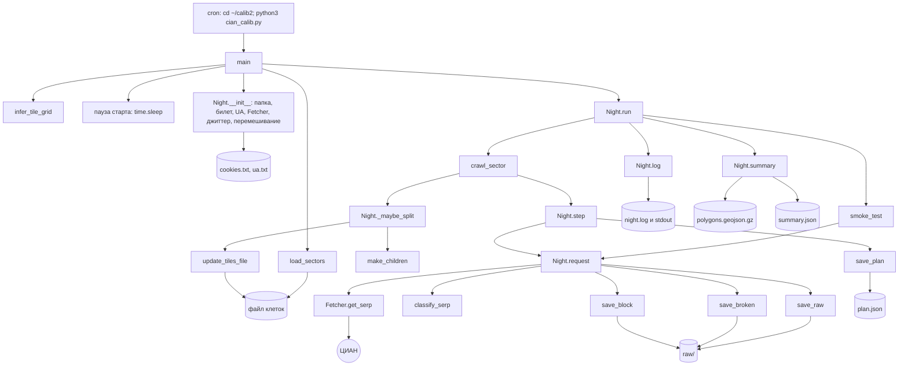
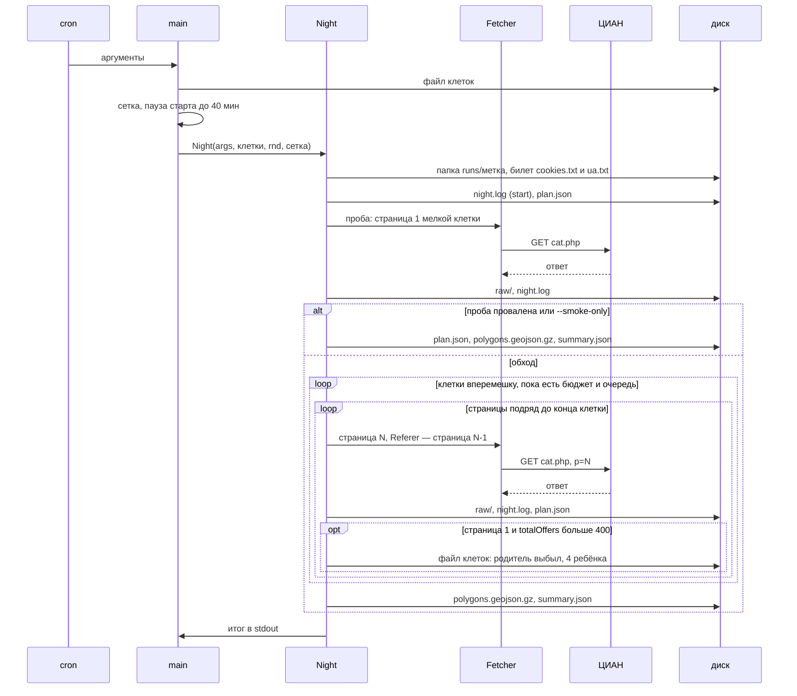
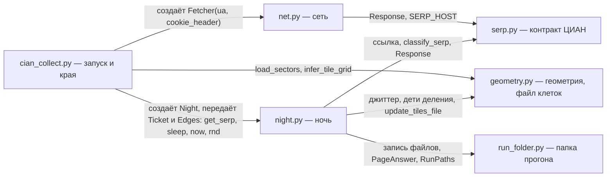

# Сборщик ЦИАН: устройство, целевая архитектура и план рефакторинга

**Что это.** Как устроен сборщик ЦИАН (`collector/`) сейчас — раздел 2 — и как к этому пришли: рефакторинг, починка и переезд из land-monitor без изменения поведения и формата папки прогона (остальные разделы).

**Статус.** Справка, не нормативно. Документ живёт в репозитории ads_collector.
- **Раздел 2** — нынешнее устройство пакета; ведёт `architect`, имена сверены с кодом на PR #1 ads_collector (ветка block/move-from-land-monitor).
- **Разделы 1, 3–6, 8–9 и строка «Задание» ниже** — история рефакторинга (PR #121) и починки (PR #122) в репозитории land-monitor. Номера PR, коммиты, номера строк и файлы, которых здесь нет (`land_monitor/`, `watchdog/`, `docs/REQUIREMENTS_V1.md`, `docs/TEST_PLAN_STAGE2.md`, `docs/ROADMAP.md`, `docs/STAGE1_HANDOFF.md`, `docs/ARCHITECTURE.md`, `docs/GLOSSARY.md`), относятся к land-monitor; в этих разделах они не правятся. Где история расходится с кодом (сеть — в `net.py`, переэкспорта `__all__` нет, 21.61 запускает модулем, `Fetcher._decode` стал функцией `decode_body`, `clip_ring_rect` без `noqa: C901`, страница Servicepipe — `BLOCK`, `_broken_*` пробы — `.html.gz`, ночь 09-18 удалена), правы код и раздел 2.
- **Раздел 7** — переезд в свой репозиторий: сделан (PR #1 ads_collector).

Нормативны `docs/TEST_PLAN.md` (модуль 21) и `docs/CIAN_DATA_FORMAT.md` (формат папки прогона). При расхождении документа с кодом сборщика прав код.

**Задание (история, land-monitor).** `docs/ROADMAP.md`, очередь п. 14 (HANDOFF Ж10), шаг «план рефакторинга». Опора — тесты модуля 21 (PR #116, кейсы 21.1–21.77; после рефакторинга — 21.78 и пометки удалённых). Порядок (решение Андрея 10.11): тесты (сделано) → рефакторинг без изменения поведения → свой репозиторий с тестом-контрактом формата. Починка ошибок З155–З157 — отдельный этап после рефакторинга (раздел 6).

**Где что.** На сервере работает `~/calib2/cian_calib.py`: его запускает cron, сбор на паузе с 10.11. Пакет `collector/` этого репозитория — переработка того же сборщика: поведение и формат папки прогона те же, на сервер он ещё не выкачен. Выкатка — отдельный шаг (2.7, вопрос 3).

## 1. Как сейчас

### 1.1. Части кода

`collector/cian_collect.py` — один файл, 1951 строка, только стандартная библиотека. Рядом лежит `collector/status.py` (50 строк) — отдельный скрипт: идёт ли сбор и итоги трёх последних прогонов. К ЦИАН он не ходит, сборщик не импортирует.

| Часть | Строки | Что делает | Внешний мир |
|---|---|---|---|
| шапка | 1–61 | история, примеры запуска, классы проблем | — |
| настройки | 84–152 | константы: имена файлов, 28 объявлений на страницу и потолок 54 страницы, деление (400, дно 3), окно, паузы, повторы, проба, адрес ЦИАН, файлы билета, 3 UA, маркеры капчи, обязательные поля, вердикты | — |
| геометрия | 155–228 | `load_sectors`, `jitter_ring`, `build_serp_url` | диск (чтение файла клеток), случайность |
| сетка и деление | 230–479 | `infer_tile_grid`, `tile_base_square`, `quarter_rect`, `clip_ring_rect`, `ring_area_km2`, `densify_ring`, `make_children`, `update_tiles_file` | диск (перезапись файла клеток) |
| разбор ответа | 481–649 | `extract_initial_state`, `missing_fields`, `classify_serp` с помощниками, `offer_ids`, `pages_for` | — (чистые) |
| сеть | 651–759 | `parse_cookie_header`, `seed_jar`, `lower_headers`, `NoRedirect`, `Fetcher` | сеть, `time.monotonic` |
| прогон | 761–1328 | `make_task`, класс `Night` (~570 строк): папка, билет, очередь, проба, обход, деление, повторы, паузы, запись всех файлов, сводка и печать итога | диск, время, сон, случайность, stdout |
| встроенные тесты | 1330–1898 | `_selftest` (unittest), частично дублирует модуль 21 | диск (образцы рядом с файлом) |
| запуск | 1901–1951 | `main`: argparse, seed, файл клеток, фильтр `--status`, сетка, пауза старта, `Night(...).run()` | argv, диск, сон, случайность |

Длиннее 40 строк: `Night.__init__`, `Night.run`, `Night.smoke_test`, `Night.crawl_sector`, `Night.step`, `Night.summary` (~100 строк), `clip_ring_rect`, `update_tiles_file`, `main`, `_selftest`.

### 1.2. Связи



### 1.3. Поток данных ночи



### 1.4. Где сеть, диск, время, случайность и глобальное состояние

| Что | Где сейчас |
|---|---|
| сеть | `Fetcher._do` (urllib, тайм-аут 45 с, без редиректов, банк кук) |
| диск — вход | `load_sectors` (файл клеток); `Night.__init__` читает `cookies.txt` и `ua.txt` из текущей папки, возраст кук — по mtime |
| диск — выход | `Night.__init__` (папка и `raw/`), `log` (дописывает night.log и печатает строку), `save_plan`, `save_raw`, `save_broken`, `save_block`, `_write_polygons`, `summary`; `update_tiles_file` (перезапись файла клеток) |
| время стены | `datetime.now().astimezone()`: метка и дата папки, первая колонка night.log, `split_at`; `datetime.now().strftime("%H%M%S")` — время в именах `_broken_*` и `_block_*`; `time.time()` — возраст кук |
| длительность | `time.monotonic` в `Fetcher._do` (поле `ms`) |
| сон | `time.sleep`: пауза старта (`main`), пауза повтора (`crawl_sector`), паузы между запросами (`sleep_between`); при `--fast` не спит |
| случайность | один `random.Random(seed)`, вызовы ниже |
| глобальное состояние | пороги — модульные константы, их читают внутри функций (тест 21.44 подменяет `SPLIT_THRESHOLD`); `argparse.Namespace` уходит в `Night` и читается в 10+ местах (`dry_run`, `fast`, `discovery`, `geojson` …); `Night` — один изменяемый объект из ~25 полей; файлы билета и `runs/` — относительно текущей папки (cron делает `cd ~/calib2`) |

Порядок вызовов случайности — часть поведения: от него зависят ссылки, очередь, клетка пробы, места детей и паузы. Эталонные ночи его ловят.

1. `main`: `random.randrange(2**31)`, если нет `--seed`; затем `random.Random(seed)`.
2. `main`: `uniform(0, 2400)` — пауза старта (боевой запуск без `--no-start-delay`).
3. `Night.__init__`: `choice(USER_AGENTS)` — только если нет непустого `ua.txt`.
4. `Night.__init__`: джиттер каждой клетки в порядке файла (`randint(0, 990)` дважды на вершину).
5. `Night.__init__`: `shuffle` порядка клеток.
6. Проба: `shuffle` пула.
7. Каждая пауза `sleep_between`: `uniform(lo, hi)`. Если бюджет исчерпан, выход до вызова. При `--fast` вызов есть, сна нет.
8. Между клетками: `uniform(1.5, 3.0)` (множитель), затем п. 7.
9. Деление: на каждого ребёнка джиттер, затем `randint(0, len(pending))` — место в очереди.
10. Повтор NET_ERROR: `uniform` паузы повтора.

## 2. Устройство пакета (прежнее название раздела — «Как будет»)

Нынешнее устройство пакета `collector/`. Раздел 1 — исходный сборщик одним файлом до рефакторинга, это история.

### 2.1. Модули

Пакет `collector/`: шесть файлов кода (2122 строки) и пустой `__init__.py`. `status.py` — отдельный скрипт, пакет его не импортирует.

| Файл | Что делает | Чего не делает | Внешний мир |
|---|---|---|---|
| `cian_collect.py` — запуск и края (204 строки) | разбирает argv в `Settings` (нет `--seed` — случайный seed); создаёт `random.Random(seed)`; проверяет, что файл клеток есть, читает его и восстанавливает сетку (зовёт `geometry`); пауза старта; читает билет `Ticket` (нет `ua.txt` — UA из `USER_AGENTS`); создаёт `net.Fetcher`, собирает края ночи `Edges`, запускает `Night`; печатает сетку и итог | HTTP (это `net`); правил обхода, разбора ответа, записи файлов прогона; ничего не переэкспортирует — тесты импортируют имена из их модулей | argv, `time.time/sleep`, `datetime.now`, `random`, файлы билета, наличие файла клеток, stdout |
| `net.py` — сеть (175) | `Fetcher(user_agent, cookie_header).get_serp(url, referer)` → `serp.Response`: банк кук из билета с ротацией из `Set-Cookie`, заголовки браузера и Referer, без редиректов (`NoRedirect`), раскодирование тела (`decode_body`), заголовки в нижнем регистре, длительность запроса, тайм-аут `HTTP_TIMEOUT_S` (45 с). Сбой сети и битое сжатие ответа 200 — `Response` с кодом 0 и деталью (`urlerror:…`, `timeout`, `oserror:…`, `decode:…`) | не классифицирует ответ (`serp`) и не решает о повторах (`night`); UA не выбирает — он приходит из билета; не пишет на диск, не печатает; не берёт время стены и случайность | сеть, `time.monotonic` |
| `night.py` — ночь (836) | `Settings`, `Ticket`, `Edges`, `TileState`, `PageTask`, `NightState`. Сверху правила обхода без внешнего мира: пул пробы, решение о делении, границы паузы, пометка «билет сгорел», учёт страницы, дочитанность, ступень, словари `plan.json` и `summary.json`. Ниже класс `Night` — дирижёр: проба, очередь, листание, деление, бюджет, повторы, стоп, Ctrl+C | не делает HTTP (зовёт `edges.get_serp`); не импортирует `time`, `urllib`, не зовёт `datetime.now` и функции модуля `random`; не знает имён и кодировок файлов (это `run_folder`); не разбирает HTML (`serp`); не считает геометрию (`geometry`) | только через `Edges`, `run_folder` и `geometry.update_tiles_file` |
| `serp.py` — контракт ЦИАН (307) | типы `Response` (ответ на запрос выдачи) и `Classified` (итог разбора); ссылка на выдачу; разбор `initialState`; обязательные поля; классы ответа (`OK`, `PAGE_END`, `BLOCK`, `API_CHANGED`, `NET_ERROR`); id объявлений; число страниц; константы контракта (28 на страницу, потолок 54, маркеры капчи, обязательные поля, адрес) | сети, диска, решений «что дальше» | — (чистый) |
| `geometry.py` — геометрия и файл клеток (411) | чистые функции: джиттер, сетка, базовый квадрат, четверти, отсечение, площадь, уплотнение, дети деления. Внизу края: чтение (`load_sectors`) и атомарная перезапись (`update_tiles_file`) файла клеток | решения «делить ли» (это ночь); записи в папку прогона | файл клеток; случайность приходит аргументом `rnd` |
| `run_folder.py` — папка прогона (189) | тип `PageAnswer` (ответ на один запрос); всё об именах, кодировках и порядке записи: папка и её метка, строка night.log с эхом в stdout, plan.json атомарно, страница `.json.gz` + `.html.gz`, `_broken_*` + `.note.txt`, `_block_*.txt`, снимок охвата (gzip mtime=0, атомарно), summary.json последним. Тексты служебных файлов — чистыми функциями сверху | не решает, что писать (словари приходят из ночи); не берёт время сам (метка приходит аргументом); в сеть не ходит | диск, stdout (эхо строк лога) |
| `__init__.py` | пустой | — | — |
| `status.py` (65) | отдельный скрипт «идёт ли сбор»: процесс сборщика и итоги трёх последних прогонов | пакет не импортирует | диск (`runs/`), `pgrep` |

Правило импорта (держит страж — кейс 21.78, 2.4):
- `cian_collect` никто в пакете не импортирует: это вершина;
- `net` импортирует только `cian_collect`; сам `net` берёт из пакета только `serp` (`Response`, `SERP_HOST`) — так устроен код, отдельной проверки стража на это нет;
- `night` берёт `serp`, `geometry`, `run_folder`;
- `serp`, `geometry`, `run_folder` не импортируют никого из пакета — листья;
- импорты абсолютные (`from collector import serp`), относительных нет. Причина — читаемость: одна форма записи на весь пакет, и по импорту сразу видно полное имя модуля, то же, что подменяют тесты (`collector.net`). Запуск модулем работал бы и с относительными импортами, поэтому правило держит страж, а не способ запуска.

Запуск — только модулем, из папки, где лежит `collector/`: `python3 -m collector.cian_collect …` (2.7, `collector/README.md`). Запуск файлом (`python3 collector/cian_collect.py`) не работает: он кладёт в `sys.path` саму папку `collector/`, и `import collector` не найдётся. Тест 21.61 запускает так же, модулем: `runpy.run_module("collector.cian_collect", run_name="__main__")` зовёт `main()`.

### 2.2. Отличие от отправной точки

| Отправная точка (PM, 10.11) | Итог | Почему |
|---|---|---|
| запуск; сеть — отдельно | `cian_collect.py` и `net.py` | как в отправной точке, но не сразу. В рефакторинге (PR #121 land-monitor) сеть временно жила в `cian_collect.py`: тесты подменяли `cc.Fetcher` и `cc.time`, а менять тесты было нельзя. При переезде (PR #1 ads_collector, раздел 7) тесты перешли на подмену `net.Fetcher` и `net.time`, сеть ушла в свой модуль |
| прогон (дирижёр); правила обхода — отдельно | `night.py`: правила сверху, дирижёр ниже | правил ~10 коротких функций (~120 строк), отдельный файл — лишний переход для читателя; так устроены модули land_monitor (`backup.py`: правила сверху, края внизу) |
| геометрия; файл клеток — отдельно | `geometry.py`, край внизу | тест-план держит их в одной части Б (кейсы 21.14 и 21.22); файл клеток — данные геометрии |
| настройки — один dataclass | `Settings` в `night.py` | его читают только ночь и запуск. Константы контракта ЦИАН (28, 54, маркеры) — не настройки, остаются в `serp.py`. Допуск площади ребёнка 0,001 км² — в `geometry.py`: сигнатура `make_children` закреплена тестами |
| контракт ЦИАН, папка прогона | как в отправной точке | — |

Итого 6 файлов кода вместо 8. Структура повторяет разделы `tests/test_collector.py`: А (разбор ответа) → `serp`, Б (геометрия) → `geometry`, В (сеть) → `net`, Г (сценарии прогона) → `night`, Д (`main`) → `cian_collect`; формат папки прогона (эталонные ночи и контракт формата 21.79 в `tests/test_collector_nights.py`) → `run_folder`.

### 2.3. Зависимости



Стрелка — «импортирует». `night` не знает о `net`: запрос выдачи приходит к нему функцией `edges.get_serp` (это метод `Fetcher.get_serp`).

### 2.4. Где сеть, диск, время и случайность

| Внешний мир | Где живёт | Как попадает внутрь |
|---|---|---|
| сеть | `net.Fetcher` (urllib, тайм-аут 45 с, без редиректов, банк кук) | `main` создаёт `net.Fetcher`; `Night` получает только `edges.get_serp` |
| длительность запроса | `time.monotonic` в `net` | поле `ms` в `Response` |
| время стены | `cian_collect.now_local()` = `datetime.now().astimezone()` | `edges.now`: метка папки, первая колонка лога, `split_at`, ЧЧММСС служебных файлов |
| сон | `time.sleep` в `cian_collect` | `edges.sleep` — паузы между запросами и перед повторами; пауза старта — `wait_start` в `main` |
| возраст кук | `time.time()` в `main` | аргумент `now_ts` у `read_ticket` |
| случайность | `random.Random(seed)` в `main`; seed без `--seed` — `random.randrange` в `parse_settings` | `edges.rnd`; `wait_start`, `read_ticket` и `geometry.jitter_ring` получают `rnd` аргументом |
| диск | `run_folder.py`; низ `geometry.py`; в `cian_collect` — билет (`read_ticket`) и проверка, что файл клеток есть | `Night` зовёт `run_folder` и `geometry.update_tiles_file` |
| stdout | `run_folder.append_log` (эхо строк); `cian_collect` (сетка, пауза старта, итог) | — |

Чистые: `serp.py` целиком, `geometry.py` без двух функций файла, тексты служебных файлов в `run_folder.py`. Без внешнего мира: правила вверху `night.py` (часть из них, например `absorb_page`, меняет переданную клетку).

Точки подмены в тестах: `net.Fetcher` (сценарии через `main`), `net.time` (длительность), `net.decode_body` (21.27, 21.29), `cian_collect.time` (`time`, `sleep`), `cian_collect.datetime`, `cian_collect.random` (`Random`, `randrange`), `night.Night.sleep_between` (21.36). Поэтому `main` берёт `net.Fetcher` по имени модуля в момент вызова, а `net` зовёт `decode_body` и `time.monotonic` через имена своего модуля: подмена теста доходит до кода.

Страж (кейс 21.78 тест-плана, `test_21_78_*` в конце `tests/test_collector.py`; разбор исходников модулем `ast`):
- `night.py`, `serp.py`, `geometry.py`, `run_folder.py` не импортируют `time`, `socket`, `urllib.request`, `urllib.error`, `http`;
- они же и `net.py` не обращаются к `datetime.now`, `.today`, `.utcnow` и к модулю `random` (тип `random.Random` в подсказках можно);
- `night.py` и `serp.py` не зовут `open`, не обращаются к `os.*` (кроме `os.path.basename`), не импортируют `gzip`, `io`, `pathlib`, `shutil` и не печатают в stdout — диск только в `run_folder.py` и низу `geometry.py`;
- `net.py` не зовёт `open` (встроенный, `gzip.open`, `Path.open`; HTTP-запрос `<…>.opener.open` — не диск) и `os.*`, не импортирует `io`, `pathlib`, `shutil` и имён из `os`, не печатает в stdout; `gzip` и `zlib` — только раскодирование тела в памяти;
- `cian_collect` никем в пакете не импортируется; `net` не импортирует никто, кроме `cian_collect`; `socket`, `urllib.request`, `urllib.error`, `http` не импортирует ни один модуль, кроме `net` (и `cian_collect` тоже нет);
- в пакете нет относительных импортов; `serp`, `geometry`, `run_folder` не импортируют никого из пакета;
- проба стража на образцах: каждое нарушение находится, образец разрешённого — нет.

### 2.5. Данные

| Тип | Поля | Где |
|---|---|---|
| `Settings` (frozen dataclass) | из argv: `budget`, `window_hours`, `tiles_path`, `runs_dir`, `smoke_only`, `start_delay`, `seed`; умолчания — нынешние константы: `split_threshold=400`, `max_split_level=3`, `start_jitter_max_s=2400`, `interval_spread=0.40`, `inter_tile_pause=(1.5, 3.0)`, `net_retry_pauses=((60,120),(150,240),(300,420))`, `smoke_pool_size=5`, `smoke_max_tries=2`, `smoke_min_area_km2=15`, `cookies_file="cookies.txt"`, `ua_file="ua.txt"`. Свойство `tile_mode` (порог деления больше 0). Поля `fast` нет: `--fast` убран (вопрос 1) | `night.py` |
| `Ticket` | `cookie_header: str \| None`, `ua: str`, `age_h: float \| None`; свойство `has_ticket` | `night.py` |
| `Edges` | `get_serp: Callable[[str, str \| None], serp.Response]`, `rnd`, `now`, `sleep` — только связь с внешним миром; билет идёт в `Night` отдельным аргументом | `night.py` |
| `TileState` (клетка сбора) | `name`, `status`, `area_km2`, `ring` (с джиттером), `ring_canonical`, `level`, `parent`, `base`, `split`, `children`, `total_offers`, `pages_planned`, `pages_done`, `ids`, `dup_ids`, `served_end` — бывший словарь `Night.sectors[key]` | `night.py` |
| `PageTask` | `sector`, `page`, `kind`, `origin`, `attempts`, `state`, `detail` — в этом порядке, он же порядок ключей в `done` | `night.py` |
| `NightState` | `spent`, `stopped`, `stop_class`, `stop_detail`, `smoke`, `split_events`, `done`, `pending` | `night.py` |
| `RunPaths` | `folder`, `raw`, `log`, `plan`, `summary`, `polygons` | `run_folder.py` |
| `PageAnswer` (frozen dataclass) | `key`, `page`, `kind`, `verdict`, `detail`, `code`, `total`, `ids`, `size`, `ms`, `body`, `headers` — ответ на один запрос: строка лога, учёт страницы и вход записи `_broken_*` и `_block_*` (бывший кортеж `Night.request` и аргументы `save_broken`/`save_block`). Лежит в `run_folder.py`, потому что `run_folder` не импортирует никого из пакета, а `night` его импортирует | `run_folder.py` |
| `Response`, `Classified` (NamedTuple) | ответ `net.Fetcher.get_serp` (`code`, `body`, `size`, `ms`, `neterr`, `headers`; при сбое сети и битом сжатии ответа 200 — код 0, тело пусто, `neterr` — деталь) и итог `classify_serp` (`verdict`, `detail`, `total`, `offers`); `Response` из `serp` берут и `net`, и `night` (тип `Edges.get_serp`) — поэтому он в листе `serp`, а не в `net` | оба — `serp.py` |

`Response` и `Classified` — кортежи с именами полей: тесты сравнивают их с обычными кортежами, срезают `[:2]`, распаковывают — всё работает без правок тестов. Файл клеток остаётся списком словарей: `load_sectors` закреплён тестом 21.14. `TileState` строится из него в `Night`. Ключ `sector` в файлах прогона и файле клеток — историческое имя формата, означает клетку сбора, не сектор показа.

### 2.6. Основные функции

```python
# cian_collect.py
def main() -> None
def parse_settings(argv: list[str]) -> Settings          # seed — random.randrange(2**31), если нет --seed
def read_ticket(settings: Settings, now_ts: float, rnd: random.Random) -> Ticket
def wait_start(settings: Settings, rnd: random.Random) -> None
def now_local() -> datetime
def print_grid(grid: dict, settings: Settings) -> None
def print_summary(report: dict, folder: str) -> None            # report — словарь summary.json
USER_AGENTS: list[str]                                   # запасной UA билета: нет ua.txt — случайный из трёх
RUNS_DIR, BUDGET, WINDOW_HOURS                           # умолчания аргументов запуска

# net.py — вся сеть
HTTP_TIMEOUT_S = 45
class Fetcher:
    def __init__(self, user_agent: str, cookie_header: str | None = None) -> None
    def get_serp(self, url: str, referer: str | None = None) -> Response   # Response — из serp; сбой — код 0 и neterr
def decode_body(raw: bytes, content_encoding: str | None) -> str          # gzip/deflate; битое сжатие — исключение, его ловит Fetcher
def parse_cookie_header(header: str) -> list[tuple[str, str]]
def seed_jar(jar: http.cookiejar.CookieJar, header: str, domain: str = ".cian.ru") -> None
def lower_headers(headers) -> dict
class NoRedirect(urllib.request.HTTPRedirectHandler)

# serp.py — сигнатуры как сейчас (закреплены тестами)
class Response(NamedTuple)          # code, body, size, ms, neterr, headers
class Classified(NamedTuple)        # verdict, detail, total, offers
def build_serp_url(ring, page: int = 1) -> str
def extract_initial_state(html: str) -> dict | None
def get_path(obj, path: str)
def missing_fields(offers: list) -> list[str]
def classify_serp(code: int, body: str, neterr: str | None = None, page: int = 1,
                  location: str | None = None, waf: str | None = None) -> Classified
def offer_ids(offers: list) -> list[int]
def pages_for(total: int | None) -> int

# geometry.py — сигнатуры как сейчас
def load_sectors(path: str) -> list[dict]
def jitter_ring(ring, rnd: random.Random) -> list[tuple[float, float]]
def infer_tile_grid(cells: list[dict]) -> dict
def tile_base_square(key: str, grid: dict) -> tuple[float, float, float, float]
def quarter_rect(rect, q: int) -> tuple[float, float, float, float]
def clip_ring_rect(ring, rect) -> list[tuple[float, float]]
def ring_area_km2(ring) -> float
def densify_ring(ring, min_unique: int = 12) -> list[tuple[float, float]]
def make_children(parent_key: str, parent_ring, parent_level: int, grid: dict, base=None) -> list[dict]
def update_tiles_file(path: str, parent_key: str, children: list[dict], split_at: str) -> None

# night.py — правила (без внешнего мира)
def mean_interval(window_hours: float, budget: int) -> float
def pause_bounds(mean: float, factor: float, spread: float) -> tuple[float, float]
def smoke_pool(tiles: dict[str, TileState], min_area_km2: float, size: int) -> list[str]
def split_decision(tile: TileState, tile_mode: bool, threshold: int, floor: int) -> str   # "split" / "floor" / "no"
def burned_mark(verdict: str, detail: str, has_ticket: bool) -> str
def absorb_page(tile: TileState, page: int, total: int | None, ids: list[int]) -> bool    # меняет tile; True — короткая страница
def is_complete(tile: TileState) -> bool
def read_out(tile: TileState, page: int) -> bool                  # страница клетке уже не нужна: конец набора или оценка исчерпана
def task_state(verdict: str, attempts: int, retries: int) -> str  # единственное правило повторов
def ladder(stopped: str | None, stop_class: str | None) -> tuple[bool, str]
def tile_plan_entry(tile: TileState) -> dict
def tile_summary(tile: TileState) -> dict
def task_entry(task: PageTask) -> dict
def plan_payload(state: NightState, settings: Settings, ticket: Ticket, started_at: datetime,
                 tiles: dict[str, TileState]) -> dict
def summary_report(state: NightState, settings: Settings, ticket: Ticket, started_at: datetime,
                   tiles: dict[str, TileState]) -> dict

# night.py — дирижёр
class Night:
    def __init__(self, settings: Settings, raw_tiles: list[dict], grid: dict, ticket: Ticket,
                 edges: Edges) -> None
    def run(self) -> dict                                             # словарь summary.json; папка — self.paths.folder
    def smoke(self) -> bool
    def crawl_tile(self, key: str) -> bool
    def step(self, task: PageTask) -> str
    def request(self, key: str, page: int, kind: str) -> PageAnswer   # пишет страницу, _broken_* или _block_*
    def split(self, key: str) -> bool
    def mark_end(self, key: str, why: str) -> None
    def sleep_between(self, factor: float = 1.0) -> None              # точка подмены теста 21.36
    def log(self, **fields: object) -> None
    def save_plan(self) -> None
    def finish(self) -> dict

# run_folder.py
def folder_label(started_at: datetime, smoke_only: bool) -> str
def create_folder(runs_dir: str, started_at: datetime, smoke_only: bool) -> RunPaths
def append_log(paths: RunPaths, stamp: str, fields: dict) -> None   # строка night.log и её эхо в stdout
def write_plan(paths: RunPaths, payload: dict) -> None
def write_page(paths: RunPaths, key: str, page: int, data: dict, html: str) -> None
def broken_note(answer: PageAnswer, ua: str) -> str
def write_broken(paths: RunPaths, answer: PageAnswer, ua: str, hms: str) -> str   # → имя файла; hms — ЧЧММСС
def block_text(answer: PageAnswer, ua: str) -> str
def write_block(paths: RunPaths, answer: PageAnswer, ua: str, hms: str) -> None
def write_polygons(paths: RunPaths, rings: dict[str, list]) -> None
def write_summary(paths: RunPaths, report: dict) -> None
```

### 2.7. Как сборщик будет запускаться на сервере

Пакет на сервер ещё не выкачен. Когда дойдёт до выкатки (вопрос 3), устройство такое:

```
~/calib2/
    collector/  __init__.py  cian_collect.py  net.py  night.py  serp.py  geometry.py  run_folder.py
    status.py                      — рядом с runs/, как сейчас: он делает chdir в свою папку и ищет runs/2*
    cookies.txt  ua.txt  cian_collect_tiles_v0_3.geojson  runs/  grid_night.out  grid_day.out
```

Строки cron — ночная и дневная, обе меняются (данные и билет по-прежнему берутся из текущей папки; аргументы — как сейчас, `collector/README.md`, «Расписание»):

```
0 0 * * * cd /home/andrew/calib2 && python3 -m collector.cian_collect --budget 550 --window-hours 7 --geojson cian_collect_tiles_v0_3.geojson >> grid_night.out 2>&1
30 11 * * * cd /home/andrew/calib2 && python3 -m collector.cian_collect --budget 600 --window-hours 7 --geojson cian_collect_tiles_v0_3.geojson >> grid_day.out 2>&1
```

- **Что копировать:** только `.py` пакета `collector/` (без тестов) и `status.py`.
- **Откат:** старый `cian_calib.py` остаётся рядом, переключение — строкой cron.
- **Поиск процесса:** у `python3 -m collector.cian_collect` другая строка процесса. Поиск в `status.py` (кейс 21.74) и проверку «окна правок» в README (`pgrep -af "^python3 cian_"`) нужно поменять в той же выкатке.
- **Python:** системный `python3` сервера — 3.12.3 (проверено Андреем 10.11), совпадает с `target-version = "py312"` ruff; только стандартная библиотека.
- **Вариант с клоном репозитория** (вместо копии пакета): код лежит клоном ads_collector (например, `~/projects/ads_collector`), cron — `cd /home/andrew/calib2 && PYTHONPATH=/home/andrew/projects/ads_collector python3 -m collector.cian_collect …`; данные остаются в `~/calib2`. Какой вариант — решается в задаче выкатки.

## 3. Что не меняется

### 3.1. Папка прогона — перечень

Сверено по коду `collector/cian_collect.py` и по читателям: `land_monitor/slice_loader.py`, `watchdog/collection.py`, `collector/status.py`, `land_monitor/backup.py` (через `slice_loader.hashed_files`), `land_monitor/run_archive.py`, ротация HTML (cron `CIAN-ROTATION`).

| Что | Имя | Как пишется | Кто читает |
|---|---|---|---|
| папка | `<runs-dir>/ГГГГ-ММ-ДД_ЧЧММ`, у `--smoke-only` — суффикс `-smoke` | метка — время старта после паузы старта, часы машины (МСК); папка создаётся с `exist_ok` — два старта в одну минуту пишут в одну папку (как сейчас) | загрузчик `list_runs`, сторож `_run_names`, `status.py` (`runs/2*`), упаковщик, бэкап |
| `night.log` | — | строки дописываются по одной сразу (открыть, дописать, закрыть), UTF-8; каждая строка эхом в stdout: «время, два пробела, поля через таб» | загрузчик `read_page_times`; сторож `run_stats`, `active_run` (и время изменения файла — признак идущего обхода); `status.py`; хэш |
| `plan.json` | — | JSON, отступ 1, русские буквы как есть, без перевода строки в конце; атомарно через `plan.json.tmp`; в начале, после каждого запроса обхода (после запроса пробы — нет), после деления, после каждой клетки, в конце | загрузчик `read_plan` (`pending_sectors`); хэш |
| `polygons.geojson.gz` | — | в конце, перед `summary.json`, всегда (и при провале пробы, и у `--smoke-only`); gzip без имени файла, mtime=0; атомарно через `.tmp` | загрузчик `read_run_polygons`; хэш; архив |
| `summary.json` | — | последним, только в конце, не атомарно; JSON, отступ 1, русские как есть, без перевода строки в конце; его наличие = прогон закончен | загрузчик, сторож (поля и время записи), `status.py`, хэш; бэкап не удаляет его никогда |
| `raw/<ключ>_p<N>.json.gz` | — | только при OK; gzip текста `{"totalOffers": …, "offers": […]}` без отступа, русские как есть, `offers` — как отдал ЦИАН | загрузчик `read_pages`; хэш и архив — распакованными |
| `raw/<ключ>_p<N>.html.gz` | — | при каждом OK; gzip тела ответа (раскодированный текст, битые байты — знак замены) | ротация удаляет через 30 дней; в хэш и архив не входит |
| `raw/_broken_<ключ>_p<N>_<вид>_<код>_<ЧЧММСС>.html.gz` / `.json.gz` | `.html.gz` у любого вида, в том числе `smoke` (З157, block/collector-fixes, PR #122); `.json.gz` писала проба до починки — такие файлы остались в старых прогонах | только API_CHANGED с непустым телом; тело целиком | загрузчик пропускает; `.json.gz` (старые) — в хэше и архиве; `.html.gz` — нет и ротируется |
| `raw/_broken_…_<ЧЧММСС>.note.txt` | — | две строки: `verdict=API_CHANGED detail=<деталь> http=<код> kind=<вид>` и `sector=<ключ> page=<N> ua=<UA>` | хэш |
| `raw/_block_<ключ>_p<N>_<код>_<ЧЧММСС>.txt` | — | `verdict=BLOCK detail=<деталь без «\|cookie_expired_or_burned»> http=<код>`, `sector=… page=… ua=…`, пустая строка; затем заголовки `location`, `waf-verdict`, `waf-verdict-reason`, `server`, `x-request-id`, `set-cookie` (какие есть, в этом порядке, `имя: значение`); пустая строка, первые 100 000 знаков тела или `<пустое тело>` | загрузчик пропускает; хэш |

Других файлов в папке нет, `.tmp` не остаётся. Время в именах служебных файлов — часы машины ЧЧММСС.

**Деталь API_CHANGED с сохранённым телом** получает хвост с именем файла: `<деталь>|saved:<имя _broken_ с расширением>`, например `no_initial_state|saved:_broken_T0608_p2_ssr_200_013140.html.gz` (`cian_collect.py:976–977`, имя — `os.path.basename` из `save_broken`). В таком виде деталь идёт в `err=` строки запроса и `detail=` строки STOP в `night.log`, в `detail` задачи `done` и в `stop_detail` в `plan.json` и `summary.json`, а на пробе — ещё в `smoke.detail`. В `.note.txt` пишется деталь без хвоста. При пустом теле файла нет и хвоста нет.

**summary.json**, ключи в этом порядке: `night`, `dry_run` (всегда `false` — загрузчик требует ровно `false`), `budget`, `spent`, `stopped`, `stop_class`, `stop_detail`, `smoke`, `ticket`, `cookie_age_h`, `ladder_step_valid`, `ladder_result`, `sectors_touched`, `sectors_complete`, `duplicate_ids_total`, `stateless_pagination_ok`, `served_vs_total_median`, `collect_file` (имя файла клеток без пути), `tile_mode`, `split_threshold` (400 или `null` при выключенном делении), `split_events` (`{parent, total_offers, children}`), `sectors`.

- В `sectors` — только клетки со страницами, в порядке: клетки файла, затем дети в порядке делений. У каждой: `name`, `status`, `level`, `parent`, `split`, `children`, `total_offers`, `pages_planned`, `pages_done` (по возрастанию), `served_end`, `unique_ids`, `duplicate_ids`, `complete`, `served_vs_total` (до 0,01; только у дочитанной с `total_offers` > 0).
- `smoke` — один из трёх видов: `{sector, verdict: "OK", offers, total}`, `{sector, verdict: "EMPTY", offers: 0, total}`, `{sector, verdict, detail}`.
- `stopped` — одно из: `smoke_failed`, `smoke_only`, `budget_exhausted`, `queue_empty`, `block`, `api_changed`, `net_error`, `interrupted`.
- `stop_class` — `null`, `BLOCK`, `API_CHANGED`, `NET_ERROR` или `interrupted`.

**plan.json**, ключи в этом порядке: `night`, `dry_run` (`false`), `started_at` (ISO с поясом, секунды), `budget`, `spent`, `window_hours` (дробное), `mean_interval_s` (до 0,1), `user_agent`, `seed`, `ticket`, `cookie_age_h`, `smoke`, `stopped`, `stop_class`, `stop_detail`, `sectors`, `split_events`, `done`, `pending_sectors`.

- В `sectors` — все клетки ночи (и не начатые). У каждой: `name`, `status`, `area_km2`, `level`, `parent`, `base` (у детей — неокруглённый базовый квадрат), `split`, `children`, `total_offers`, `pages_planned`, `pages_done`, `ids`, `dup_ids`, `served_end`.
- `done` — задачи обхода `{sector, page, kind: "ssr", origin: "seed" | "expanded", attempts, state: "done" | "page_end" | "net_error" | "failed", detail}`. Запрос пробы в `done` не пишется: `len(done)` + число строк `kind=smoke` = `spent`.
- `pending_sectors` — строки-ключи; клетка пробы из очереди не убирается.

**night.log**: строка — `ISO-время с поясом (секунды)` + таб + поля `ключ=значение` через таб, в этом порядке:

| Строка | Поля |
|---|---|
| старт | `event=start budget sectors window_h mean_interval_s ticket(0/1) cookie_age_h order=sectors_shuffled_pages_sequential dry_run=0` |
| запрос | `n sector page kind(smoke/ssr) http ms offers bytes total("-" если нет) verdict err` |
| конец клетки | `event=sector_end sector why` (`short_page`, `smoke_empty`, `redirect_to_p1_<код>`, `empty_page`; запасное `page_end` в коде есть, но не достигается — деталь у задачи `PAGE_END` есть всегда) |
| пустая проба | `event=smoke_empty sector note=сектор пуст, беру другой` |
| деление | `event=split sector total level children=<a,b,c,d>` |
| дно | `event=split_floor sector level total note=дно деления: листаем` |
| пустое деление | `event=split_skip sector note=нет непустых четвертей` |
| повтор | `event=retry sector page attempt of after_s` |
| стоп | `event=STOP reason cls detail spent` (у провала пробы без класса `cls=-`); пишется только при `smoke_failed`, `block`, `api_changed`, `net_error` |

**Входы.**
- **Файл клеток** (`--geojson`). Читаются `properties`: `sector` (строкой), `name`, `status`, `area_km2`, `level`, `parent`, `clipped`, `base`, `collect` (`false` — пропуск); геометрия только `Polygon`, иначе `ValueError`.
- **Перезапись файла клеток при делении.** У родителя `collect=false`, `status=split`, `split_at`, `children`. У ребёнка ключи в порядке: `sector`, `name`, `status`, `collect`, `display`, `level`, `parent`, `cell_km`, `clipped`, `merged_from`, `area_km2`, `vertices`, `base`, `split_at`; кольцо и `base` округлены до 7 знаков. Отступ 1, русские как есть, атомарно (кейс 21.22).
- **`cookies.txt`** — строка Cookie; пустой файл = нет билета; возраст — по mtime.
- **`ua.txt`** — пустой или нет файла: случайный из трёх UA.

**Аргументы и вывод.**
- Остаются `--budget` (50), `--geojson`, `--runs-dir` (`runs`), `--window-hours` (8.0), `--smoke-only`, `--no-start-delay`, `--seed`; `--fast` и обязательность `--geojson` — вопрос 1.
- stdout: первая строка — сетка (`сетка клеток: шаг …`, кейс 21.17), затем строка паузы старта (21.58), эхо строк лога, блок итога (21.54).
- Нет файла клеток — выход `не найден <путь>` (21.60).

### 3.2. Поведение

| Что | Как сейчас и после рефакторинга | Кейсы |
|---|---|---|
| классы ответа | 403/429 → BLOCK; 404/410 и прочий не-200 → API_CHANGED; ≥500 → NET_ERROR; 3xx: капча → BLOCK, p>1 на cat.php без p или с p=1 → PAGE_END, прочее → BLOCK; нет `initialState`: `servicepipe.tech` в HTML → BLOCK `servicepipe` (З155; проверяется раньше капчи; регистр учитывается; страницы без признака сняты до включения Servicepipe 09.11 — при смене шаблона перепроверить), капча в первых 200 000 знаков → BLOCK, иначе API_CHANGED; пусто при total>0: на p1 API_CHANGED, на p>1 PAGE_END; поле потеряно во всех первых 5 → API_CHANGED | 21.1–21.13 |
| проба | пул — клетки ≥15 км² (нет таких — все), 5 самых мелких, перемешать, до 2 попыток; пустая → `smoke_empty` и вторая; OK с объявлениями — страница учтена, обход клетки со стр. 2; провал → `smoke_failed`, обхода нет; запрос пробы тратит бюджет | 21.32–21.35, 21.41 |
| «билет сгорел» | BLOCK при билете и деталь содержит «403» или «captcha» → `\|cookie_expired_or_burned` (проба и обход) | 21.48 |
| порядок | клетки вперемешку, страницы подряд; Referer — ссылка предыдущей страницы с тем же джиттером; стр. 1 с билетом — Referer главной, без билета — без Referer | 21.24, 21.36 |
| паузы | средний интервал = окно × 3600 / бюджет; пауза = U(0,6; 1,4) × интервал × множитель; после пробы и между страницами множитель 1, между клетками U(1,5; 3,0); после последней клетки и при исчерпанном бюджете паузы нет | 21.36, 21.45 |
| старт | U(0; 40 мин) перед прогоном, кроме `--smoke-only` и `--no-start-delay` | 21.58 |
| бюджет | проверка перед каждым запросом; исчерпан → `budget_exhausted` | 21.45 |
| конец клетки | короткая страница (1–27), PAGE_END, все страницы по оценке `pages_for`, потолок 54 | 21.36–21.39 |
| повторы | NET_ERROR: 3 повтора, паузы U(60,120), U(150,240), U(300,420) через `time.sleep`; каждая попытка тратит бюджет и даёт задачу в `done` (`net_error`, повтор — новая задача); 4-й сбой → `failed`, STOP `net_error` | 21.46, 21.55, 21.70 |
| стоп | BLOCK и API_CHANGED в обходе → STOP; Ctrl+C в обходе → `interrupted` со сводкой и снимком; Ctrl+C на пробе и в паузе сразу после неё — выход без сводки (пауза `sleep_between()` стоит до `try` в `Night.run`) | 21.47–21.51 |
| деление | на стр. 1 total > 400 → 4 четверти ∩ родитель, дети в случайные места очереди того же прогона, файл клеток переписан, родитель дальше не листается; дно level 3 — листается (`split_floor`); пустые четверти — `split_skip`; порог 0 — деления нет (`tile_mode=false`) | 21.40–21.44 |
| дочитанность | `complete` = клетка не разрезана и (`served_end` или страниц столько, сколько по оценке) | 21.54 |
| ступень | `budget_exhausted`/`queue_empty` → passed; класс BLOCK → blocked; `smoke_only` → smoke_only; прочее → invalid | 21.54 |
| случайность | один `Random(seed)`, порядок вызовов — раздел 1.4 | ночи 21.68–21.70 |

### 3.3. Точки подмены для тестов

| Подмена | Сейчас | После рефакторинга |
|---|---|---|
| `cc.main()` | `cian_collect.main` | там же |
| `cc.Fetcher` — класс `Fetcher(user_agent, cookie_header)` с атрибутом `opener` | `cian_collect.py` | там же. `main` создаёт его по имени модуля в момент вызова, поэтому подмена теста срабатывает; `Night` получает только `get_serp` |
| `cc.time` (`time`, `monotonic`, `sleep`; у `FakeTime` других нет) | модульное имя | только в `cian_collect.py`, только эти три функции; `Night` получает `sleep` через `Edges`, возраст кук считает `main` |
| `cc.datetime` (`now`, `astimezone`, `strftime`, `isoformat`) | модульное имя | только в `cian_collect.py`: `now_local()` уходит в `Edges.now` |
| `cc.random` (`Random`, `randrange`; тест подставляет пространство имён только с ними) | `main` | `main` зовёт только `random.Random` и `random.randrange` |
| `cc.Night.sleep_between(self, factor=1.0)` — подглядывание в 21.36 | метод `Night` | класс `Night` в `night.py`, виден как `cc.Night`; все паузы между запросами идут через этот метод |
| `cc.<чистые функции>`, `cc.OK` … `cc.PAGE_END`, `cc.USER_AGENTS` | `cian_collect.py` | функции и вердикты — в `serp.py` и `geometry.py`, `cian_collect.py` импортирует их и перечисляет в `__all__`; `USER_AGENTS` — константа `cian_collect.py` |
| `runpy.run_path("collector/cian_collect.py")` (21.61) | файл | файл остаётся, импорты абсолютные |
| билет и `runs/` в папке теста | текущая папка | так же |
| `cc.SPLIT_THRESHOLD` (21.44, внутр.) | константа | `Settings.split_threshold`; тест переписывается |
| `cc._median` (21.17, внутр.) | `cian_collect.py` | `geometry._median`; тест переписывается |
| `cc.Night(argparse.Namespace, sectors, rnd, grid)` — помощник `make_night` (внутр.) | — | `Night(Settings, raw_tiles, grid, Ticket, Edges)`; помощник переписывается |

## 4. Режимы

| Режим или флаг | Судьба | Почему |
|---|---|---|
| боевой (без флагов) | остаётся | решение Андрея 10.11 |
| `--smoke-only` | остаётся | решение Андрея 10.11 |
| `--budget`, `--runs-dir`, `--window-hours` | остаются | строки cron |
| `--geojson` | остаётся; предлагаю сделать обязательным (вопрос 1) | сейчас умолчание — `cian_sectors_v2.geojson`, файл 45 секторов, а этот режим уходит; cron и тесты флаг передают |
| `--seed` | остаётся | воспроизводимость; на нём стоят эталонные ночи и почти все сценарии (`run_main`); пишется в `plan.json` |
| `--no-start-delay` | остаётся | ручной запуск на сервере без паузы до 40 мин; на нём стоит помощник `run_main` всех сценариев |
| `--fast` | предлагаю убрать (вопрос 1) | тестам не нужен (часы подменены); на сервере случайный запуск с ним — сотни запросов к ЦИАН подряд |
| файл 45 секторов (без `level`) | убирается (решение 10.11) | запасной сервер 45 секторов работает на своей замороженной копии скриптов в `~/calib/` (`collector/README.md`, «45 секторов — заморожено»), удаление режима его не касается; сетка восстанавливается всегда; файл без клеток → громкая ошибка `infer_tile_grid` «сетку не восстановить …»; ветка «нет секторов после фильтра» уходит вместе с фильтром |
| `--status` | убирается | фильтр секторов по статусу (all/working/drawn) файла 45 секторов |
| `--discovery` | убирается | только первые страницы; эталон ночи 09-18 уходит вместе с ним (решение 10.11) |
| `--dry-run` | убирается | выдуманные ответы; поле `dry_run` в `summary.json` и `plan.json` и `dry_run=0` в строке `start` остаются как постоянные `false`/`0` — их читает загрузчик |
| `--selftest` | убирается → pytest | `_selftest` (~570 строк) дублирует модуль 21 |

**`status.py` и `--status` не связаны.** `--status` — фильтр сборщика по статусу секторов. `status.py` — отдельный скрипт «идёт ли сбор»: на его вывод ссылается тревога сторожа (`watchdog/collection.py`, `STATUS_COMMAND`). `status.py` остаётся:
- в рефакторинге — только правки под ruff без изменения вывода (переменная `l` → `line`, файлы через `with`); тесты 21.74–21.77 не меняются;
- поиск процесса (`pgrep -af cian_collect.py`) меняется при выкатке, вместе с кейсом 21.74.

## 5. Переход

### 5.1. Шаги

Один PR (правило «блок = модуль целиком»), коммиты по шагам. После каждого шага гоняются `.venv/bin/python -m pytest -q tests/test_collector.py tests/test_collector_nights.py tests/test_collector_status.py`.

«Страховка» — все тесты модуля 21, кроме удаляемых режимов и новых версий внутренних тестов, которые ещё ждут своего шага. Она зелёная после каждого шага.

**Старые и новые внутренние тесты живут рядом.** На шаге 0 старые внутренние тесты не переписываются, а остаются и продолжают держать поведение. Рядом пишутся новые — под новый интерфейс, красные до своего шага. Старый тест удаляется на том шаге, где зеленеет новый, поэтому поведение каждого внутреннего теста держит хотя бы один зелёный тест на любом шаге.
- Имена: на шаге 0 старые тесты и их помощник получают суффикс `_old` (`make_night_old`), новые берут окончательные имена. Две функции с одним именем в одном файле затёрли бы друг друга.
- Пока старый тест жив, имена кода, к которым он обращается (`Night.dir`, `Night.summary_path`, `Night._mark_sector_end`, `night.sectors`, `cc.SPLIT_THRESHOLD` и т. п.), остаются; убираются на шаге удаления теста.
- Новые тесты импортируют новые модули (`collector.night`, `collector.run_folder`, `collector.geometry`) внутри своих тел или своего помощника, а не в шапке файла: импорт несуществующего модуля в шапке уронит сбор всего `tests/test_collector.py`.

Когда зеленеет новый и удаляется старый:
- шаг 0 — 21.24 (Referer) и 21.54 (печать итога): новые идут через `main`, поведение не меняется, поэтому старые удаляются сразу;
- шаг 2 — 21.17 (`geometry._median`);
- шаг 3 — 21.36 без HTML (`run_folder.write_page`);
- шаг 4а — 21.36 границы паузы (`pause_bounds`), 21.44 без деления (`split_decision`), 21.53 (`absorb_page`), 21.54 лестница и пустая ночь (`ladder`, `summary_report`); страж 21.78 — зелёный с этого шага;
- шаг 4б — новый помощник `make_night`, 21.38 (`Night.mark_end`), 21.44 порог 0 (`Settings.split_threshold`), 21.52 (`read_ticket`); удаляется `make_night_old`.

**Порядок 4а/4б.** Сначала правила, потом перенос `Night` и новый конструктор. При обратном порядке старые тесты, которые строят ночь через `make_night_old` (границы паузы, без деления, повторный учёт, лестница, пустая ночь), сломались бы на смене конструктора, а их новые версии позеленели бы только на шаге правил — между шагами поведение никто бы не держал.

**Покрытие.** После шага 0 оно ниже 100 %: тесты режимов удалены, а код режимов ещё есть. С шага 1 — 100 % после каждого шага: старые внутренние тесты держат свои ветки до шага, где их сменяют новые (например, `html=None` у записи страницы — старый тест до шага 3, новый с шага 3).

| Шаг | Кто | Что | Тесты после шага |
|---|---|---|---|
| 0 | test-writer, коммит «тесты» | удалить тесты режимов (5.2); старые внутренние — суффикс `_old`, рядом новые под новый интерфейс (5.3); 21.24 и 21.54 (печать итога) — сразу заменить; новый страж 21.78 | страховка и старые внутренние зелёные; новые внутренние (кроме 21.24 и 21.54) и страж красные; покрытие ниже 100 % (режимы без тестов) |
| 1 | coder | разовый скрипт побайтной сверки со старым кодом (5.6 п. 4) — пишется здесь и гоняется после каждого следующего шага; убрать режимы: `_selftest`, `--dry-run` (`_fake`, суффикс `-dry`, `fetcher=None`; `dry_run` → постоянный `False`/`0`), `--discovery`, `--status`, ветку файла секторов (сетка всегда, `tile_mode = порог > 0`); `--geojson` и `--fast` — по ответу на вопрос 1 | страховка зелёная, покрытие 100 %, сверка 5.6 — совпало всё |
| 2 | coder | пакет: `collector/__init__.py`; перенос без правок текста функций в `serp.py` и `geometry.py`; `cian_collect.py` импортирует их и перечисляет в `__all__`; `scripts/collector_fixtures.py` — новые пути (сейчас он грузит `cian_collect.py` по пути и зовёт `_balanced_object`, `TILE_KEY_RE`; после шага упадёт при запуске, а тестов у скрипта нет — сам никто не заметит) | страховка зелёная; проверка «только перенос» — `git diff --color-moved` |
| 3 | coder | `run_folder.py`: запись файлов прогона выносится из `Night` без правки текстов форматов; методы `Night` временно зовут его | страховка зелёная |
| 4а | coder | `night.py` без класса `Night`: dataclass'ы (`Settings`, `Ticket`, `Edges`, `CellState`, `PageTask`, `NightState`), `PageAnswer` в `run_folder.py`, правила обхода — функциями без внешнего мира (2.6). `Night` пока в `cian_collect.py` с прежним конструктором: переходит на клетки `CellState` и эти правила; `Settings` и `Ticket` временно собирает сам из `args` и файлов билета, оставляя имена, к которым ходят старые тесты шага 4б; методы — до 40 строк | страховка зелёная; новые тесты шага 4а и страж зелёные, их старые версии удалены |
| 4б | coder | перенос `Night` в `night.py` с конструктором `(settings, cells, grid, ticket, edges)`, имена методов из 2.6; `main` собирает `Settings`, `Ticket`, `Fetcher`, `Edges`; печать итога — `cian_collect.print_summary(report, folder)`; прямые `time`, `datetime`, `random` уходят из `Night` в `Edges` | всё зелёное, `make_night_old` и старые тесты шага 4б удалены |
| 5 | coder | ruff и mypy для `collector/`: `pyproject.toml` (`collector` убрать из `[tool.ruff] exclude`, добавить в `[tool.ruff.lint.isort] known-first-party` и `[tool.mypy] files`); правки под правила без изменения поведения; `ruff format`. Что ruff находит в нынешнем коде вне `_selftest` и `Night` (их переписывают шаги 1, 4а и 4б; проверено `ruff check` с настройками проекта 10.11) и что с этим делать: (1) `clip_ring_rect` — сложность C901 16 при пороге 8: функцию не трогать (другой порядок операций сдвигает 7-й знак колец детей), `# noqa: C901` с причиной рядом; (2) `classify_serp` и `NoRedirect.redirect_request` — PLR0913 (6 аргументов): сигнатуры менять нельзя — первую держат тесты, вторая переопределяет метод urllib; `# noqa: PLR0913` с причиной рядом; (3) `except Exception` в `Fetcher._do` — BLE001: в рефакторинге поведение не меняется, `# noqa: BLE001` с причиной рядом, сужение — в этапе починки (раздел 6); (4) `_balanced_object` и `missing_fields` — C901 10, в `missing_fields` ещё SIM102: правятся под порог, поведение держат 21.3, 21.4, 21.10; (5) около сотни строк длиннее 88 знаков, в основном комментарии и строки — `ruff format` их не переносит, правятся руками; (6) `status.py` — E741 (`l` → `line`), SIM115 (файлы через `with`), одна длинная строка. После шага — последний прогон сверки 5.6, её итог идёт в описание PR | всё зелёное, `ruff check .`, `ruff format --check .`, `mypy` — чисто |
| 6 | docs-keeper, architect (вызов 2) | документы (5.5) | — |

Ревью — частями по шагам (правило ~600–800 строк). Шаг 2 проверяется режимом `--color-moved`: он показывает, что строки перенесены, а не переписаны.

### 5.2. Что удаляется вместе с режимами

- `tests/test_collector.py`, раздел «Е. Удалить вместе с режимом» (стр. 2768–2988, 16 тестов): `test_21_56_dry_run_folder_name`, `test_21_58_dry_run_no_start_delay`, `test_21_44_no_split_without_grid`, `test_21_62_*` (2), `test_21_63_*` (2), `test_21_64_*` (3), `test_21_65_*` (3), `test_21_66_*` (3) и их помощники (`sector`, `SECTORS`, `REAL_TILES`, `DISCOVERY`, `DRY_CELLS`, `SAMPLE_FILE`, `selftest`, `in_tmp`).
- `tests/test_collector_nights.py`:
  - `test_21_67_night_2026_09_18`, `test_21_72_loader_rejects_dry`;
  - ночь 09-18 в `NIGHTS` и `NIGHT_SLICES`: из-за неё 21.71 перебирает и эту ночь, а она идёт с `--discovery`;
  - хвост `--discovery` в `night_argv`.
- Фикстура `tests/fixtures/collector/nights/2026-09-18_2306/` и её строка в `README.md` фикстур (решение 10.11: эталон 09-18 уходит вместе с `--discovery`).
- `test_21_46_fast_no_sleep` — только если Андрей выберет «убрать `--fast`» (вопрос 1).
- Модуль 21 тест-плана: строки 21.62–21.67 и подслучаи `-dry` в 21.44, 21.56, 21.58, 21.72 помечаются «удалён при рефакторинге»; 21.71 — «три эталонные ночи».

### 5.3. Внутренние тесты: что переписывается

Новая версия пишется на шаге 0 рядом со старой; старая получает суффикс `_old` и удаляется на шаге, где зеленеет новая (перечень шагов — 5.1). Проверяемое поведение то же. К концу PR от каждого теста остаётся только новая версия.

| Тест | Сейчас обращается к | Станет |
|---|---|---|
| `test_21_17_median` | `cc._median` | `geometry._median`, те же значения |
| `test_21_24_referer_of_page_is_previous_page` | `Night.request`, `night.sectors[B]["ring"]` | сценарий через `main`: у запросов страниц 2 и 3 клетки B Referer = ссылка предыдущего запроса этой клетки (`player.sent`) |
| `test_21_36_pause_lower_bound`, `…upper_bound` | `night.rnd`, `night.sleep_between(2.0)` | `pause_bounds(72.0, 2.0, 0.40) == (0,6·72·2; 1,4·72·2)` |
| `test_21_36_save_raw_without_html` | `night.save_raw` | `run_folder.write_page(…, html=None)` — только `.json.gz` |
| `test_21_38_sector_end_logged_once` | `night._mark_sector_end` ×2 | `Night.mark_end` ×2 на ночи из нового `make_night`; в night.log одна строка |
| `test_21_44_no_split` (3), `test_21_44_threshold_zero_disables_tile_mode` | `night._maybe_split`, `night.tile_mode`, `cc.SPLIT_THRESHOLD` | `split_decision(...) == "no"`; порог 0 → `tile_mode` ложь |
| `test_21_52_ticket_files`, `…_no_ticket_files`, `…_empty_ticket_files` | `make_night` → `has_ticket`, `cookie_age_h`, `ua`, `fetcher.has_ticket` | `read_ticket(settings, EPOCH, Random(1))` → `Ticket`; `Fetcher(t.ua, t.cookie_header).has_ticket` |
| `test_21_53_same_page_absorbed_once` | `night._absorb` ×2 | `absorb_page(tile, 1, 100, [1, 2])` ×2 на `TileState` |
| `test_21_54_ladder` (6) | `night.summary()` | `ladder(stopped, stop_class)` |
| `test_21_54_nothing_complete` | `night._absorb`, `night.summary()` | `summary_report(...)` с одной недочитанной клеткой |
| `test_21_54_printed_summary` | `night.run()`, `night.summary()`, `night.dir` | сценарий через `main` и `capsys`: хвост stdout |
| помощник `make_night` | `cc.Night(argparse.Namespace(...), …)` | `Night(Settings(...), raw_tiles, grid, Ticket(...), Edges(...))` с подменами из `env`; старый — `make_night_old` до шага 4б |

**Критерий приёмки.** Дифф `tests/` после PR — только удаления из 5.2, правки из 5.3 и новый страж 21.78. Остальные тесты модуля 21, включая эталонные ночи 21.68–21.70, контракт загрузчика 21.71–21.72 и `tests/collector_support.py`, не меняются ни строкой. Исключение — комментарии и docstring со ссылками на номера строк сборщика и на удалённые режимы (в том числе шапка `tests/test_collector.py`: «кейсы 21.1–21.66», раздел «удалить вместе с режимом»), они устаревают; это не проверки.

### 5.4. Оценка объёма

- **Код:** было 1951 строка (из них ~570 встроенные тесты и ~60 удаляемых режимов). Стало 2143 в пяти файлах (PR #121): `cian_collect` 418, `night` 838, `serp` 292, `geometry` 400, `run_folder` 195 (оценка плана была ~1430: комментарии «почему» со ссылками на кейсы и правила, docstring, dataclass'ы вместо словарей). `status.py` — 50 → 65.
- **Тесты:** `tests/test_collector.py` 3335 строк, `tests/test_collector_nights.py` 444, `tests/test_collector_status.py` 167, `tests/collector_support.py` 248; страж 21.78 и его проба на образцах — в конце `test_collector.py`. Фикстура ночи 2026-09-18_2306 удалена (папка — Андреем, уборка в коде — З165, block/collector-fixes, PR #122).

### 5.5. Правки вне кода

- **Общие файлы:**
  - `pyproject.toml` — разделы `[tool.ruff]`, `[tool.ruff.lint.isort]`, `[tool.mypy]`;
  - `CLAUDE.md` §5 — «сборщик локально только `--selftest`/`--dry-run`» → «локально — только тесты pytest», решение 10.11, DECISIONS строка 881;
  - `CLAUDE.md` §6 — строка о пакете `collector/`.
- **`docs/`:**
  - `docs/TEST_PLAN_STAGE2.md` — модуль 21: пометки удалённых, новые имена функций в столбце «Функция / правило», перечень «Что рефакторинг обязан сохранить», кейс 21.78;
  - `docs/CIAN_DATA_FORMAT.md` — ссылки на номера строк сборщика → имена функций;
  - `docs/ARCHITECTURE.md` — architect, вызов 2;
  - `docs/STAGE1_HANDOFF.md` — Ж10: шаг «рефакторинг» сделан;
  - `docs/GLOSSARY.md` — по желанию раздел «Сборщик ЦИАН»: проба `smoke`, билет `ticket`, деление `split`, дно `floor`, ступень `ladder`, края `Edges`;
  - `docs/DECISIONS.md`, `docs/ROADMAP.md` — тимлид.
- **Вне `docs/`:** `collector/README.md` (таблица файлов, правило 6, что в репозитории уже не копия сервера); `tests/fixtures/collector/README.md`; комментарии со ссылками на строки сборщика в `land_monitor/slice_loader.py` (`_load_folder`) и `watchdog/collection.py` (`_line_time`); текст `scripts/plausibility_stats.py` (стр. 67: `collector/cian_collect.py:1239-1242` — расчёт `complete` в `Night.summary`, станет `night.is_complete`; стр. 79 — ссылка на файл без строк, правки не требует).

### 5.6. Как проверить «ни байта формата»

1. **Эталонные ночи 21.68–21.70** (в CI) — папка прогона и файл клеток против `expected/`:
   - `night.log`, `plan.json`, `summary.json`, файл клеток — текстом, после маски времени и `bytes=`;
   - снимок охвата — распакованным;
   - `raw/` — описью sha256 распакованного.

   Порядок ключей, порядок полей строк, порядок случайности и `.tmp` ловятся здесь.
2. **Маскированное в ночах держат точные модульные тесты:** время первой колонки и `started_at` — 21.55; `split_at` — 21.40; ЧЧММ папки — 21.56; служебные файлы — 21.47, 21.49, 21.50; полные `summary.json` и `plan.json` — 21.54, 21.55; файл клеток — 21.22; mtime gzip и состав папки — 21.54.
3. **Загрузчик читает то, что пишет сборщик** — 21.71, 21.72.
4. **Побайтная сверка со старым кодом, без масок** — скрипт в `var/scratch/` пишет coder на шаге 1 и гоняет после каждого шага: 1, 2, 3, 4а, 4б, 5. Скрипт в репозиторий не идёт; итог последнего прогона — в описание PR рефакторинга, сверяет reviewer. Скрипт:
   - берёт старый `collector/cian_collect.py` из `main` (`git show` через `subprocess`, сохраняет в `var/scratch/`);
   - проигрывает тем же `CianPlayer`, `FakeTime`, `frozen_datetime` старым и новым кодом сценарии — так, чтобы каждое событие `night.log` встретилось хоть в одном: три эталонные ночи; `--smoke-only`; BLOCK и API_CHANGED на странице 2; Servicepipe на пробе; Ctrl+C в обходе; дно деления (`split_floor`); пустое деление (`split_skip`); пустая проба (`smoke_empty`); четыре сбоя сети подряд (`retry` ×3 и STOP `net_error`); бюджет кончился внутри клетки; ночь без билета;
   - сравнивает все файлы побайтно (часы заморожены одинаково, поэтому совпадают и метки времени), `.gz` — распакованными плюс заголовок снимка охвата;
   - печатает «совпало N из N».

## 6. Этап починки ошибок после рефакторинга

**Сделано** (block/collector-fixes, PR #122; сверено с кодом и тестами): все четыре строки таблицы, плюс З158 (тесты умолчаний `parse_settings`, 21.59), З160 (файл клеток без целых клеток — выход «файл клеток <путь>: <причина>», 21.60), З161 (описание argparse), З162 (`write_page(html: str)` без ветки `None`), З164 (`clip_ring_rect` разложена на `_cross`, `_inside`, `_clip_pass`, `_drop_repeats`, `noqa: C901` снят, эталоны не сдвинулись; `Fetcher._decode` заменён функцией `decode_body`), З165 (ночь 09-18 удалена из фикстур и скрипта). Колонки «Какие тесты меняют ожидание» ниже — план; пометок «известная ошибка» в тестах больше нет. Битое сжатие в ответе 200 сделано позже, при переезде (PR #1 ads_collector, З167; кейсы 21.29, 21.46): битый gzip, обрезанный gzip (`EOFError`) и битый deflate (`zlib.error`) — NET_ERROR с повторами, как сбой сети. Раньше битый gzip давал деталь `oserror:<текст>`, а два других случая роняли ночь без сводки. Деталь `decode:<текст>` — допущение тимлида до ответа Андрея (раздел 6 описания PR #1).

Отдельный PR после слияния рефакторинга. Модуль 21; четыре коммита в порядке ниже. Эталонные ночи не затрагиваются: в них нет ни Servicepipe, ни провальной пробы, `expected/` не перезаписывается. На сервер починка попадает только с выкаткой (вопрос 3).

| Задел | Что меняется | Какие тесты меняют ожидание | Последствия |
|---|---|---|---|
| З156 — пустая единственная клетка пула пробы | попыток пробы — не больше числа кандидатов; кандидаты кончились → `smoke_failed`, «все smoke-сектора пусты», вердикт пробы `EMPTY` | 21.35 («известная ошибка», `IndexError`) → `smoke_failed` без второй попытки | только текст итога пробы; формат не меняется |
| З155 — страница проверки Servicepipe | `serp.classify_serp`: страница без `initialState` с признаками Servicepipe → BLOCK. Признаки выбирает data-checker по `tests/fixtures/collector/servicepipe/`. Деталь — вопрос 4 | 21.13 («известная ошибка») → BLOCK; 21.50 → на пробе пишется `raw/_block_T1205_p1_200_<ЧЧММСС>.txt` вместо `_broken_*` (подслучай «странность» для этой страницы исчезает); новый подслучай: Servicepipe посреди обхода → STOP `block` | в итоге прогона `stop_class=BLOCK`, ступень `blocked`; сторож пишет «блок WAF» вместо «смена API»; у загрузчика причина неполного обхода — «блокировка ЦИАН»; тело страницы — в `_block_*.txt` (первые 100 000 знаков, в хэше и архиве) |
| З157 — расширение `_broken_*` у пробы | по ответу на вопрос 5 (рекомендация — `.html.gz` у любого вида) | 21.50 (подслучай API_CHANGED на пробе: 200 с чужой страницей) → `_broken_<клетка>_p1_smoke_200_<ЧЧММСС>.html.gz` | `.html.gz` не входит в хэш и архив и удаляется ротацией через 30 дней, как у обхода; старые прогоны не меняются; `CIAN_DATA_FORMAT.md` §1 — правка |
| сужение `except Exception` в `Fetcher._do` (правило «ошибки громко», в рефакторинге закрыто `noqa: BLE001`) | при раскодировании тела ответа-ошибки ловятся только `(OSError, EOFError, zlib.error)` (битый gzip — `BadGzipFile`, подкласс `OSError`; обрезанный gzip — `EOFError`; битый deflate — `zlib.error`); `noqa` убирается | ожидания не меняются (21.27 «битый gzip» — тело как есть); новые подслучаи 21.27: обрезанный gzip и битый deflate — тело как есть; неожиданное исключение при раскодировании (подменённое в тесте) — летит из `get_serp`, а не глотается | только неожиданные ошибки раскодирования: раньше — тело как есть, теперь — падение прогона с понятной ошибкой; формат не меняется |

Порядок: З156 (независима, самая маленькая) → З155 (нужны признаки страницы от data-checker и ответ на вопрос 4) → З157 (вопрос о данных) → сужение `except` (независимо, в конце). Деление на PR: один PR, четыре коммита. Делить незачем: все четыре трогают пробу, разбор ответа и сеть одного модуля, срочности нет — сбор на паузе по договору с ЦИАН. Починка сбор не возвращает, а меняет только то, как сборщик называет эту страницу.

## 7. Переезд в свой репозиторий

**Сделано** (PR #1 ads_collector, ветка block/move-from-land-monitor; перенос — коммит 583474b из land-monitor 881658d, после PR #122):
- перенесены `collector/` (пакет, `status.py`, `README.md`), `scripts/collector_fixtures.py`, тесты и фикстуры `tests/fixtures/collector/`, настройки ruff, mypy и coverage, файл проверки на GitHub (проверки GitHub сейчас не работают — решение Андрея 11.11, рассчитывать только на локальный прогон);
- кейсы 21.71–21.72 (тесты загрузчика) остались в land-monitor, в `docs/TEST_PLAN.md` — с пометкой «не переносится»;
- переэкспорт `__all__` из `cian_collect.py` убран: тесты импортируют из `collector.serp`, `collector.geometry`, `collector.night`, `collector.run_folder`, `collector.net`;
- сеть ушла в `collector/net.py`; тесты подменяют `net.Fetcher`, `net.time`, `net.decode_body`; страж 21.78 расширен на `net` и относительные импорты; 21.61 запускает модулем;
- тест-контракт формата — кейс 21.79 (`run_folder_violations` в `tests/test_collector_nights.py`): три эталонные ночи, `--smoke-only`, блок, смена API; объём — перечень ниже;
- описание формата `docs/CIAN_DATA_FORMAT.md` живёт здесь (вопрос 6);
- попутно — битое сжатие в ответе 200 (З167, раздел 6).

Не в этом репозитории: копия эталонных папок и тег для тестов загрузчика land-monitor (п. «Как опирается land-monitor») — задача land-monitor.

План переезда, как он был записан до работы:

- **Что переезжает.**
  - `collector/` (пакет, `status.py`, `README.md`);
  - тесты `tests/test_collector.py`, `tests/test_collector_status.py`, `tests/collector_support.py`;
  - `tests/test_collector_nights.py` без 21.71–21.72 (они проверяют загрузчик land-monitor);
  - фикстуры `tests/fixtures/collector/`;
  - настройки ruff, mypy, coverage, проверка на GitHub.
- **Подпорки ради неизменных тестов снимаются.** Обе временные, обе нужны только затем, чтобы в рефакторинге тесты не менялись (2.2, 3.3):
  - переэкспорт `__all__` из `cian_collect.py` — тесты переводятся на импорт из своих модулей (`collector.serp`, `collector.geometry`, `collector.night`, `collector.run_folder`), переэкспорт убирается;
  - `Fetcher` в файле запуска — уходит в свой модуль сети, тесты подменяют часы и `Fetcher` в нём.
- **Тест-контракт формата** — в репозитории сборщика, без `land_monitor`. Проверяет каждую папку, которую дают проигрывания (эталонные ночи, `--smoke-only`, блок, смена API):
  - состав папки и маски имён;
  - ключи `summary.json` и `plan.json` — набор, порядок, типы;
  - грамматику строк `night.log`: время с поясом, известные события и поля;
  - инварианты: ключи снимка = ключам `sectors`; `unique_ids + duplicate_ids` = объявлений на страницах клетки; `len(done)` + строк `kind=smoke` = `spent`; у каждой строки `verdict=OK` есть файл страницы и наоборот; у `split=true` все дети в `sectors` ∪ `pending_sectors`; `dry_run=false`; mtime снимка 0; нет `.tmp`.
- **Как опирается land-monitor.**
  - Его тесты загрузчика (нынешние 21.71–21.72) читают эталонные папки прогонов: копию `expected/` ночей из репозитория сборщика, с указанием версии (тег).
  - Смена формата — только решением Андрея, двумя PR сразу: в сборщике (контракт и новые эталонные папки) и в land-monitor (загрузчик, его тесты, копия папок).
  - Сторож и `status.py` читают только поля из перечня 3.1.
- **Где живёт описание формата** — вопрос 6.

## 8. Риски

| Риск | Чем ловится | Что делать |
|---|---|---|
| сдвинулся порядок вызовов случайности (очередь, клетка пробы, места детей, паузы) | ночи 21.68–21.70 (`pending_sectors`, порядок строк, `after_s`), 21.33, 21.34, 21.36, 21.46, 21.58 | один `Random`, вызовы строго в порядке 1.4 |
| модуль внутри пакета сам импортировал `time` или `datetime` — подмена часов не дошла | тест повиснет на настоящем сне или запишет настоящее время (21.55); страж 21.78 | края только в `cian_collect.py` |
| поменялся порядок ключей JSON или полей строки лога, остался `.tmp` | ночи (текстом), 21.54, 21.55, состав папки в 21.54 | словари собирать явными функциями (`tile_plan_entry`, `tile_summary`, `task_entry`) в порядке 3.1 |
| арифметика геометрии с плавающей точкой: другой порядок операций сдвигает 7-й знак колец детей | 21.17–21.22 (точные значения), файл клеток в ночах | переносить формулы как есть; правки под линтер не трогают формулы |
| правило повторов записано в двух местах (`crawl_sector`: `attempts < 3`, `step`: `attempts <= 3`); при слиянии сдвинутся состояния задач | 21.46, 21.55 (задачи после сбоя), 21.70 | одно правило с тем же итогом: 3 задачи `net_error`, 4-я `failed` и STOP |
| в коде есть неочевидные мёртвые места (`last_sector` не читается; запись страницы без HTML в бою не бывает) | побайтная сверка 5.6 после каждого шага | удалять только то, что не пишет в файлы; ветку `html=None` оставить (тест 21.36) |
| сервер и репозиторий расходятся: ручная правка `cian_calib.py` во время рефакторинга | — | сервер заморожен до выкатки; любая ручная правка — тем же днём коммитом в репозиторий |
| `scripts/collector_fixtures.py` перестаёт запускаться (грузит файл по пути, зовёт внутренние имена), а тестов у него нет | — | шаг 2 |
| запуск через `python -m` меняет строку процесса | — | `status.py`, README «окна правок» — в выкатке |
| большой дифф (~−1950 / +1430 в коде) | — | ревью частями по шагам; шаг 2 — `--color-moved` |
| эталон не покрывает ночь без билета целиком, деление на пробе внутри ночи, Ctrl+C (в том числе в паузе сразу после пробы — выход без сводки, тестом не покрыт) | модульные 21.41, 21.48, 21.51, 21.52; побайтная сверка 5.6 (ночь без билета, Ctrl+C) | пауза после пробы остаётся до `try` в `run`, как сейчас |
| `except Exception` в `Fetcher._do` нарушает правило «ошибки громко» | — | в рефакторинге не меняется (`# noqa: BLE001` с причиной рядом); сужение — в этапе починки (раздел 6) отдельным коммитом с тестом |

## 9. Вопросы к Андрею (решены 10.11)

Все семь решены Андреем 10.11 (ответы — строкой «Решено» в каждом вопросе; строки в `docs/DECISIONS.md`).

### 1. Флаги `--fast`, `--seed`, `--no-start-delay`, `--geojson`

Первые три флага не были в вашем списке на удаление. `--fast` убирает все паузы между запросами. Он был нужен для отладки, а сейчас тесты подменяют часы и без него. На сервере случайный запуск с ним — сотни запросов к ЦИАН подряд, вероятная блокировка. `--seed` задаёт случайность ночи (на нём стоят эталонные ночи). `--no-start-delay` убирает паузу старта до 40 минут при ручном запуске. `--geojson` — путь к файлу клеток. Сейчас без него берётся файл 45 секторов, а этот режим уходит. Значит, нужно либо требовать флаг всегда, либо сменить умолчание на нынешний файл клеток.

| Флаг | Что делает | Предложение | Что удаляется |
|---|---|---|---|
| `--fast` | без пауз | убрать | тест 21.46 «`--fast` — ни пауз» |
| `--seed` | повторяемая случайность, пишется в `plan.json` | оставить | — |
| `--no-start-delay` | ручной запуск без паузы старта | оставить | — |
| `--geojson` | файл клеток | обязательный (без флага — ошибка запуска с подсказкой); вариант — умолчание `cian_collect_tiles_v0_3.geojson` | умолчание `cian_sectors_v2.geojson`; тестов не затрагивает — строки cron и тесты флаг передают |

Рекомендация: убрать `--fast`, оставить `--seed` и `--no-start-delay`, `--geojson` сделать обязательным: имя файла клеток меняется с версиями (`_v0_3`), а умолчание в коде устареет молча.

Меняет план: нет

**Решено Андреем 10.11:** как рекомендовано — `--fast` убрать, `--seed` и `--no-start-delay` оставить, `--geojson` обязательный.

### 2. Где держать числа сборщика

В сборщике около 15 чисел: порог деления 400, дно деления, паузы, повторы, пул пробы. Правило проекта — пороги в `config.toml`. Но сборщик — отдельная программа: он уезжает в свой репозиторий и `config.toml` land-monitor не читает. Сейчас эти числа — константы в коде.

| Вариант | Что | Плюсы | Минусы |
|---|---|---|---|
| А | в коде, одним набором настроек с умолчаниями (`Settings`) | как сейчас, только собраны в одном месте; ничего нового на сервере | менять — правкой кода |
| Б | свой файл настроек сборщика рядом на сервере | менять без правки кода | новый файл и его проверки, ещё одна вещь в выкатке |
| В | `config.toml` land-monitor | одно место | связывает две программы, мешает переезду |

Рекомендация: А; файл — при переезде, если понадобится менять числа без выкатки.

Меняет план: нет

**Решено Андреем 10.11:** А — в коде, одним набором настроек (`Settings`).

### 3. Когда выкатывать новый сборщик на сервер

На сервере работает старый `cian_calib.py`. Новый код попадёт туда только выкаткой: скопировать папку `collector/`, поменять строку cron на `python3 -m collector.cian_collect`, поправить поиск процесса в `status.py`. Починка ошибок (раздел 6) до выкатки на сервере не действует. Кроме того, в дорожной карте п. 14 записано «тесты → рефакторинг → блоки девелопера → выкатка», а в решении 10.11 — «тесты → рефакторинг → свой репозиторий». Нужен общий порядок.

| Вариант | Порядок | Плюсы | Минусы |
|---|---|---|---|
| А | рефакторинг → починка → выкатка из land-monitor → свой репозиторий → блоки девелопера | починка на сервере раньше | две выкатки с разным устройством папок на сервере |
| Б | рефакторинг → починка → свой репозиторий → выкатка → блоки девелопера | одна выкатка, сразу в окончательном виде | починка ждёт переезда; сбор всё равно на паузе |
| В | как в п. 14: … → блоки девелопера → выкатка | меньше шагов на сервере | самая поздняя выкатка, больше расхождение кода и сервера |

Рекомендация: Б; до выкатки серверный сборщик не правится.

Меняет план: да

**Решено Андреем 10.11:** Б — рефакторинг → починка → свой репозиторий → выкатка → блоки девелопера; п. 14 ROADMAP переписан под этот порядок.

### 4. Как называть страницу Servicepipe после починки (о данных — ответ до слияния PR починки)

После починки страница проверки браузера Servicepipe станет «блокировкой», а не «сменой формата». Нужно слово, которым она запишется в итог прогона и в тревогу сторожа. И нужно решить, ставить ли пометку «билет сгорел». Свежий билет 10.11 не помог, так что пометка была бы неправдой. Слово записывается в файлы прогона навсегда.

| Вариант | Деталь в итоге | Тревога сторожа |
|---|---|---|
| А | `servicepipe`, без пометки | «BLOCK / servicepipe» |
| Б | `captcha` (пометка ставится сама по нынешнему правилу) | «BLOCK / captcha\|cookie_expired_or_burned» |
| В | `servicepipe` с пометкой | «BLOCK / servicepipe\|cookie_expired_or_burned» |

Рекомендация: А.

Меняет план: нет

**Решено Андреем 10.11:** А — деталь `servicepipe`, без пометки `cookie_expired_or_burned` (применяется в PR починки).

### 5. Файл непонятной страницы на пробе (о данных — ответ до слияния PR починки)

Если проба получает непонятную страницу, её тело сохраняется файлом `_broken_…_smoke_….json.gz`, хотя внутри HTML. У обхода тот же случай даёт `.html.gz`. Расширение решает судьбу файла:
- `.html.gz` считается HTML страниц: не входит в отпечаток прогона и архив, удаляется ротацией через 30 дней;
- `.json.gz` входит в архив и бэкап навсегда.

| Вариант | Что | Плюсы | Минусы |
|---|---|---|---|
| А | оставить как есть | ничего не менять | два правила для одного случая, HTML под именем json |
| Б | `.html.gz` у пробы и у обхода | одно правило, как в описании формата | файл живёт 30 дней — на разбор хватает (тревога приходит утром) |
| В | `.json.gz` у обоих | улика навсегда в архиве | HTML под именем json, расходится с описанием формата; меняет и обход |

Рекомендация: Б.

Меняет план: нет

**Решено Андреем 10.11:** Б — `.html.gz` у пробы и у обхода (применяется в PR починки).

### 6. Где будет жить описание формата папки прогона после переезда

Сейчас `docs/CIAN_DATA_FORMAT.md` лежит в land-monitor, а пишет формат сборщик. После переезда это два репозитория.

| Вариант | Где | Плюсы | Минусы |
|---|---|---|---|
| А | в репозитории сборщика; land-monitor ссылается на версию и хранит копию эталонных папок для своих тестов | описание рядом с тем, кто пишет файлы, и с тестом-контрактом | ссылки из документов land-monitor ведут в другой репозиторий |
| Б | остаётся в land-monitor | ссылки не меняются | сборщик меняет формат, а описание — в чужом репозитории |
| В | копия в обоих | всё под рукой | две копии расходятся |

Рекомендация: А; решается в задаче переезда.

Меняет план: нет

**Решено Андреем 10.11:** А — в репозитории сборщика.

### 7. Разрешения на время рефакторинга

Правка `collector/*.py` спрашивает ваше разрешение (решение 09.11), а рефакторинг меняет и создаёт шесть таких файлов десятками правок. Удаление фикстуры ночи 2026-09-18_2306 (решение 10.11: уходит вместе с `--discovery`) упирается в закрытую запись в `tests/fixtures/`.

| Вариант | Что | Плюсы | Минусы |
|---|---|---|---|
| А | на время задачи вы снимаете правило для `collector/*.py` и возвращаете после слияния; папку фикстуры удаляете сами по просьбе тимлида | работа не стоит ночью | две ручные операции |
| Б | отвечать на каждый запрос | ничего не менять в настройках | десятки запросов, ночные простои |
| В | папку фикстуры оставить | без ручного удаления | мёртвый груз, путаница в описании фикстур |

Рекомендация: А.

Меняет план: нет

**Решено Андреем 10.11:** А — на время задачи рефакторинга Андрей снимает защиту `collector/*.py` в `settings.json` локально (не коммитится) и возвращает после слияния; папку фикстуры `2026-09-18_2306` удаляет сам по просьбе тимлида.