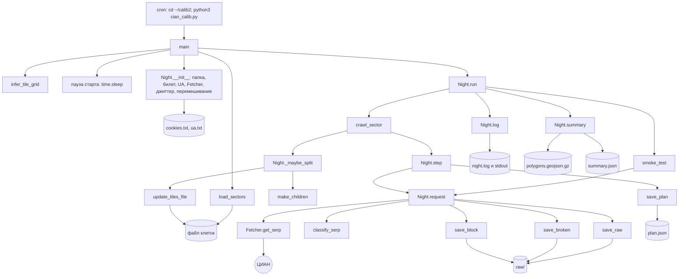
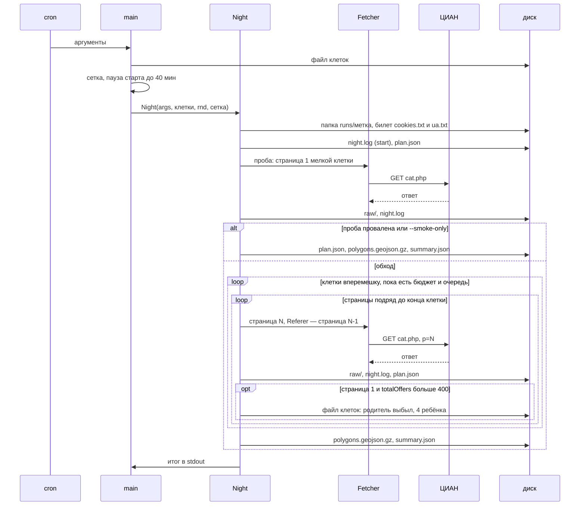
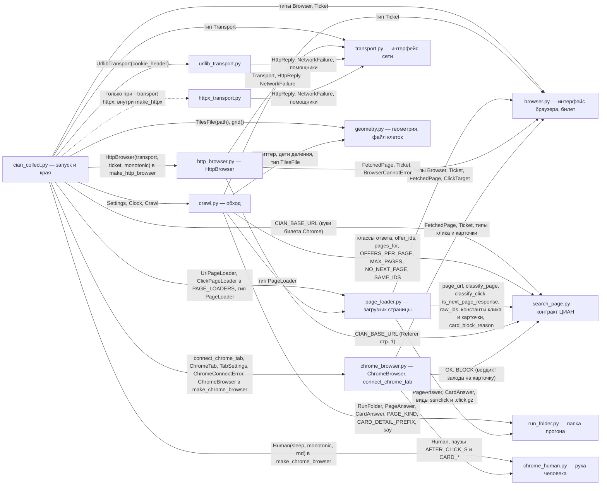

# Сборщик ЦИАН: устройство, целевая архитектура и план рефакторинга

**Что это.** Как устроен сборщик ЦИАН (`collector/`) сейчас — раздел 2 — и как к этому пришли: рефакторинг, починка и переезд из land-monitor без изменения поведения и формата папки прогона (остальные разделы).

**Статус.** Справка, не нормативно. Документ живёт в репозитории ads_collector.
- **Раздел 2** — нынешнее устройство пакета; ведёт `architect`, имена сверены с кодом на PR #9 ads_collector (ветка block/click-pages).
- **Разделы 1, 3–6, 8–9 и строка «Задание» ниже** — история рефакторинга (PR #121) и починки (PR #122) в репозитории land-monitor. Номера PR, коммиты, номера строк и файлы, которых здесь нет (`land_monitor/`, `watchdog/`, `docs/REQUIREMENTS_V1.md`, `docs/TEST_PLAN_STAGE2.md`, `docs/ROADMAP.md`, `docs/STAGE1_HANDOFF.md`, `docs/ARCHITECTURE.md`, `docs/GLOSSARY.md`), относятся к land-monitor; в этих разделах они не правятся. Где история расходится с кодом (переэкспорта `__all__` нет, 21.61 запускает модулем, `clip_ring_rect` без `noqa: C901`, страница Servicepipe — `BLOCK`, `_broken_*` пробы — `.html.gz`, ночь 09-18 удалена), правы код и раздел 2. Имена `night.py`, `Night`, `NightState`, `Edges`, `serp.py`, `build_serp_url`, `classify_serp`, `net.py`, `Fetcher`, `get_serp`, `Response` в этих разделах — прежние, до PR #2; `load_sectors`, `update_tiles_file`, `create_folder`, `RunPaths`, `CrawlInput`, `Crawl.run`, `crawl_tile` — прежние, до PR #3; `PageFetcher`, `crawl.Ticket`, `Crawl.step`, `Crawl.request`, `Crawl.smoke`, `smoke_pool`, `Crawl.run_folder`, `RunFolder.folder` и отдельный запрос пробы (`kind=smoke`) — прежние, до PR #4; `page_fetch.py`, `CianSite`, `Crawl.site`, `Crawl.pause_before_start`, поля `PageTask.kind` и `PageAnswer.kind` — прежние, до PR #5; аргумент `browser` у `Crawl`, атрибут `Crawl.browser`, ссылка, Referer, `browser.fetch` и `classify_page` в `Crawl.request_page`, параметр `html` у `write_page` — прежние, до PR #6; нынешние — словарь 2.8.
- **Раздел 7** — переезд в свой репозиторий: сделан (PR #1 ads_collector).

Нормативны `docs/TEST_PLAN.md` (модуль 21) и `docs/CIAN_DATA_FORMAT.md` (формат папки прогона). При расхождении документа с кодом сборщика прав код.

**Задание (история, land-monitor).** `docs/ROADMAP.md`, очередь п. 14 (HANDOFF Ж10), шаг «план рефакторинга». Опора — тесты модуля 21 (PR #116, кейсы 21.1–21.77; после рефакторинга — 21.78 и пометки удалённых). Порядок (решение Андрея 10.11): тесты (сделано) → рефакторинг без изменения поведения → свой репозиторий с тестом-контрактом формата. Починка ошибок З155–З157 — отдельный этап после рефакторинга (раздел 6).

**Где что.** На сервере работает `~/calib2/cian_calib.py`: его запускает cron, сбор на паузе с 10.11. Пакет `collector/` этого репозитория — переработка того же сборщика: поведение и формат папки прогона те же, на сервер он ещё не выкачен. Выкатка — отдельный шаг (2.7, вопрос 3).

## 1. Как сейчас

### 1.1. Части кода

`collector/cian_collect.py` — один файл, 1951 строка, только стандартная библиотека. Рядом лежит `collector/status.py` (50 строк) — отдельный скрипт: идёт ли сбор и итоги трёх последних прогонов. К ЦИАН он не ходит, сборщик не импортирует.

| Часть | Строки | Что делает | Внешний мир |
|---|---|---|---|
| шапка | 1–61 | история, примеры запуска, классы проблем | — |
| настройки | 84–152 | константы: имена файлов, 28 объявлений на страницу и потолок 54 страницы, деление (400, дно 3), окно, паузы, повторы, проба, адрес ЦИАН, файлы билета, 3 UA, маркеры капчи, обязательные поля, вердикты | — |
| геометрия | 155–228 | `load_sectors`, `jitter_ring`, `build_serp_url` | диск (чтение файла клеток), случайность |
| сетка и деление | 230–479 | `infer_tile_grid`, `tile_base_square`, `quarter_rect`, `clip_ring_rect`, `ring_area_km2`, `densify_ring`, `make_children`, `update_tiles_file` | диск (перезапись файла клеток) |
| разбор ответа | 481–649 | `extract_initial_state`, `missing_fields`, `classify_serp` с помощниками, `offer_ids`, `pages_for` | — (чистые) |
| сеть | 651–759 | `parse_cookie_header`, `seed_jar`, `lower_headers`, `NoRedirect`, `Fetcher` | сеть, `time.monotonic` |
| прогон | 761–1328 | `make_task`, класс `Night` (~570 строк): папка, билет, очередь, проба, обход, деление, повторы, паузы, запись всех файлов, сводка и печать итога | диск, время, сон, случайность, stdout |
| встроенные тесты | 1330–1898 | `_selftest` (unittest), частично дублирует модуль 21 | диск (образцы рядом с файлом) |
| запуск | 1901–1951 | `main`: argparse, seed, файл клеток, фильтр `--status`, сетка, пауза старта, `Night(...).run()` | argv, диск, сон, случайность |

Длиннее 40 строк: `Night.__init__`, `Night.run`, `Night.smoke_test`, `Night.crawl_sector`, `Night.step`, `Night.summary` (~100 строк), `clip_ring_rect`, `update_tiles_file`, `main`, `_selftest`.

### 1.2. Связи



### 1.3. Поток данных ночи



### 1.4. Где сеть, диск, время, случайность и глобальное состояние

| Что | Где сейчас |
|---|---|
| сеть | `Fetcher._do` (urllib, тайм-аут 45 с, без редиректов, банк кук) |
| диск — вход | `load_sectors` (файл клеток); `Night.__init__` читает `cookies.txt` и `ua.txt` из текущей папки, возраст кук — по mtime |
| диск — выход | `Night.__init__` (папка и `raw/`), `log` (дописывает night.log и печатает строку), `save_plan`, `save_raw`, `save_broken`, `save_block`, `_write_polygons`, `summary`; `update_tiles_file` (перезапись файла клеток) |
| время стены | `datetime.now().astimezone()`: метка и дата папки, первая колонка night.log, `split_at`; `datetime.now().strftime("%H%M%S")` — время в именах `_broken_*` и `_block_*`; `time.time()` — возраст кук |
| длительность | `time.monotonic` в `Fetcher._do` (поле `ms`) |
| сон | `time.sleep`: пауза старта (`main`), пауза повтора (`crawl_sector`), паузы между запросами (`sleep_between`); при `--fast` не спит |
| случайность | один `random.Random(seed)`, вызовы ниже |
| глобальное состояние | пороги — модульные константы, их читают внутри функций (тест 21.44 подменяет `SPLIT_THRESHOLD`); `argparse.Namespace` уходит в `Night` и читается в 10+ местах (`dry_run`, `fast`, `discovery`, `geojson` …); `Night` — один изменяемый объект из ~25 полей; файлы билета и `runs/` — относительно текущей папки (cron делает `cd ~/calib2`) |

Порядок вызовов случайности — часть поведения: от него зависят ссылки, очередь, клетка пробы, места детей и паузы. Эталонные ночи его ловят.

1. `main`: `random.randrange(2**31)`, если нет `--seed`; затем `random.Random(seed)`.
2. `main`: `uniform(0, 2400)` — пауза старта (боевой запуск без `--no-start-delay`).
3. `Night.__init__`: `choice(USER_AGENTS)` — только если нет непустого `ua.txt`.
4. `Night.__init__`: джиттер каждой клетки в порядке файла (`randint(0, 990)` дважды на вершину).
5. `Night.__init__`: `shuffle` порядка клеток.
6. Проба: `shuffle` пула.
7. Каждая пауза `sleep_between`: `uniform(lo, hi)`. Если бюджет исчерпан, выход до вызова. При `--fast` вызов есть, сна нет.
8. Между клетками: `uniform(1.5, 3.0)` (множитель), затем п. 7.
9. Деление: на каждого ребёнка джиттер, затем `randint(0, len(pending))` — место в очереди.
10. Повтор NET_ERROR: `uniform` паузы повтора.

## 2. Устройство пакета (прежнее название раздела — «Как будет»)

Нынешнее устройство пакета `collector/`. Раздел 1 — исходный сборщик одним файлом до рефакторинга, это история.

Коротко: `cian_collect` разбирает запуск и собирает обход вместе с внешним миром (случайность, часы, файл клеток, пауза старта, вход на ЦИАН); `crawl` ведёт обход по клеткам и решает, что запросить дальше; за одной страницей он идёт к загрузчику страницы (`page_loader`: интерфейс `PageLoader`) и получает готовый ответ `PageAnswer` одним вызовом `load_page`; паузу между запросами он тоже отдаёт загрузчику (`stay_on_page`), а после паузы спрашивает, не было ли захода на карточку объявления (`visit_card`). Загрузчиков два, выбирает флаг `--page-loader`: «по ссылке» `UrlPageLoader` (по умолчанию: каждая страница — переход по ссылке, пауза — сон) и «кликом» `ClickPageLoader` (страница 1 — по ссылке, следующие — клик по номеру страницы во вкладке, пауза — прокрутка страницы, с `--cards` — заходы на карточки). Загрузчик знает только интерфейс `Browser` из `browser`; реализацию выбирает флаг `--browser` из словаря `BROWSERS`: `HttpBrowser` из `http_browser` (по умолчанию) идёт в транспорт (`urllib_transport` или `httpx_transport`) и кликать не умеет, `ChromeBrowser` из `chrome_browser` — во вкладку настоящего Chrome и кликает, листает и заходит на карточки «рукой человека» `chrome_human.Human`. Всё знание о ЦИАН (ссылка, разбор ответа, что нажать, признаки блока карточки) — в `search_page`; на диск пишет `run_folder` (класс `RunFolder`), файл клеток читает и переписывает `geometry` (класс `TilesFile`).

Весь запуск — четыре строки `main` (`collector/cian_collect.py`):

```python
def main(transport_factory: TransportFactory = make_transport) -> None:
    settings = read_settings(sys.argv[1:])
    # вся сборка внешнего мира: часы, rnd, пауза старта, билет, транспорт,
    # загрузчик страницы
    crawl = build_crawl(settings, transport_factory)
    crawl.collect()
    crawl.print_summary()
```

`read_settings` — argv в `Settings`. `build_crawl` — сверху вниз: `random.Random(seed)`, `TilesFile` и сетка (печатает её), часы `Clock`, пауза старта `pause_before_start` (случайная, нет у `--smoke-only` и `--no-start-delay`; печатает строку «старт окна»), затем край `enter_cian` — две строки: браузер `BROWSERS[settings.browser].make(settings, rnd, transport_factory)` (`http` — `make_http_browser`: билет из файлов, транспорт, браузер; `chrome` — `make_chrome_browser`: вкладка Chrome `connect_chrome_tab`, билет из вкладки `read_chrome_ticket`, ожидания вкладки `TabSettings`, рука `Human`, браузер) и над ним загрузчик страницы `PAGE_LOADERS[settings.page_loader](browser, settings, rnd, clock)`; отдаёт `Crawl(settings, tiles_file, loader, clock, rnd)`. Билет — после паузы: порядок случайности (seed → пауза старта → UA → джиттер клеток → перемешивание) и возраст кук — часть поведения (эталонные ночи); у `chrome` UA берётся из вкладки, и шага «UA» в порядке случайности нет. `transport_factory` — точка подмены транспорта в тестах (сборке `chrome` он не нужен).

`Crawl.collect` — прогон сверху вниз:
1. `open_run` — время старта, папка прогона `RunFolder.create`, клетки с джиттером, очередь вперемешку; на ЦИАН не входит — загрузчик страницы уже есть;
2. строка `start` в `night.log`, первый `plan.json`;
3. `--smoke-only` — только `download_page` страницы 1 первой клетки (без деления и листания; сбой сети — повторы, как везде) и сразу итог;
4. пока есть очередь и бюджет: взять клетку → `download_tile` → `plan.json` → `pause_between_tiles`; выход из цикла решает итог `PageOutcome` (свойство `stopped`), а не общее `state.stopped` (21.91): стоп клетки (провал пробы, блок, сеть, бюджет) или стоп паузы (блок на карточке объявления, 21.98); Ctrl+C — стоп `interrupted`, но до итога пробы (`smoke_unanswered`) — выход из `main` без сводки (21.51);
5. `finish` — причина конца (`stop_reason`), `plan.json`, снимок охвата, `summary.json` последним; итог — словарь в `crawl.report`.

`download_tile` — одна клетка: страница 1 → стоп / деление на четверти (`split_into_quarters`) / страницы 2…N до конца набора, между страницами `pause_between_pages`; отдаёт итог последней страницы (`READ`, `TILE_END` или стоп с причиной) или стоп паузы. Одна страница с повторами при сбое сети — `download_page` (→ `PageOutcome` по правилу `page_outcome`); одна попытка — `try_page` (решения: бюджет, строка лога, задача в `done`, учёт страницы или стоп) → `request_page` (страница у загрузчика одним вызовом `loader.load_page`, запись файла ответа, id объявлений; без решений; 2.3). Пауза (`sleep_between`, общая у `pause_between_pages` и `pause_between_tiles`): длительность считает обход (`rnd`), проводит её загрузчик на открытой странице (`loader.stay_on_page`), затем `loader.visit_card()`; заход был — `record_card` пишет строку `event=card`, у `BLOCK` — файл блока карточки и стоп `block`.

**Проба** — не отдельный шаг: это страница 1 первой клетки очереди, обычный запрос обхода (21.32). `try_page` узнаёт её по `smoke_unanswered()` (итога пробы ещё нет) и по окончательному ответу (после повторов) пишет итог — ключ `smoke` (`smoke_entry`); стоп на ней — `smoke_failed`, обхода дальше нет; бюджет кончился на её повторах — тоже провал пробы. `--budget` меньше 1 — ошибка запуска (`check_args`, код 2), поэтому в законченном прогоне `smoke` — всегда словарь.

### 2.1. Модули

Пакет `collector/`: тринадцать файлов кода (4327 строк) и пустой `__init__.py`. `status.py` — отдельный скрипт, пакет его не импортирует.

| Файл | Что делает | Чего не делает | Внешний мир |
|---|---|---|---|
| `cian_collect.py` — запуск и края (518 строк) | `read_settings`: argv в `Settings` (флаги `--transport`, `--browser`, `--page-loader`, `--cards`, `--front`, `--cookies`, `--ua`, `--chrome-port`, `--chrome-path`, `--chrome-profile` — профиль хранится абсолютным путём; нет `--seed` — случайный seed); ошибки запуска, которых argparse не видит (`check_args`: `--budget` меньше 1; `--page-loader click` с браузером, у которого нет `clicks`; `--cards` без `--page-loader click`; не установлена библиотека выбранного транспорта или браузера — один цикл по полю `library` у `TRANSPORTS[--transport]` и `BROWSERS[--browser]`, например httpx при `--transport httpx`, playwright при `--browser chrome`; у браузера с `ticket_files` — `check_ticket_files`: названный флагом файл билета отсутствует, пуст или это папка), — код 2 до паузы старта. `build_crawl`: `random.Random(seed)`; проверяет, что файл клеток есть, читает его (`TilesFile`) и восстанавливает сетку (без целых клеток — выход с путём и причиной); печатает сетку; часы `Clock`; пауза старта `pause_before_start` (первый вызов случайности после seed; печатает строку паузы и спит через `clock.sleep`); `enter_cian`; собирает `Crawl` с готовым загрузчиком страницы. `enter_cian` — край входа на ЦИАН, две строки: браузер из словаря `BROWSERS` по `settings.browser` (флаг `--browser`, умолчание `BROWSER = "http"`; значение — `BrowserChoice(library, ticket_files, make, clicks)`, одно место для choices, ранних проверок и сборки, по образцу `TRANSPORTS`), над ним загрузчик страницы — создатель из словаря `PAGE_LOADERS` по `settings.page_loader` (флаг `--page-loader`, умолчание `PAGE_LOADER = "url"`; вид создателя `PageLoaderMaker(browser, settings, rnd, clock) → PageLoader`: `make_url_loader` — `UrlPageLoader(browser, clock.sleep)`, `make_click_loader` — `ClickPageLoader(browser, rnd, cards_per_tile)`, где `cards_per_tile` — `Settings.cards_per_tile` при `--cards`, иначе None). Сборка браузера — функция вида `BrowserMaker(settings, rnd, transport_factory) → Browser`, их две. `make_http_browser`: билет `Ticket` (`read_ticket`; нет UA — случайный из `USER_AGENTS`), транспорт по имени через `transport_factory` (по умолчанию `make_transport`; список транспортов — словарь `TRANSPORTS`, одно место для choices, проверки библиотеки и создания), `HttpBrowser(transport, ticket, time.monotonic)`. `make_chrome_browser`: вкладка `chrome_browser.connect_chrome_tab(порт, путь, профиль, PORT_WAIT_S, POLL_S)` (зовётся по имени модуля — точка подмены 21.90; `ChromeConnectError` — `sys.exit` с текстом «--browser chrome: …», без трассировки), билет из вкладки `read_chrome_ticket` (UA — `navigator.userAgent`, куки для `search_page.CIAN_BASE_URL` строкой «a=1; b=2», `age_h` None), ожидания вкладки `chrome_browser.TabSettings` из констант (`GOTO_TIMEOUT_MS`, `WAIT_UNTIL`, `CLICK_TIMEOUT_MS`, `LOAD_TIMEOUT_MS`, `URL_TIMEOUT_MS`, `CARD_OPEN_TIMEOUT_MS`), флага `--front` и клавиши «в новой вкладке» `new_tab_key(sys.platform)` (Meta на macOS, иначе Control), рука `chrome_human.Human(time.sleep, time.monotonic, rnd)` — тот же `rnd`, что у обхода, затем `ChromeBrowser(tab, ticket, time.monotonic, tab_settings, human)`; `transport_factory` ей не нужен. Билет и транспорт — часть сборки своего браузера, а не общего входа. `main` — четыре строки | HTTP (это транспорт); заголовков и распаковки (это `HttpBrowser`); перехода вкладки, клика, прокрутки, захода на карточку, подключения к Chrome и его запуска (это `chrome_browser` и `chrome_human`); ссылки, разбора страницы и выбора «по ссылке или кликом» для страницы N (это загрузчик страницы); правил обхода, разбора ответа, записи файлов прогона, текста итога (всё это — `crawl` и `run_folder`); ничего не переэкспортирует — тесты импортируют имена из их модулей | argv, `time.time/sleep/monotonic`, `datetime.now`, `random`, файлы билета, наличие файла клеток, поиск библиотеки транспорта и браузера в окружении (`importlib.util.find_spec`), чтение билета из вкладки Chrome (`read_chrome_ticket`), stdout (сетка, строка паузы старта) |
| `transport.py` — интерфейс сети (73) | `Transport` (Protocol, один метод `get(url, headers) → HttpReply`); `HttpReply` — ответ как с провода (код, заголовки в нижнем регистре, тело байтами); `NetworkFailure` — ответа нет, текст — деталь; помощники обеих реализаций: `parse_cookie_header`, `lower_headers`; `HTTP_TIMEOUT_S` (45 с), `COOKIE_DOMAIN` (`.cian.ru`) | сети, распаковки, своих заголовков; не импортирует никого из пакета | — |
| `urllib_transport.py` — транспорт по умолчанию (113) | `UrllibTransport(cookie_header)`: банк кук из билета (`seed_jar`) с ротацией из `Set-Cookie`, без перехода по редиректу (`NoRedirect`), тайм-аут; заголовков opener по умолчанию не шлёт. Ответ-ошибка (3xx, 4xx, 5xx) — тоже `HttpReply`; сбой — `NetworkFailure` (`urlerror:…`, `timeout`, `oserror:…`, в том числе обрыв протокола `http.client.HTTPException`) | не распаковывает тело и не добавляет заголовков; не повторяет; не пишет на диск, не печатает, не берёт часы | сеть (stdlib) |
| `httpx_transport.py` — транспорт на httpx (62) | `HttpxTransport(cookie_header, network=None)` — то же поведение на внешней библиотеке httpx: куки клиента на `COOKIE_DOMAIN`, без редиректов, заголовки клиента по умолчанию очищены, тело — `iter_raw` без распаковки; те же слова детали сбоя, что у urllib на том же событии | то же, что urllib; импортируется только из `make_httpx` (создатель транспорта `httpx` в `TRANSPORTS`) при `--transport httpx` | сеть (httpx) |
| `browser.py` — интерфейс браузера (122) | всё, что загрузчик страницы и обход знают о браузере. `Browser` (Protocol): атрибут `ticket`; `fetch(url, referer) → FetchedPage` — один переход без повторов, сбой сети — `FetchedPage` с кодом 0, прочие исключения летят наружу; `click_and_catch(target, wanted) → ClickedPage \| None` — нажать на открытой странице и поймать первый подходящий ответ (нажимать нечего — None, ответа за тайм-аут нет — код 0); `scroll_page(seconds)` — пролистать открытую страницу до низа; `view_card(link_pattern, block_reason) → CardVisit` — зайти на случайное объявление открытой страницы в новой вкладке, пролистать и закрыть (ошибка вкладки — вердикт `CARD_ERROR`, не исключение). Не умеет действия — `BrowserCannotError`. Нейтральные типы (2.5): `Ticket`, `FetchedPage`, `ClickTarget`, `ResponseWanted`, `ClickedPage`, `BlockReason`, `CardVisit`; что именно нажать и что ловить, приходит аргументами из `search_page` через загрузчик. Контракт для реализаций — `docs/reference/browser_contract.md`, проверки — наборы 21.86 и 21.98 | кода реализации нет: заголовков, распаковки, транспорта, вкладки; знания о ЦИАН нет (параметр `p`, «Дальше», шаблон ссылки объявления — в `search_page`); не выбирает реализацию (`BROWSERS` в `cian_collect`); лист пакета — никого из `collector` не импортирует; без сети, часов, диска, сжатия и печати | — |
| `http_browser.py` — `HttpBrowser`, браузер над транспортом (149) | `HttpBrowser(transport, ticket, monotonic).fetch(url, referer)` → `FetchedPage`: заголовки браузера и Referer по UA и признаку билета (`browser_headers`), один вызов транспорта, распаковка тела (`decode_body`: gzip/deflate, битый UTF-8 — знак замены), длительность по переданному `monotonic`. Сбой сети и битое сжатие ответа 2xx (`decode:…`) — ранний выход из `fetch`: `FetchedPage` с кодом 0, пустым телом, без заголовков и с деталью `neterr`; битое сжатие у прочих кодов — сырые байты как текст. `click_and_catch`, `scroll_page`, `view_card` — `BrowserCannotError` через один помощник `cannot(action)`: у транспорта нет открытой страницы | не повторяет (повторы — `Crawl`); не строит ссылку страницы и Referer страницы N (это `page_loader.load_by_url`; сам ставит только Referer главной на стр. 1 с билетом); не классифицирует ответ (`search_page`); не выбирает транспорт и UA и не читает файлы билета (`make_http_browser` и `read_ticket` в `cian_collect`); Cookie сам не кладёт — его несёт транспорт, собранный из того же билета (21.23); импортирует его только `cian_collect`; не импортирует `time`, не пишет на диск: gzip и zlib — только в памяти | — (сеть и часы приходят аргументами) |
| `chrome_browser.py` — `ChromeBrowser`, браузер над вкладкой Chrome (599) | `ChromeTab` — вкладка Playwright (`page`) и два класса её ошибок (`timeout_error`, `error`): они едут с вкладкой, потому что модуль не импортирует playwright наверху. `TabSettings` — ожидания вкладки, мс (переход, ответ на клик, `load`, адрес после клика, новая вкладка карточки) и два признака карточки (`front`, `new_tab_key`). `ChromeBrowser(tab, ticket, monotonic, settings, human)`. `fetch(url, referer)` → `FetchedPage`: один `page.goto` с тайм-аутом и событием загрузки, без своих заголовков (Referer не подставляет — заголовки самого Chrome); тело — ответ сервера на переход `response.body()` (не DOM после скриптов), битый UTF-8 — знак замены, `size` — байт тела; у редиректа — код и заголовки первого ответа цепочки (`first_response`), тело пусто; заголовки в нижнем регистре (`lower_headers`); тайм-аут перехода и ошибка с `net::ERR_` (`CHROME_NET_ERROR`) — сбой сети: код 0, `neterr` — первая непустая строка текста (`one_line`); прочие ошибки Playwright и `ChromeNoResponseError` (`goto` без ответа, нет ответа первого шага редиректа) летят наружу. `click_and_catch(target, wanted)`: что нажать — `find_target` (последняя ссылка, у которой параметр адреса равен номеру страницы; нет — последний активный элемент с текстом «Дальше»; нет и его — None без часов и движения), прицел рукой `human.aim_at`, ожидание ответа `expect_response` (до клика; документ чужого фрейма не ловится), клик `human.click`; тело — по правилам `fetch` (у 3xx пустое); затем `settle_after_click` — ожидания `load` и адреса с номером (`wait_quietly`: их тайм-аут не сбой) и пауза руки; тайм-аут прицела или ответа — код 0, `neterr` `CLICK_TIMEOUT` (`click_timeout`), `net::ERR_*` — код 0; `ClickedPage.is_document` — пойман документ, а не ответ API. `scroll_page(seconds)` — `human.scroll_page`. `view_card(link_pattern, block_reason)`: ссылки объявлений на странице (`OFFER_LINKS_JS`, только видимые; нет — `ERROR no_offer_links`), случайная — `human.rnd.choice`, клик рукой с клавишей `new_tab_key` и ожидание новой вкладки (`open_card`), трафик по CDP (`listen_traffic`: сумма `encodedDataLength`), ожидание `load`, взгляд; `block_reason(адрес)` дал причину — `BLOCK` с телом вкладки; иначе листание `CARD_VIEW_S` и `OK`; адрес — без параметров (`plain_url`); ошибка Playwright — `ERROR` с первой строкой текста, вкладки, открытые за заход, закрываются (вкладки человека — нет); с `front` вкладки — на передний план, ошибка вывода выдачи вперёд меняет только `OK` на `ERROR`. Внизу функция-край `connect_chrome_tab(port, chrome_path, profile_dir, port_wait_s, poll_s)` → `ChromeTab`: подключение `connect_over_cdp` к `http://127.0.0.1:<порт>` (`try_connect`), вкладка — первая открытая в `contexts[0]` или новая (`first_tab`); порт молчит — один запуск Chrome (`subprocess.Popen`, своя папка профиля, отдельная сессия: Chrome остаётся открытым после сборщика) и ожидание порта раз в `poll_s` не дольше `port_wait_s`; не вышло — `ChromeConnectError` с портом, путём, профилем и причиной. Контракт — `docs/reference/browser_contract.md`, проверки — набор 21.86, кейсы 21.88 (`ChromeBrowser`), 21.89 (`connect_chrome_tab`), 21.93 (клик), 21.98 (карточка) | не повторяет (повторы — `Crawl`); не читает билет и не выбирает себя (`make_chrome_browser`, `read_chrome_ticket` и `BROWSERS` в `cian_collect`); не перехватывает запросы и не останавливает Chrome на редиректе; не классифицирует ответ и не решает «по ссылке или кликом»; не знает, что нажимать и как выглядит блок карточки (приходит аргументами); мышь и колесо сам не двигает (это `Human`); импортирует его только `cian_collect`, сам из пакета берёт только `browser`, `chrome_human` и `search_page` (вердикты `OK`/`BLOCK` захода); playwright, `subprocess` и `time` на верхнем уровне не импортирует — только внутри `connect_chrome_tab`, поэтому модуль импортируется без playwright (как `httpx_transport` без httpx); без `socket`, `urllib*`, `http*`, печати, записи на диск, `datetime.now` и `random` | `ChromeBrowser` — нет (вкладка, часы и рука с её сном и `rnd` приходят аргументами); `connect_chrome_tab` — край внутри модуля: playwright, процесс Chrome (`subprocess`), ожидание порта (`time.monotonic`, `time.sleep`) — исключение из «внешний мир — по краям», держит страж 21.78 (2.4) |
| `chrome_human.py` — рука человека (295) | `Human(sleep, monotonic, rnd)` над вкладкой Playwright, которую дают аргументом: `move_mouse` (дуга Безье `mouse_path`, разгон и торможение, дрожание, на дальнем пути иногда перелёт с поправкой), `aim_at` (прокрутить к элементу, «посмотреть», мышь в случайную точку внутри; рамки нет — None), `click` (задержка нажатия; с клавишей — нажать, клик, отпустить; точки нет — клик элементом), `scroll_page(page, seconds)` (колесо до низа примерно за `seconds`: шаги, иногда назад и «читает», у низа «смотрит», время вышло — быстрее, страховка `SCROLL_OVERTIME_S`), `pause(bounds)`; помнит, где мышь на каждой вкладке. Перенос пробы `click_test.py`; задержки, вероятности и пороги — константы вверху модуля (в том числе `AFTER_CLICK_S` и `CARD_*`, их зовёт `ChromeBrowser`), кейс 21.94 | не ищет, что нажать, и не ловит ответов (это `ChromeBrowser`); не знает ЦИАН; лист пакета, берут его только `chrome_browser` и `cian_collect`; без диска, печати, `time` и функций модуля `random` | — (сон, часы и `rnd` приходят аргументами) |
| `page_loader.py` — загрузчик страницы (311) | «дай страницу N клетки» для обхода. `PageLoader` (Protocol) — всё, что обход знает о загрузчике: атрибут `ticket`, `load_page(key, ring, page) → run_folder.PageAnswer` (один запрос, ответ разобран, `ids` пусты — их считает обход после записи файла, 21.36), `stay_on_page(seconds)` (пауза на открытой странице, длительность считает обход, 21.97) и `visit_card() → run_folder.CardAnswer \| None` (заход на карточку после паузы, 21.98). Общие функции: `load_by_url` (ссылка `page_url`, Referer — ссылка страницы `page − 1` того же кольца, `browser.fetch`) и `document_answer` (разбор `classify_page` с `location` и `waf-verdict`). `UrlPageLoader(browser, sleep)` — каждая страница по ссылке, пауза — `sleep` (это `Clock.sleep` обхода), карточек нет. `ClickPageLoader(browser, rnd, cards_per_tile)` (21.95): путь за страницей — правило `way_to_page(tab, key, page)`: страница 1 — по ссылке, удачно открыта N−1 той же клетки — кликом, сбой этой же N — повтор по ссылке, иначе `PageOrderError`; клик — `browser.click_and_catch(ClickTarget(PAGE_PARAM, N, NEXT_BUTTON_TEXT), is_next_page_response)`: нажимать нечего — `PAGE_END no_next_page` (`nothing_to_click`), документ — `document_answer` с видом `click`, ответ API — `click_answer` (`classify_click`, тело — в `.click.gz`), те же сырые id, что на прошлой странице (`raw_ids`), — `PAGE_END same_ids` без объявлений; память — `tab = (клетка, страница, удачно) \| None` и `last_ids` (`remember`); пауза — `browser.scroll_page`. Карточки (только при `cards_per_tile`): после страницы 1 — выбор страниц захода `plan_card_pages(total, offers_on_page, per_tile, rnd)` (как `card_pages` пробы: 1…N−1, у одностраничной — 1); `visit_card` — на выбранной и удачно открытой странице один раз `browser.view_card(OFFER_LINK_PATTERN, card_block_reason)` → `CardAnswer` с клеткой и страницей | не знает `HttpBrowser`, `ChromeBrowser`, заголовков и транспорта; не повторяет: один `load_page` — одно обращение к браузеру, повтор после сбоя сети — тот же вызов ещё раз из обхода; не тратит бюджет, не пишет файлы и лог, не делит клетки, не решает стоп по блоку карточки (это `Crawl.record_card`); не выбирает себя (это `PAGE_LOADERS` в `cian_collect`); не берёт часы, не пишет на диск, не печатает | — (сеть и вкладка — через переданный `Browser`; сон и `rnd` — аргументами) |
| `crawl.py` — обход (1000) | данные: `Settings`, `Clock`, `TileState`, `PageTask`, `CrawlState`, итог страницы `PageOutcome` (`READ`, `TILE_END`, стоп с причиной). Сверху правила обхода без внешнего мира: средний интервал и границы паузы, решение о делении, пометка «билет сгорел», итог пробы (`smoke_entry`), учёт страницы, пометка конца листания кликом (`end_noted`), дочитанность, правило повторов, итог страницы (`page_outcome`), ступень, причина конца (`stop_reason`), словари `plan.json` и `summary.json`, текст итога (`summary_text` с пометками «КОНЕЦ КЛИКОМ», слова о билете `ticket_text` — у билета без возраста просто «есть», строки ступени `LADDER_VERDICTS`). Ниже класс `Crawl` — обход: `collect` (прогон целиком; `--smoke-only` — ветка в нём), `open_run`, `download_tile`, `download_page` (повторы; оба → `PageOutcome`), `try_page` (одна попытка: бюджет, лог, учёт, стоп, итог пробы), `request_page` (страница у загрузчика, запись её файлов, id), `smoke_unanswered`, `split_into_quarters`, паузы `pause_between_pages`, `pause_between_tiles` (→ `PageOutcome`), `pause_before_retry`, запись захода на карточку `record_card`, стоп `stop_run`, бюджет, Ctrl+C, `finish`, `print_summary` | не делает паузу старта и не входит на ЦИАН (это `build_crawl`); не делает HTTP и не знает транспорта, браузера, ссылок, Referer, клика и разбора ответа (страницу берёт одним вызовом `loader.load_page`; готовый загрузчик получает аргументом); сам не спит между запросами (паузу проводит `loader.stay_on_page`; сам спит только перед повтором — `clock.sleep`); не импортирует `time`, `urllib`, не зовёт `datetime.now` и функции модуля `random`; не знает имён и кодировок файлов (`run_folder`); не читает файл клеток (`TilesFile`); не печатает сам (`run_folder.say`); не считает геометрию (`geometry`) | только через `loader` (страницы, паузы, заходы на карточки и билет `loader.ticket`), `clock`, `rnd`, `RunFolder` (`Crawl.folder`), `run_folder.say` и `TilesFile.record_split` |
| `search_page.py` — контракт ЦИАН (396) | ссылка на страницу поиска (`page_url`); разбор `initialState`; обязательные поля; классы ответа (`OK`, `PAGE_END`, `BLOCK`, `API_CHANGED`, `NET_ERROR`) — `classify_page` → `Classified`; id объявлений (`offer_ids`; сырые для сверки «те же id» — `raw_ids`); число страниц; константы контракта (28 на страницу, потолок 54, маркеры капчи и Servicepipe, обязательные поля, `CIAN_BASE_URL`). Листание кликом: что нажать (`PAGE_PARAM` = `p`, `NEXT_BUTTON_TEXT` = «Дальше»), какой ответ ловить (`is_next_page_response`: документ или xhr/fetch `search-offers`, кроме рекомендаций), разбор ответа API на клик `classify_click` (`data.offersSerialized`, `data.offerCount`; не JSON — как ответ без объявлений), детали конца выдачи `NO_NEXT_PAGE`, `SAME_IDS`. Карточки: шаблон ссылки объявления `OFFER_LINK_PATTERN`, признак блока по адресу `card_block_reason` (капча — `captcha`, хост не `cian.ru` и не `*.cian.ru` — `foreign_url`). Всё это зовёт загрузчик страницы; обход берёт классы ответа, `offer_ids`, `pages_for`, `OFFERS_PER_PAGE`, `MAX_PAGES`, `NO_NEXT_PAGE`, `SAME_IDS` | сети, диска, решений «что дальше»; не нажимает и не ловит сам | — (чистый) |
| `geometry.py` — геометрия и файл клеток (427) | чистые функции: джиттер, сетка (`infer_tile_grid`), базовый квадрат, четверти, отсечение, площадь, уплотнение, дети деления. Внизу край — класс `TilesFile(path)`: конструктор читает клетки в `tiles` (выбывшие `collect=false` пропускает, не `Polygon` — `ValueError`), `grid()` — сетка по ним (считается заново), `record_split` — атомарная перезапись файла при делении. `tiles` — клетки на момент чтения, `record_split` их не обновляет | решения «делить ли» (это обход); записи в папку прогона | файл клеток; случайность приходит аргументом `rnd` |
| `run_folder.py` — папка прогона (262) | литералы формата: вид запроса `PAGE_KIND = "ssr"` (по ссылке) и `CLICK_KIND = "click"` (кликом) — в `night.log`, `plan.json`, имени и записке `_broken_*` (поле наших файлов, не контракт ЦИАН); вид файла тела `HTML_BODY` (`.html.gz`) и `CLICK_BODY` (`.click.gz` — ответ API на клик целиком); приставка детали блока карточки `CARD_DETAIL_PREFIX = "card_"`; начало тела в файле блока `BLOCK_BODY_CHARS`. Типы `PageAnswer` (ответ на один запрос: создаёт загрузчик страницы, по нему обход пишет файлы и лог; поля `kind`, `body_ext`) и `CardAnswer` (заход на карточку: создаёт загрузчик, по нему обход пишет строку `event=card` и у блока — файл). Класс `RunFolder` — путь папки прогона (`path`), пути её файлов и запись в неё: `RunFolder.create` (папка по метке и `raw/`), `append_log` (строка night.log с эхом в stdout), `write_plan` (атомарно), `write_page` (`.json.gz` + тело как есть в `.html.gz` или `.click.gz` по `body_ext` — тело любой текст, имя по формату), `write_broken` (+ `.note.txt`; вид в имени — `answer.kind`, расширение всегда `.html.gz`), `write_block`, `write_card_block` (`_block_<клетка>_p<N>_0_<ЧЧММСС>.txt`), `write_polygons` (gzip mtime=0, атомарно), `write_summary` (последним). `say` — единственная печать обхода в stdout. Метка папки и тексты служебных файлов — чистыми функциями (`folder_label`, `broken_note`, `block_text`, `card_block_text`, `body_excerpt`) | не решает, что писать (словари и текст итога приходят из обхода); не берёт время сам (метка и штамп приходят аргументом); в сеть не ходит | диск, stdout (`say`) |
| `__init__.py` | пустой | — | — |
| `status.py` (65) | отдельный скрипт «идёт ли сбор»: процесс сборщика и итоги трёх последних прогонов | пакет не импортирует | диск (`runs/`), `pgrep` (`subprocess`) |

Правило импорта (держит страж — кейс 21.78, 2.4):
- `cian_collect` никто в пакете не импортирует: это вершина;
- слои без циклов: `crawl` → `page_loader` → `browser` (интерфейс); реализации браузера: `http_browser` → `browser`, `transport`, `search_page`; `chrome_browser` → `browser`, `search_page`, `chrome_human`; `crawl` берёт ещё `geometry`, `run_folder`; `cian_collect` берёт и `search_page` (`CIAN_BASE_URL` — для кук билета Chrome) и `chrome_human` (сборка `Human`). Страж держит все слои: `crawl` берёт из пакета только `page_loader` (тип `PageLoader`), `search_page` (классы ответа, числа контракта, детали конца выдачи), `geometry`, `run_folder` и из `browser` — только тип `Ticket` (`from collector.browser import Ticket`, именем: билет обход читает как `loader.ticket`); имён `page_url`, `classify_page`, `Browser`, `HttpBrowser`, `ChromeBrowser`, `FetchedPage`, `fetch` в `crawl.py` нет — обход не знает ссылок, разбора и браузера (решения Андрея 12.11 и 15.11); `page_loader` берёт только `browser`, `search_page`, `run_folder` — интерфейс, не реализацию;
- реализации — только у вершины: реализации транспорта (`urllib_transport`, `httpx_transport`) и реализации браузера (`http_browser`, `chrome_browser`) импортирует только `cian_collect`; руку `chrome_human` — только `chrome_browser` и `cian_collect`; реализации транспорта берут из пакета только `transport`. `httpx_transport` импортируется внутри функции `make_httpx`, не на верхнем уровне: без httpx сборщик с urllib запускается голым `python3`. `chrome_browser` импортируется наверху, как `http_browser`: playwright в нём — только внутри функции-края `connect_chrome_tab`, поэтому без playwright сборщик с браузером `http` тоже идёт голым `python3`;
- сеть stdlib (`socket`, `urllib.request`, `urllib.error`, `http*`) — только в `urllib_transport`; `httpx` — только в `httpx_transport`; `playwright` — только в `chrome_browser` и только внутри `connect_chrome_tab` (там же `subprocess` и `time` этого модуля); `subprocess` в пакете — ещё только в отдельном скрипте `status.py`;
- `search_page`, `geometry`, `run_folder`, `transport`, `browser`, `chrome_human` не импортируют никого из пакета — листья;
- импорты абсолютные (`from collector import search_page`), относительных нет. Причина — читаемость: одна форма записи на весь пакет, и по импорту сразу видно полное имя модуля, то же, что подменяют тесты (`collector.http_browser`). Запуск модулем работал бы и с относительными импортами, поэтому правило держит страж, а не способ запуска.

Запуск — только модулем, из папки, где лежит `collector/`: `python3 -m collector.cian_collect --geojson <файл клеток> […] [--transport urllib|httpx] [--browser http|chrome] [--page-loader url|click] [--cards] [--front] [--cookies <файл>] [--ua <файл>] [--chrome-port N] [--chrome-path <программа>] [--chrome-profile <папка>]` (2.7, `collector/README.md`, «Запуск с Chrome на Маке»). Без `--cookies` и `--ua` билет — `cookies.txt` и `ua.txt` из папки запуска, как раньше; без `--browser` — `HttpBrowser` (choices флага — ключи `BROWSERS`), прежние аргументы работают как раньше. У `--browser chrome` файлы билета не проверяются и не читаются (билет — из вкладки), `--transport` не используется (сеть — у Chrome), но его библиотека проверяется; умолчания `--chrome-*` — `CHROME_PORT` (9222), `CHROME_PATH` (Chrome на macOS), `CHROME_PROFILE` (`chrome-profile` в папке запуска). Без `--page-loader` — «по ссылке», как раньше; `--page-loader click` — только с браузером, который кликает (`BrowserChoice.clicks`, сейчас `chrome`); `--cards` (1–2 захода на карточку на клетку, `Settings.cards_per_tile`) — только с `--page-loader click` (нарушение любого из двух правил — код 2 до паузы старта); `--front` выводит вкладку карточки, а потом выдачу на передний план. Запуск файлом (`python3 collector/cian_collect.py`) не работает: он кладёт в `sys.path` саму папку `collector/`, и `import collector` не найдётся. Тест 21.61 запускает так же, модулем: `runpy.run_module("collector.cian_collect", run_name="__main__")` зовёт `main()`.

Зависимости: только стандартная библиотека, кроме httpx в `httpx_transport.py` (решение Андрея 11.11; только при `--transport httpx`) и playwright в `chrome_browser.py` (решение Андрея 16.11; только при `--browser chrome`, `playwright install` не нужен — сборщик подключается к установленному Chrome); обе — в `requirements.txt` (`httpx==0.28.1`, `playwright==1.65.2`) и стоят в `.venv` разработки.

Вне пакета — `scripts/`, инструменты разработчика; сборщик их не импортирует и на сервер они не копируются:
- `collector_fixtures.py` — разовая выборка фикстур тестов (вход проигрывания ночей) из полных прогонов land-monitor; источник только читает;
- `rebuild_expected.py` — пересборка эталонов ночей 21.68–21.70 (`expected/`: `night.log`, `plan.json`, `summary.json`) только по решению о смене поведения; проигрыватель берёт из `tests/test_collector_nights.py`, сначала сверяет неизменное (`raw_manifest.json`, снимок охвата, `tiles.geojson`, `spent`) и при расхождении падает, ничего не записав; запускает Андрей модулем (`python -m scripts.rebuild_expected [--check]`);
- `setup_env.sh` — сборка окружения `.venv` (запускает Андрей).

### 2.2. Отличие от отправной точки

| Отправная точка (PM, 10.11) | Итог | Почему |
|---|---|---|
| запуск; сеть — отдельно | `cian_collect.py`; сеть — `transport.py`, `urllib_transport.py`, `httpx_transport.py`, браузер — `browser.py` (интерфейс), `http_browser.py` и `chrome_browser.py` (реализации), рука человека — `chrome_human.py`; получение страницы — `page_loader.py` | в рефакторинге (PR #121 land-monitor) сеть временно жила в `cian_collect.py` — менять тесты было нельзя; при переезде (PR #1) ушла в `net.py`. В PR #2 (block/transport, задание PM: второй транспорт) `net.py` разложен: реализации только доставляют запрос и приносят байты, наша логика над ними (заголовки, распаковка, длительность, сбой → код 0) — одна, в `page_fetch.py` (допущение в разделе 6 описания PR #2); в PR #5 (block/simplify-3) он переименован в `browser.py`. В PR #6 (block/page-source, решение Андрея 15.11) «получить страницу N клетки» — ссылка, Referer, запрос через браузер, разбор — ушло из `Crawl.request_page` в источник страниц `page_source.py`, чтобы вторая реализация (Chrome кликом) встала новым файлом без правки `crawl.py`. В PR #7 (block/browser-interface) браузер разделён так же, как транспорт: `browser.py` — интерфейс `Browser` (Protocol) с `Ticket` и `FetchedPage`, прежний класс — реализация `HttpBrowser` в `http_browser.py` (переименование файла); выбор — словарь `BROWSERS`, чтобы `ChromeBrowser` встал новым файлом без правки обхода, источника страниц и `HttpBrowser`. В PR #8 (block/chrome-insert) так и встал: `chrome_browser.py` (внешний исполнитель по контракту) и в `cian_collect.py` — сборка `make_chrome_browser`, билет из вкладки `read_chrome_ticket`, значения `BROWSERS` стали `BrowserChoice` (библиотека, файлы билета, сборка); в `crawl.py` — только поля `chrome_*` у `Settings` и слова о билете без возраста (`ticket_text`). В PR #9 (block/click-pages, решения Андрея 1–10) источник страниц переименован в загрузчик страницы (`page_source.py` → `page_loader.py`, `PageSource` → `PageLoader`, `get_page` → `load_page`, `UrlPageSource` → `UrlPageLoader`) и получил паузу `stay_on_page` и заход на карточку `visit_card`; вторая реализация `ClickPageLoader` встала в тот же файл, рядом с `UrlPageLoader` (общая `load_by_url`; отступление от прежнего плана «своим файлом» — DECISIONS, block/click-pages); интерфейс `Browser` получил `click_and_catch`, `scroll_page`, `view_card`, движения человека вынесены в новый лист `chrome_human.py`; обход получает итог страницы `PageOutcome` вместо проверки общего `state.stopped` и пишет заходы на карточки (`record_card`) |
| прогон (дирижёр); правила обхода — отдельно | `crawl.py`: правила сверху, дирижёр ниже | правил ~15 коротких функций, отдельный файл — лишний переход для читателя; так устроены модули land_monitor (`backup.py`: правила сверху, края внизу) |
| геометрия; файл клеток — отдельно | `geometry.py`, край внизу — класс `TilesFile` | тест-план держит их в одной части Б (кейсы 21.14 и 21.22); файл клеток — данные геометрии. В PR #3 функции `load_sectors` и `update_tiles_file` заменены методами `TilesFile`, а не обёрнуты им |
| настройки — один dataclass | `Settings` в `crawl.py` | его читают только обход и запуск. Константы контракта ЦИАН (28, 54, маркеры) — не настройки, остаются в `search_page.py`. Литералы формата файлов (вид запроса `kind=ssr` — `PAGE_KIND`) — в `run_folder.py`. Исключения из правила чисел (CLAUDE.md §6): `HTTP_TIMEOUT_S` и `COOKIE_DOMAIN` — в `transport.py` (нужны обеим реализациям, а `search_page` они не импортируют); умолчания аргументов запуска — в `cian_collect.py`; допуск площади ребёнка 0,001 км² — в `geometry.py` (сигнатура `make_children` закреплена тестами) |
| края ночи одним объектом (`Edges`, PR #121) | `Crawl(settings, tiles_file, loader, clock, rnd)` | в PR #2 `Edges` убран: каждый кусок внешнего мира идёт своим аргументом, неизменяемые входы собраны в `CrawlInput`. В PR #3 (block/simplify) `CrawlInput` убран: клетки и сетку несёт `TilesFile`, билет и запрос страницы отдаёт край `enter_cian` — обход зовёт его в `open_run`, после паузы старта, потому что порядок случайности (пауза старта → UA → джиттер клеток) и время возраста кук — часть поведения (эталонные ночи). В PR #4 (block/simplify-2) пара «билет + запрос страницы» стала одним предметом `CianSite` — обход держит его в `Crawl.site`. В PR #5 (block/simplify-3) пауза старта (`pause_before_start`) и вход на ЦИАН переехали в `build_crawl`: сон и случайность — край, порядок случайности тот же; обход получает готовый `Browser` (бывший `CianSite`) в `Crawl.browser`, функции-лямбды больше нет. В PR #6 (block/page-source) вместо браузера обход получает источник страниц (`Crawl.source`), билет читает как `source.ticket` — отдельный аргумент `ticket` дал бы шесть аргументов. В PR #9 источник стал загрузчиком страницы (`Crawl.loader`, билет — `loader.ticket`); часы `Clock` получает и создатель загрузчика — `UrlPageLoader` спит тем же `clock.sleep` |
| контракт ЦИАН, папка прогона | как в отправной точке; папка прогона — класс `RunFolder` (PR #3) | — |
| классы-предметы (задание PR #3): файл клеток, сайт ЦИАН, страница поиска, папка прогона, обход | есть `TilesFile`, `RunFolder`, `Crawl` (PR #3), браузер (PR #4 как `CianSite`, имя `Browser` — PR #5, с PR #7 — класс `HttpBrowser` под интерфейсом `Browser`); «страницы поиска» классом нет; закрыто частично в PR #6 | предмет — браузер, который ходит на ЦИАН с билетом: интерфейс `Browser` живёт в `browser.py` вместе с `Ticket` и `FetchedPage`, реализация `HttpBrowser` — в `http_browser.py` (модуль и класс переименованы в PR #5 по заданию, разделены в PR #7; список стража 21.78 и CLAUDE.md §6 — там же). Страница: с PR #6 `PageAnswer` — один тип от загрузчика страницы до записи файлов (поле `offers` добавлено, `Classified` больше не перекладывается в обходе; с PR #9 — ещё `kind` и `body_ext`); `FetchedPage` и `ClickedPage` остаются внутренними ступенями загрузчика (ответ браузера до разбора). `PageAnswer` и `CardAnswer` лежат в `run_folder`, потому что `run_folder` — лист стража, а нужны они `page_loader`, `crawl` и `run_folder`; единый класс «страница поиска» — остаток упрощения (`docs/ROADMAP.md`, «Мелочи»; DECISIONS, block/simplify-2) |
| проба — отдельный запрос по случайной мелкой клетке | проба — страница 1 первой клетки очереди (PR #4) | один путь запроса вместо двух: ушли `smoke`, пул пробы и три числа `Settings`; итог пробы пишет `try_page` (задание PR #4, кейс 21.32) |

Итого 13 файлов кода. Структура повторяет тесты: в `tests/test_collector.py` А (разбор ответа) → `search_page`, Б (геометрия и ссылка) → `geometry`, В (браузер над транспортом `HttpBrowser` и загрузчик «по ссылке», 21.83) → `http_browser`, `page_loader`, Г (сценарии прогона; обход над подделкой загрузчика `FakePageLoader`, 21.85; итог страницы `PageOutcome`, 21.91) → `crawl`, Д (`main`; выбор загрузчика `PAGE_LOADERS`, 21.84; выбор браузера `BROWSERS` и `make_http_browser`, 21.87; сборка браузера chrome `make_chrome_browser` и `read_chrome_ticket`, 21.90) → `cian_collect`, Е — страж 21.78; контракт браузера — `tests/test_collector_browser.py` (набор 21.86 по стендам `STANDS`: `HttpStand` над `FakeTransport` и `ChromeStand` над фальшивой вкладкой `FakePage`; клик, прокрутка и карточка — у стендов с `clicks`) → `browser`, `http_browser`, `chrome_browser`; то, что знает только Chrome, — `tests/test_collector_chrome_browser.py` (`ChromeBrowser` 21.88, клик 21.93, `connect_chrome_tab` 21.89) → `chrome_browser`; рука человека — `tests/test_collector_chrome_human.py` (21.94) → `chrome_human`; листание кликом и карточки — `tests/test_collector_click.py` (`ClickPageLoader` 21.95, прогон кликом 21.96, паузы на странице 21.97, карточки 21.98) → `page_loader`, `crawl`, `run_folder`; сами транспорты — `tests/test_collector_transport.py` (один набор «тот же вход → тот же ответ» для urllib и httpx); формат папки прогона (эталонные ночи и контракт формата 21.79 в `tests/test_collector_nights.py`) → `run_folder`.

### 2.3. Зависимости



Стрелка — «импортирует». `crawl` не знает ни одной реализации транспорта, браузера и загрузчика страницы, `page_loader` — ни одной реализации браузера и транспорта: край `enter_cian` из `cian_collect` берёт сборку браузера из `BROWSERS[settings.browser].make` (`make_http_browser` собирает `HttpBrowser` с готовым транспортом и билетом из файлов, `make_chrome_browser` — `ChromeBrowser` над вкладкой от `connect_chrome_tab` с билетом из вкладки и рукой `Human`), над ним — загрузчик `PAGE_LOADERS[settings.page_loader](browser, settings, rnd, clock)`; `build_crawl` зовёт `enter_cian` после паузы старта и кладёт готовый загрузчик в `Crawl` аргументом — обход хранит его в `Crawl.loader`.

**Путь одного запроса** (`Crawl.request_page`; его зовёт только `try_page` — одна попытка из `download_page`, проба в том числе):
1. `loader.load_page(key, ring, page)` — дальше шаги загрузчика, обход их не видит. У `UrlPageLoader` — всегда «по ссылке» (`load_by_url`); у `ClickPageLoader` — путь по правилу `way_to_page` (страница 1 и повтор после сбоя — по ссылке, следующая — кликом, см. ниже). По ссылке:
   1. `search_page.page_url(ring, page)` — ссылка; Referer — ссылка страницы `page − 1` с тем же джиттером;
   2. `browser.fetch(url, referer)` — вызов интерфейса `Browser`; дальше шаги реализации, загрузчик их не видит. У `HttpBrowser`: заголовки браузера (`browser_headers`), затем `transport.get(url, headers)` → `HttpReply` (код, заголовки, байты) или `NetworkFailure`. У `ChromeBrowser`: `page.goto(url, wait_until, timeout)` вкладки — заголовки и куки ставит сам Chrome, Referer не подставляется;
   3. → `FetchedPage(code, body, size, ms, neterr, headers)`: у `HttpBrowser` тело распаковывает `http_browser.reply_text`, у `ChromeBrowser` — тело ответа сервера `response.body()`, у редиректа — первый ответ цепочки; сбой — код 0 и `neterr` (у любой реализации — по контракту `docs/reference/browser_contract.md`);
   4. `search_page.classify_page(code, body, neterr, page, location, waf)` → `Classified(verdict, detail, total, offers)` (`document_answer`);
   5. → `run_folder.PageAnswer` (объявления в `offers`, `ids` пусты, `kind` = `PAGE_KIND` (`ssr`), тело — в `.html.gz`).

   Кликом (`ClickPageLoader.load_by_click`; открыта удачная страница N−1 той же клетки):
   1. `browser.click_and_catch(ClickTarget("p", "N", "Дальше"), search_page.is_next_page_response)` — у `ChromeBrowser`: найти, прицелиться и кликнуть рукой, поймать ответ, дождаться `load` и адреса (2.1);
   2. нажимать нечего (`None`) — `PAGE_END no_next_page`, код 0; пойман документ — разбор `classify_page`; пойман ответ API — `search_page.classify_click` (JSON), тело — в `.click.gz`; у обоих `kind` = `CLICK_KIND` (`click`);
   3. `OK` с теми же сырыми id, что у прошлой страницы (`raw_ids`), — `PAGE_END same_ids` без объявлений: страница не идёт в учёт и на диск.
2. Запись методами `RunFolder` (`Crawl._write_answer`): страница при OK (`offers` и `totalOffers` в `.json.gz`, тело как есть в `.html.gz` или `.click.gz` по `answer.body_ext`), `_broken_*` при API_CHANGED с телом (к детали — `|saved:<имя>`; вид в имени — `answer.kind`), `_block_*` при BLOCK (UA — из `loader.ticket`).
3. id объявлений — `search_page.offer_ids(answer.offers)`, после записи файла (сбой разбора id не отменяет записанный файл, 21.36).
4. Дальше решает `Crawl`: учёт страницы или стоп и на странице 1 первой клетки — итог пробы (`try_page`), конец клетки (`mark_end`: строка `sector_end`; `no_next_page` и `same_ids` по правилу `end_noted` — ещё пометка «КОНЕЦ КЛИКОМ» в итоге stdout), деление (`split_into_quarters` из `download_tile`), повтор после сбоя сети (`download_page`: правило `task_state`, пауза `pause_before_retry` из `Settings.net_retry_pauses`) или стоп; итог — `PageOutcome` (`page_outcome`). Один `load_page` — одно обращение к браузеру (`fetch` или `click_and_catch`; у `HttpBrowser` — один вызов транспорта, у `ChromeBrowser` — один `goto` или один клик); каждая попытка, и «нажимать нечего» тоже, — строка `night.log` (поле `kind`), задача в `plan.json` и единица бюджета.

**Пауза и заход на карточку** (решения Андрея 8 и 9; DECISIONS, block/click-pages): `Crawl.sleep_between` — бюджета нет → `READ` без паузы и без случайности; иначе длительность `rnd.uniform` по `pause_bounds` → `loader.stay_on_page(seconds)` (`UrlPageLoader` — `clock.sleep`, `ClickPageLoader` — `browser.scroll_page`) → `loader.visit_card()`. `ClickPageLoader.visit_card` заходит, только если вкладка удачно открыла страницу, выбранную `plan_card_pages` после страницы 1 клетки, и захода на ней ещё не было: `browser.view_card(OFFER_LINK_PATTERN, card_block_reason)` → `CardAnswer`. `Crawl.record_card`: строка `event=card` (`sector page url traffic view_s verdict err`); бюджет не тратит, в `done` не идёт; `OK` и `ERROR` — обход идёт (`READ`); `BLOCK` — деталь с приставкой `card_`, файл `_block_<клетка>_p<N>_0_<ЧЧММСС>.txt`, `stop_run` (строка `STOP block`, пометка «билет сгорел») и стоп `block`.

**Граница загрузчика страницы** (решения Андрея 15.11 и 2–3 block/click-pages; DECISIONS, block/page-source и block/click-pages):
- Загрузчик отдаёт обходу на каждый вызов `load_page(key, ring, page)` один вид ответа — `PageAnswer`: ключ клетки и номер страницы (как переданы), код HTTP, класс ответа (`OK` / `PAGE_END` / `BLOCK` / `API_CHANGED` / `NET_ERROR`) и деталь, `totalOffers`, объявления (`offers`), размер, мс, тело текстом и заголовки, вид запроса `kind` и вид файла тела `body_ext`; `ids` пусты. Сбой сети — тоже ответ (`NET_ERROR`, код 0), не исключение; просьба о странице не по порядку у `ClickPageLoader` — `PageOrderError` (ошибка программы). Билет — атрибут `ticket`. Паузу между запросами проводит `stay_on_page`, заход на карточку — `visit_card` (`None` — захода нет).
- В обходе остались: бюджет, длительность пауз, повторы (повтор — тот же `load_page` ещё раз; как повторить — дело реализации: `ClickPageLoader` повторяет по ссылке), деление клеток, проба, id объявлений, стоп по блоку карточки, `night.log`, `plan.json`, `summary.json` и запись файлов. Обход берёт из `search_page` только классы ответа, числа контракта и детали конца выдачи.
- Новая реализация — класс с `ticket`, `load_page`, `stay_on_page`, `visit_card` (в `page_loader.py` или своим файлом) и строка в `PAGE_LOADERS` с создателем вида `PageLoaderMaker`; флаг `--page-loader` получает её сам (choices — ключи словаря); `crawl.py` не трогается.
- **Открытые места**: обязательный `ticket` у `PageLoader` — обход читает из билета UA, признак билета и возраст кук (строка `start`, `plan.json`, «билет сгорел», `_block_*` и `_broken_*`); у `ChromeBrowser` билет — снимок вкладки в момент сборки (`read_chrome_ticket`: UA вкладки, куки для `https://www.cian.ru`, возраста нет — `age_h` None; решение Андрея 16.11, `docs/reference/browser_contract.md`, раздел 5); куки, которые Chrome обновит за прогон, в билет не попадают.

**Граница браузера** (задания block/browser-interface и block/click-pages; DECISIONS там же): интерфейс `Browser` — атрибут `ticket`, `fetch(url, referer) → FetchedPage`, `click_and_catch(target, wanted) → ClickedPage | None`, `scroll_page(seconds)`, `view_card(link_pattern, block_reason) → CardVisit`; один `fetch` — один переход без повторов; редирект — код и заголовки первого ответа цепочки (`location`); `waf-verdict` доходит без изменений; сбой сети — `FetchedPage` с кодом 0 и `neterr` (у клика без ответа — `click_timeout`), прочие исключения летят наружу; ровно два обращения к переданному `monotonic` на `fetch` и на клик с ответом; ошибка вкладки при заходе на карточку — вердикт `ERROR`, не исключение; реализация, которая действия не умеет, бросает `BrowserCannotError`. Знание сайта приходит аргументами: что нажать (`ClickTarget`), какой ответ ловить (`ResponseWanted`), шаблон ссылки и признак блока карточки (`BlockReason`). Полный контракт — `docs/reference/browser_contract.md`, проверки — наборы 21.86 и 21.98 (`tests/test_collector_browser.py`, словарь стендов `STANDS`: `http`, `chrome`).

**Как устроен `ChromeBrowser`** (block/chrome-insert и block/click-pages; подробно — `docs/reference/browser_contract.md`):
- `collector/chrome_browser.py`: класс `ChromeBrowser` над готовой вкладкой `ChromeTab` с ожиданиями `TabSettings` и рукой `chrome_human.Human` и функция-край `connect_chrome_tab` — подключение к Chrome по отладочному порту на 127.0.0.1, при молчании порта — запуск Chrome со своей папкой профиля и ожидание порта; playwright, `subprocess` и `time` — только внутри неё, модуль импортируется без playwright;
- `cian_collect.py`: импорт `chrome_browser` и `chrome_human` наверху; запись `"chrome": BrowserChoice(library="playwright", ticket_files=False, make=make_chrome_browser, clicks=True)` в `BROWSERS` (без playwright — код 2 до паузы старта, как у `--transport httpx`; файлы билета не проверяются); `make_chrome_browser` — вкладка → билет `read_chrome_ticket` → `TabSettings` и `Human` → `ChromeBrowser`; числа перехода, клика и ожидания — константы `GOTO_TIMEOUT_MS`, `WAIT_UNTIL`, `PORT_WAIT_S`, `POLL_S`, `CLICK_TIMEOUT_MS`, `LOAD_TIMEOUT_MS`, `URL_TIMEOUT_MS`, `CARD_OPEN_TIMEOUT_MS`; числа руки (задержки, вероятности, прицел `AIM_TIMEOUT_MS`) — константы вверху `chrome_human.py`;
- клик, прокрутка и карточка — шаги в `ChromeBrowser`, движения мыши и колеса — в `Human`: браузер решает, что ждать и ловить, рука — как двигаться;
- Chrome, запущенный сборщиком, живёт в отдельной сессии и остаётся открытым после прогона: в нём можно работать руками (`collector/README.md`, «Запуск с Chrome на Маке»).

### 2.4. Где сеть, диск, время и случайность

| Внешний мир | Где живёт | Как попадает внутрь |
|---|---|---|
| сеть | `UrllibTransport` (по умолчанию) или `HttpxTransport` — тайм-аут 45 с, без редиректов, банк кук | `make_http_browser` (браузер `BROWSERS["http"]`, его зовёт `enter_cian`) создаёт транспорт через `transport_factory` (из `main` через `build_crawl`; по умолчанию `make_transport`) и кладёт его в `HttpBrowser`, `enter_cian` кладёт браузер в загрузчик страницы (`PAGE_LOADERS[settings.page_loader]`); `Crawl` получает только готовый `loader` — аргументом из `build_crawl` |
| сеть Chrome (`--browser chrome`) | сам Chrome — отдельный процесс; сборщик говорит с ним через Playwright по отладочному порту (переход, клик, новая вкладка карточки, сессия CDP для трафика карточки) | `make_chrome_browser` (браузер `BROWSERS["chrome"]`) получает вкладку `ChromeTab` от `connect_chrome_tab`, читает из неё билет (`read_chrome_ticket` — край в `cian_collect`) и кладёт вкладку в `ChromeBrowser`; дальше — как у сети: загрузчик страницы, `Crawl.loader` |
| мышь и колесо (`--browser chrome`) | `chrome_human.Human` — над вкладкой Playwright, которую дают аргументом | `make_chrome_browser` собирает `Human(time.sleep, time.monotonic, rnd)` и кладёт в `ChromeBrowser`; его зовут `click_and_catch`, `scroll_page`, `view_card` |
| процесс Chrome и ожидание порта | `chrome_browser.connect_chrome_tab`: `sync_playwright`, `subprocess.Popen` (отдельная сессия, Chrome остаётся открытым), `time.monotonic` и `time.sleep` — импорты внутри функции. Исключение из «внешний мир — по краям»: край живёт не в `cian_collect`, а внизу модуля реализации — так задал контракт для внешнего исполнителя (`docs/reference/browser_contract.md`, раздел 6), файл встал без переделки; держит страж 21.78 (DECISIONS, block/chrome-insert) | наружу — только готовая вкладка `ChromeTab`; ожидание порта не идёт через `Clock` и не видно в `night.log` (это до обхода) |
| длительность запроса | `time.monotonic` в `cian_collect` | аргумент `monotonic` у `HttpBrowser` (`make_http_browser`) и `ChromeBrowser` (`make_chrome_browser`); ровно два вызова на `fetch` и на клик с ответом (до перехода или прицела и после тела или сбоя; правило интерфейса, 21.86) → поле `ms` в `FetchedPage`, оттуда — в `PageAnswer`; ещё `monotonic` у `Human` — отсчёт времени прокрутки `scroll_page` |
| время стены | `cian_collect.now_local()` = `datetime.now().astimezone()` | `clock.now`: время старта (метка папки, `started_at`), первая колонка лога, `split_at`, ЧЧММСС служебных файлов |
| сон | `time.sleep` в `cian_collect` | `clock.sleep` — пауза старта `cian_collect.pause_before_start` (в `build_crawl`, до обхода) и `Crawl.pause_before_retry`; паузы `pause_between_pages` и `pause_between_tiles` (обе через `sleep_between`) обход отдаёт `loader.stay_on_page`: у `UrlPageLoader` это тот же `clock.sleep` (создатель `make_url_loader` получает `Clock`), у `ClickPageLoader` — прокрутка `browser.scroll_page` → `Human` (его `sleep` — `time.sleep` из `make_chrome_browser`, мимо `Clock`); паузы руки внутри клика и захода на карточку — тоже `Human.sleep` |
| возраст кук | `time.time()` в `make_http_browser` (после паузы старта) | аргумент `now_ts` у `read_ticket`; у билета Chrome возраста нет — `age_h` None |
| случайность | `random.Random(seed)` в `build_crawl`; seed без `--seed` — `random.randrange` в `read_settings` | `pause_before_start` (пауза старта) и `enter_cian` → `make_http_browser` → `read_ticket` (UA; `make_chrome_browser` при сборке случайность не тратит) — в `build_crawl`; аргумент `rnd` у `Crawl` (джиттер, перемешивание, паузы, места детей; у пробы своей случайности нет — она первая клетка перемешанной очереди), `geometry.jitter_ring`; тот же `rnd` — у `ClickPageLoader` (страницы захода на карточку, `plan_card_pages`; без `--cards` не зовётся) и у `Human` (движения, задержки, выбор ссылки карточки и время её листания — через `human.rnd` в `ChromeBrowser`); порядок вызовов — как в 1.4 (seed → пауза старта → UA → джиттер клеток → перемешивание → …), его задают `build_crawl` и `open_run`; с `--browser chrome` рука сдвигает последовательность, и повтор по `--seed` даёт другой обход (DECISIONS, block/click-pages), у `http` и эталонных ночей порядок прежний |
| диск | `RunFolder` (`run_folder.py`; в том числе `.click.gz` и `_block_*` карточки); `TilesFile` (низ `geometry.py`); в `cian_collect` — билет (`read_ticket` → `browser.Ticket`, из `make_http_browser`), проверки `check_ticket_files` (файлы `--cookies`/`--ua` есть и не пусты; у `--browser chrome` не зовётся) и что файл клеток есть. Папку профиля Chrome (`--chrome-profile`) пишет сам Chrome; сборщик только передаёт путь | файл клеток читает конструктор `TilesFile` в `build_crawl`; `Crawl` получает `TilesFile` аргументом (деление — `record_split`) и сам создаёт папку прогона `RunFolder.create` в `open_run` (атрибут `Crawl.folder`, путь — `folder.path`) |
| stdout | `cian_collect` (`print`) — до обхода: сетка (`print_grid`, первая строка) и строка паузы старта (`pause_before_start`); `run_folder.say` — единственная печать обхода: эхо строк `night.log` (`RunFolder.append_log`) и итог (`Crawl.print_summary` → текст `crawl.summary_text`) | — |

Ошибки запуска (argparse, `sys.exit` с текстом в `build_crawl` и `make_chrome_browser`) — в stderr.

Чистые: `search_page.py` целиком, `transport.py`, `geometry.py` без `TilesFile`, метка папки и тексты служебных файлов в `run_folder.py` (`folder_label`, `broken_note`, `block_text`, `card_block_text`), `crawl.summary_text`, `crawl.page_outcome`, `crawl.end_noted`, `browser.py` целиком (интерфейс и типы), `http_browser.browser_headers` и `decode_body`, `chrome_browser.one_line`, `lower_headers`, `href_selector`, `plain_url`, `shows_page`, `page_loader.way_to_page`, `chrome_human.bezier`. Без внешнего мира: правила вверху `crawl.py` (часть из них, например `absorb_page`, меняет переданную клетку), `HttpBrowser` (сеть и часы ему переданы), `ChromeBrowser` (вкладка, часы и рука ему переданы), `Human` (сон, часы и `rnd` ему переданы), `UrlPageLoader` и `ClickPageLoader` (сеть — через переданный браузер, сон и `rnd` — аргументами), `page_loader.plan_card_pages` (`rnd` аргументом). Внешний мир внутри модуля реализации — только `chrome_browser.connect_chrome_tab` (строка таблицы выше).

Точки подмены в тестах:
- `cian_collect.main(transport_factory=…)` — сценарии через `main` получают фальшивый транспорт `FakeTransport` (`tests/collector_support.py`); эталонные ночи — настоящий `UrllibTransport` с проигрывателем ЦИАН в атрибуте `opener`;
- `cian_collect.PAGE_LOADERS` — словарь читается в момент вызова: 21.84 подставляет свой создатель загрузчика;
- `page_loader.plan_card_pages` — `ClickPageLoader.plan_cards` берёт её имя в момент вызова: 21.98 подставляет свой выбор страниц захода; `sys.platform` — `make_chrome_browser` читает его в момент сборки (клавиша `new_tab_key`, 21.98);
- листание кликом над подделкой браузера `ClickBrowser` и прогоны над фальшивой страницей выдачи `FakeListingPage` (`tests/test_collector_click.py`); рука — над фальшивой вкладкой `FakePage` с тикающими часами (`tests/test_collector_chrome_human.py`), константы руки читаются в момент вызова — 21.94 подменяет вероятности;
- `cian_collect.BROWSERS` — словарь читается в момент вызова: 21.87 подставляет свою сборку браузера;
- набор контракта браузера 21.86 (`tests/test_collector_browser.py`): стенды `HttpStand` — `HttpBrowser` над `FakeTransport` и `ChromeStand` — `ChromeBrowser` над фальшивой вкладкой `FakePage` (там же `FakeResponse`, `FakeRequest`, классы ошибок Playwright); ответ сайта — нейтральный `SiteAnswer`, реализация подключается строкой в `STANDS`;
- `cian_collect.chrome_browser.connect_chrome_tab` — `make_chrome_browser` зовёт её по имени модуля в момент вызова: 21.90 подставляет вкладку над подделкой (`replace_connect_chrome_tab`, `FakeChromePage` в `tests/test_collector.py`);
- `connect_chrome_tab` (21.89, `tests/test_collector_chrome_browser.py`): импорты внутри функции, поэтому подделки `sys.modules["playwright.sync_api"]`, `subprocess.Popen`, `time.monotonic` и `time.sleep` (через `monkeypatch`) доходят до неё; автофикстура-предохранитель `no_chrome` (`tests/collector_support.py`) во всех тестах делает playwright недоступным и запрещает `subprocess.Popen` — настоящий Chrome тесты не запустят;
- `crawl.Crawl(settings, TilesFile, loader, Clock(now, sleep), rnd)` — обход без `main`: помощник `make_crawl` — `UrlPageLoader` над `HttpBrowser` с фальшивым билетом над `FakeTransport`, пауза — сон фальшивых часов (`open_run` он зовёт сам); помощник `loader_crawl` — подделка загрузчика `FakePageLoader` (`tests/collector_support.py`: готовые `PageAnswer` по клетке и странице, журнал вызовов `asked`, паузы `stayed`, очередь заходов `cards`), обход над любым загрузчиком (21.85, 21.97, 21.98);
- `cian_collect.time` (`time`, `sleep`, `monotonic`), `cian_collect.datetime`, `cian_collect.random` (`Random`, `randrange`): `read_settings`, `build_crawl`, `make_http_browser` и `make_chrome_browser` берут их по имени модуля в момент вызова, поэтому подмена теста доходит до `Clock`, `HttpBrowser`, `ChromeBrowser` и `Human`;
- `http_browser.decode_body` (21.27, 21.29): `reply_text` зовёт её по имени модуля;
- `crawl.Crawl.sleep_between` (подглядывание в 21.36);
- в `tests/test_collector_transport.py`: `UrllibTransport.opener` (обработчик-«провод» вместо сети) и `HttpxTransport(…, network=httpx.MockTransport(…))`. Автофикстура `no_network` запрещает ещё `socket.create_connection` и `socket.socket.connect` — httpx ходит мимо `http.client`.

Страж (кейс 21.78 тест-плана, раздел Е в конце `tests/test_collector.py`; разбор исходников модулем `ast`):
- модули на диске — ровно перечисленные стражем: лишний (например, оставшийся `net.py`) или неучтённый новый не пройдёт;
- `crawl`, `search_page`, `geometry`, `run_folder`, `transport`, `browser`, `http_browser`, `page_loader`, `chrome_human` не импортируют `time`, `socket`, `urllib.request`, `urllib.error`, `http`; реализации транспорта не импортируют `time`;
- все они, реализации транспорта и `chrome_browser` не обращаются к `datetime.now`, `.today`, `.utcnow` и к модулю `random` (тип `random.Random` в подсказках можно);
- `chrome_browser` импортирует `playwright`, `subprocess` и `time` только внутри функции `connect_chrome_tab` верхнего уровня модуля (`imports_outside`): не на верхнем уровне, не в других функциях и не в методе класса с тем же именем;
- `crawl`, `search_page`, `transport`, `browser`, `page_loader`, `chrome_browser`, `chrome_human` не зовут `open`, не обращаются к `os.*` (кроме `os.path.basename`), не импортируют `gzip`, `io`, `pathlib`, `shutil` и не печатают в stdout (`print`, `sys.stdout`) — диск только в `run_folder.py` и низу `geometry.py`, stdout — по таблице выше: `cian_collect` и `run_folder.say`;
- интерфейс `browser` не импортирует `gzip` и `zlib`: распаковка — дело реализации;
- `http_browser` не зовёт `open` и `os.*`, не импортирует `io`, `pathlib`, `shutil` и имён из `os`, не печатает; `gzip` и `zlib` — только распаковка в памяти;
- реализации транспорта не зовут `open` (HTTP-запрос `<…>.opener.open` — не диск) и `os.*`, не импортируют `gzip`, `io`, `pathlib`, `shutil` и имён из `os`, не печатают: тело приносят байтами;
- `cian_collect` никем в пакете не импортируется; реализации транспорта и реализации браузера (`http_browser`, `chrome_browser`) — никем, кроме `cian_collect`; `chrome_human` — никем, кроме `chrome_browser` и `cian_collect`; сеть stdlib — только в `urllib_transport`, `httpx` — только в `httpx_transport`, `playwright` — только в `chrome_browser` (`cian_collect` тоже его не импортирует), `subprocess` — только в `chrome_browser` и `status.py`; `httpx_transport` в `cian_collect` — только внутри функции;
- порядок слоёв: `crawl` берёт из пакета только `page_loader`, `browser`, `search_page`, `geometry`, `run_folder` (`transport`, `chrome_human`, реализации браузера и транспорта — нет); `page_loader` — только `browser`, `search_page`, `run_folder`; `http_browser` — только `browser`, `transport` и `search_page`; `chrome_browser` — только `browser`, `search_page` и `chrome_human`; реализации транспорта — только `transport`;
- `crawl.py` не называет `page_url`, `classify_page`, `Browser`, `HttpBrowser`, `ChromeBrowser`, `FetchedPage`, `fetch` (ни именем, ни атрибутом, ни импортом) — из `browser` ему остаётся только тип `Ticket`;
- в пакете нет относительных импортов; `search_page`, `geometry`, `run_folder`, `transport`, `browser`, `chrome_human` не импортируют никого из пакета;
- проба стража на образцах: каждое нарушение находится, образец разрешённого — нет.

### 2.5. Данные

| Тип | Поля | Где |
|---|---|---|
| `Settings` (frozen dataclass) | из argv, без умолчаний: `budget`, `window_hours`, `tiles_path`, `runs_dir`, `smoke_only`, `start_delay`, `seed`, `transport` (`"urllib"`/`"httpx"`), `browser` (ключ `cian_collect.BROWSERS`, сейчас `"http"`; обход его не читает — как `transport`, поле для сборки в `cian_collect`), `cookies_file`, `ua_file` (умолчания `cookies.txt`, `ua.txt` подставляет `read_settings`), `chrome_port`, `chrome_path`, `chrome_profile` (флаги `--chrome-*`; умолчания — `CHROME_*` в `cian_collect`; профиль — абсолютный путь; обход их не читает — поля для `make_chrome_browser`), `page_loader` (ключ `cian_collect.PAGE_LOADERS`: `"url"`/`"click"`), `cards`, `front` (флаги `--cards`, `--front`; поля для сборки загрузчика и `TabSettings`, обход их не читает); пороги с умолчаниями: `split_threshold=400`, `max_split_level=3`, `start_jitter_max_s=2400`, `interval_spread=0.40`, `inter_tile_pause=(1.5, 3.0)`, `net_retry_pauses=((60,120),(150,240),(300,420))`, `cards_per_tile=(1, 2)` (заходов на карточку на клетку при `--cards`). Свойство `tile_mode` (порог деления больше 0). Полей `fast` и чисел пробы нет: `--fast` убран (вопрос 1), пул пробы — в PR #4 | `crawl.py` |
| `Ticket` (frozen dataclass) | `cookie_header: str \| None`, `ua: str`, `age_h: float \| None`; свойство `has_ticket`. Для `HttpBrowser` создаёт `read_ticket` (в `make_http_browser`), для `ChromeBrowser` — `read_chrome_ticket` (в `make_chrome_browser`; `age_h` всегда None); держит `browser.ticket`, загрузчик отдаёт его же как `loader.ticket`; обход читает его как `loader.ticket` (строка `start` — у билета без возраста `cookie_age_h` пусто, `plan.json`, «билет сгорел», UA служебных файлов) | `browser.py` |
| `Browser` (Protocol) | атрибут `ticket: Ticket`, методы `fetch`, `click_and_catch`, `scroll_page`, `view_card` — что загрузчик страницы знает о браузере; правила — «Граница браузера» (2.3); создаёт сборка из `BROWSERS` (в `enter_cian`), держит `UrlPageLoader.browser` или `ClickPageLoader.browser` | `browser.py` |
| `ClickTarget` (frozen dataclass) | `link_param`, `link_value`, `else_text` — что нажать: последнюю ссылку, у которой параметр адреса `link_param` равен `link_value`, нет её — последний элемент с текстом `else_text`; создаёт `ClickPageLoader` из констант `search_page` | `browser.py` |
| `ResponseWanted`, `BlockReason` (типы) | `Callable[[str, str], bool]` — ловить ли ответ (адрес, вид запроса `document`/`xhr`/`fetch`…), у загрузчика — `search_page.is_next_page_response`; `Callable[[str], str \| None]` — деталь блока карточки по её адресу или None, у загрузчика — `search_page.card_block_reason` | `browser.py` |
| `ClickedPage` (NamedTuple) | `fetched: FetchedPage`, `is_document` (клик загрузил документ, иначе пойман ответ API) — ответ `click_and_catch`; сбой — `fetched` с кодом 0 и `is_document` False | `browser.py` |
| `CardVisit` (NamedTuple) | `url` (без параметров), `traffic` (байт по сети), `seconds` (сколько листали), `verdict` (`OK` / `BLOCK` / `CARD_ERROR` = `"ERROR"`), `detail` (у `OK` — «-», у `BLOCK` — признак, у `ERROR` — текст ошибки), `body` (тело вкладки у `BLOCK`) — ответ `view_card` | `browser.py` |
| `BrowserCannotError` (исключение) | реализация не умеет действия: имя реализации и действие в тексте; бросает `HttpBrowser` на клике, прокрутке и карточке | `browser.py` |
| `HttpBrowser` (класс) | `transport`, `ticket`, `monotonic`; метод `fetch` (2.6) — ходит на ЦИАН с билетом над транспортом; реализация `Browser` по умолчанию; создаёт `make_http_browser` | `http_browser.py` |
| `ChromeBrowser` (класс) | `tab`, `ticket`, `monotonic`, `settings: TabSettings`, `human: Human`; методы `fetch`, `click_and_catch`, `scroll_page`, `view_card` (2.6) — вкладка Chrome; реализация `Browser` при `--browser chrome`; создаёт `make_chrome_browser` | `chrome_browser.py` |
| `TabSettings` (frozen dataclass) | `goto_timeout_ms`, `wait_until`, `click_timeout_ms`, `load_timeout_ms`, `url_timeout_ms`, `card_open_timeout_ms`, `front`, `new_tab_key` — ожидания вкладки и признаки карточки; собирает `make_chrome_browser` из констант `cian_collect` и `Settings.front`; dataclass, потому что иначе у `ChromeBrowser` больше 5 аргументов | `chrome_browser.py` |
| `ChromeTab` (frozen dataclass) | `page` (вкладка Playwright, тип `Any`), `timeout_error`, `error` (классы ошибок Playwright) — вкладка вместе с классами, которые ловит `ChromeBrowser`; создаёт `connect_chrome_tab`, держит `ChromeBrowser.tab` | `chrome_browser.py` |
| `Human` (класс) | `sleep`, `monotonic`, `rnd`, `mouse_at` (где мышь на каждой вкладке, по `id` вкладки) — рука человека; создаёт `make_chrome_browser`, держит `ChromeBrowser.human` | `chrome_human.py` |
| `ChromeConnectError`, `ChromeNoResponseError` (исключения) | первое — не удалось подключиться к Chrome или запустить его (порт, путь, профиль, причина в тексте; `make_chrome_browser` превращает в выход с текстом); второе — Chrome не отдал ответа на переход без ошибки: ошибка программы, летит из `fetch` наружу | `chrome_browser.py` |
| `BrowserMaker` (тип) | `Callable[[Settings, random.Random, TransportFactory], Browser]` — сборка браузера, поле `make` у `BrowserChoice`; `rnd` и `transport_factory` нужны только `HttpBrowser`, сигнатура общая | `cian_collect.py` |
| `BrowserChoice` (frozen dataclass) | `library` (модуль, который должен быть установлен; None — хватает стандартной библиотеки), `ticket_files` (билет из файлов `--cookies`/`--ua` — их проверяет `check_args`), `make: BrowserMaker`, `clicks` (умеет кликать — нужно для `--page-loader click`; по умолчанию False) — значение словаря `BROWSERS`, по образцу `TransportChoice` | `cian_collect.py` |
| `PageLoaderMaker` (тип) | `Callable[[Browser, Settings, random.Random, Clock], PageLoader]` — создатель загрузчика, значение словаря `PAGE_LOADERS`; сигнатура общая: `make_url_loader` берёт только браузер и `clock.sleep`, `make_click_loader` — браузер, `rnd` и `Settings.cards`/`cards_per_tile` | `cian_collect.py` |
| `PageLoader` (Protocol) | атрибут `ticket: Ticket`, методы `load_page(key, ring, page) → PageAnswer`, `stay_on_page(seconds)`, `visit_card() → CardAnswer \| None` — что обход знает о загрузчике страницы; реализации — `UrlPageLoader(browser, sleep)` (поля `browser`, `ticket`, `sleep`) и `ClickPageLoader(browser, rnd, cards_per_tile)` (поля `browser`, `ticket`, `rnd`, `cards_per_tile`, память `tab`, `last_ids`, `card_pages`); создаёт `enter_cian`, держит `Crawl.loader` | `page_loader.py` |
| `Tab` (тип), `PageOrderError` (исключение) | `tuple[str, int, bool] \| None` — что открыто во вкладке `ClickPageLoader`: (клетка, страница, удачно) или ничего; `PageOrderError` — просьба о странице не по порядку (`way_to_page`) | `page_loader.py` |
| `Clock` (frozen dataclass) | `now: Callable[[], datetime]`, `sleep: Callable[[float], None]` — путь времени стены и сна в обход; в `build_crawl` — `Clock(now=now_local, sleep=time.sleep)`; `clock.sleep` получают пауза старта, `pause_before_retry` и `UrlPageLoader`. Protocol нет: реализация одна и без состояния | `crawl.py` |
| `TilesFile` (класс) | `path`, `tiles: list[dict]` — клетки файла на момент чтения, без выбывших; методы `grid()` и `record_split` (2.6) | `geometry.py` |
| `TileState` (клетка сбора) | `name`, `status`, `area_km2`, `ring` (с джиттером), `ring_canonical`, `level`, `parent`, `base`, `split`, `children`, `total_offers`, `pages_planned`, `pages_done`, `ids`, `dup_ids`, `served_end` | `crawl.py` |
| `PageTask` | `sector`, `page`, `origin`, `attempts`, `state`, `detail`, `kind` (вид запроса этой попытки: `ssr` или `click`, из `answer.kind`; умолчание `PAGE_KIND`); порядок ключей в `done` задаёт `task_entry`: `sector`, `page`, `kind`, `origin`, `attempts`, `state`, `detail` (проба — такая же задача) | `crawl.py` |
| `CrawlState` | `spent`, `stopped`, `stop_class`, `stop_detail`, `smoke`, `split_events`, `done`, `pending`, `end_notes` (клетка → `no_next_page`/`same_ids`: пометки «КОНЕЦ КЛИКОМ» в итоге stdout, в `summary.json` не идут). `smoke` — `None`, пока у страницы 1 первой клетки нет окончательного ответа (`Crawl.smoke_unanswered`), затем словарь `smoke_entry`; в законченном прогоне — всегда словарь | `crawl.py` |
| `PageOutcome` (frozen dataclass) | `kind` (`"read"` — прочитана, `"end"` — конец клетки, `"stop"` — стоп прогона; не путать с видом запроса `PageTask.kind`), `reason` (у стопа — значение `stopped`); свойство `stopped`. Готовые `READ`, `TILE_END`; отдают `download_page` (по правилу `page_outcome`), `download_tile`, паузы и `record_card`; обход выходит из циклов по `.stopped` (решение Андрея 2, 21.91) | `crawl.py` |
| `HttpReply` (frozen dataclass) | `status: int`, `headers: dict[str, str]` (имена в нижнем регистре, у повтора — первое значение), `body: bytes` — ответ как с провода, без распаковки; ответ-ошибка (3xx–5xx) — тоже `HttpReply` | `transport.py` |
| `NetworkFailure` (исключение) | текст — деталь сбоя: `timeout`, `urlerror:<причина>`, `oserror:<текст>`; `http_browser` бросает его же при битом сжатии ответа 2xx — `decode:<текст>` | `transport.py` |
| `FetchedPage` (NamedTuple) | `code`, `body: str`, `size` (байт тела, каким его видит реализация; у `HttpBrowser` — с провода, у `ChromeBrowser` — `response.body()`, у редиректа 0), `ms`, `neterr`, `headers` (имена в нижнем регистре) — ответ `Browser.fetch`; при сбое — код 0, тело пусто, заголовков нет, `neterr` — деталь | `browser.py` |
| `Classified` (NamedTuple) | `verdict`, `detail`, `total`, `offers` — итог `classify_page` и `classify_click` | `search_page.py` |
| `PageAnswer` (frozen dataclass) | `key`, `page`, `verdict`, `detail`, `code`, `total`, `offers` (объявления как отдал ЦИАН), `ids`, `size`, `ms`, `body`, `headers`, `kind` (`PAGE_KIND` или `CLICK_KIND`), `body_ext` (`HTML_BODY` или `CLICK_BODY`) — ответ на один запрос: создаёт загрузчик страницы (`ids` пусты), обход пишет по нему файлы, заполняет `ids` (`replace`) и строит строку лога, учёт страницы, итог пробы; вход записи `_broken_*` и `_block_*`. Лежит в `run_folder.py`, потому что `run_folder` не импортирует никого из пакета, а `page_loader` и `crawl` его импортируют | `run_folder.py` |
| `CardAnswer` (frozen dataclass) | `key`, `page` (что открыто во вкладке) и поля `CardVisit`: `url`, `traffic`, `seconds`, `verdict`, `detail`, `body` — заход на карточку: создаёт `ClickPageLoader.visit_card`, обход пишет по нему строку `event=card` и у `BLOCK` — файл блока; лежит в `run_folder.py` по той же причине, что `PageAnswer` | `run_folder.py` |
| `RunFolder` (frozen dataclass) | `path` (сама папка), `raw`, `log`, `plan`, `summary`, `polygons` — пути папки прогона; создаётся `RunFolder.create`, пишет файлы своими методами (2.6); у обхода — `Crawl.folder` | `run_folder.py` |

Три типа ответа — три ступени, не путать: `HttpReply` (транспорт: байты с провода) → `FetchedPage` (браузер, интерфейс `Browser`: текст, длительность, сбой как код 0; `HttpReply` — только внутри `HttpBrowser`, у `ChromeBrowser` вместо него ответ Playwright) → `PageAnswer` (загрузчик страницы: вердикт разбора, объявления, вид запроса; обход добавляет id и пишет по нему файлы). У клика между ними ещё `ClickedPage` (тот же `FetchedPage` плюс «документ или ответ API»). Обход видит только `PageAnswer` и `CardAnswer`; `HttpReply`, `FetchedPage`, `ClickedPage` и `CardVisit` — внутренние ступени загрузчика. `FetchedPage` и `Classified` — кортежи с именами полей: тесты сравнивают их с обычными кортежами и распаковывают. Клетки файла — список словарей `TilesFile.tiles` (поля закреплены тестом 21.14); `TileState` строится из них в `Crawl.open_run`. Итог прогона — словарь `summary.json` в `Crawl.report` (появляется в `finish`; из него печатает `print_summary`). Ключ `sector` в файлах прогона и файле клеток — историческое имя формата, означает клетку сбора, не сектор показа.

### 2.6. Основные функции

```python
# cian_collect.py — запуск и края
def main(transport_factory: TransportFactory = make_transport) -> None   # 4 строки: read_settings → build_crawl → collect → print_summary
def read_settings(argv: list[str]) -> Settings
    # build_parser → check_args → Settings; seed — random.randrange(2**31), если нет --seed;
    # без --cookies и --ua — COOKIES_FILE, UA_FILE; профиль Chrome — os.path.abspath
def build_parser() -> argparse.ArgumentParser          # choices --transport, --browser, --page-loader — ключи TRANSPORTS, BROWSERS, PAGE_LOADERS
def check_args(ap: argparse.ArgumentParser, args: argparse.Namespace) -> None
    # код 2 до паузы старта: --budget < 1; --page-loader click с браузером без clicks; --cards без
    # --page-loader click; библиотеки --transport и --browser одним циклом; файлы билета — check_ticket_files,
    # только если BROWSERS[...].ticket_files (21.45, 21.81, 21.82, 21.84, 21.87, 21.98)
def check_ticket_files(ap: argparse.ArgumentParser, args: argparse.Namespace) -> None   # названный флагом файл есть и не пуст (21.82)
def build_crawl(settings: Settings, transport_factory: TransportFactory) -> Crawl
    # Random(seed), TilesFile и сетка (печать; нет файла или сетки — sys.exit), Clock(now_local, time.sleep),
    # pause_before_start, enter_cian → Crawl(settings, tiles_file, loader, clock, rnd)
def pause_before_start(settings: Settings, rnd: random.Random, clock: Clock) -> None
    # U(0, start_jitter_max_s), print строки паузы, clock.sleep; нет у --smoke-only и --no-start-delay (21.58)
def enter_cian(settings: Settings, rnd: random.Random,
               transport_factory: TransportFactory, clock: Clock) -> PageLoader
    # две строки: browser = BROWSERS[settings.browser].make(settings, rnd, transport_factory),
    # PAGE_LOADERS[settings.page_loader](browser, settings, rnd, clock); зовёт build_crawl после паузы старта
def make_http_browser(settings: Settings, rnd: random.Random,
                      transport_factory: TransportFactory) -> Browser
    # read_ticket(settings, time.time(), rnd) → transport_factory(settings.transport, cookie_header)
    # → HttpBrowser(transport, ticket, time.monotonic) (21.87)
def make_chrome_browser(settings: Settings, rnd: random.Random,
                        transport_factory: TransportFactory) -> Browser
    # chrome_browser.connect_chrome_tab(chrome_port, chrome_path, chrome_profile, PORT_WAIT_S, POLL_S)
    # (ChromeConnectError → sys.exit «--browser chrome: …») → read_chrome_ticket(tab)
    # → TabSettings(константы ниже, settings.front, new_tab_key(sys.platform))
    # → Human(time.sleep, time.monotonic, rnd) → ChromeBrowser(tab, ticket, time.monotonic, tab_settings, human)
    # (21.90, 21.98); фабрику транспорта не зовёт
def read_chrome_ticket(tab: chrome_browser.ChromeTab) -> Ticket
    # ua — navigator.userAgent; куки — tab.page.context.cookies(CIAN_BASE_URL) строкой «a=1; b=2»
    # (нет — None); age_h None (21.90)
def new_tab_key(platform: str) -> str                  # клавиша «в новой вкладке»: "Meta" на darwin, иначе "Control" (21.98)
def make_url_loader(browser: Browser, settings: Settings, rnd: random.Random,
                    clock: Clock) -> PageLoader        # UrlPageLoader(browser, clock.sleep); settings и rnd не нужны — сигнатура общая
def make_click_loader(browser: Browser, settings: Settings, rnd: random.Random,
                      clock: Clock) -> PageLoader
    # ClickPageLoader(browser, rnd, cards_per_tile): Settings.cards_per_tile при --cards, иначе None; clock не нужен
def make_transport(name: str, cookie_header: str | None) -> Transport   # TRANSPORTS[name].make(cookie_header); незнакомое имя — ValueError
def make_urllib(cookie_header: str | None) -> Transport  # UrllibTransport
def make_httpx(cookie_header: str | None) -> Transport   # HttpxTransport; импорт httpx_transport внутри функции
def read_ticket(settings: Settings, now_ts: float, rnd: random.Random) -> Ticket
    # куки — файл cookies_file (пусто или нет — None), возраст по mtime; UA — файл ua_file, нет — rnd.choice(USER_AGENTS)
def now_local() -> datetime                              # datetime.now().astimezone()
def print_grid(grid: dict, settings: Settings) -> None   # первая строка stdout
TransportFactory = Callable[[str, str | None], Transport]   # транспорт по имени и строке Cookie: make_transport или подмена теста
USER_AGENTS: list[str]                                   # запасной UA билета: нет ua.txt — случайный из трёх
RUNS_DIR, BUDGET, WINDOW_HOURS, TRANSPORT, BROWSER, COOKIES_FILE, UA_FILE   # умолчания аргументов запуска
CHROME_PORT = 9222; CHROME_PATH = "/Applications/Google Chrome.app/…"; CHROME_PROFILE = "chrome-profile"   # умолчания --chrome-*
GOTO_TIMEOUT_MS = 45_000; WAIT_UNTIL = "load"            # переход вкладки (тайм-аут — как HTTP_TIMEOUT_S)
PORT_WAIT_S = 30.0; POLL_S = 0.5                         # ожидание порта после запуска Chrome
CLICK_TIMEOUT_MS = 60_000; LOAD_TIMEOUT_MS = 60_000; URL_TIMEOUT_MS = 30_000   # клик: ответ, событие load, адрес с номером (числа пробы)
CARD_OPEN_TIMEOUT_MS = 30_000                            # новая вкладка карточки (--cards)
class TransportChoice                                    # library: str | None (None — stdlib), make: Callable[[str | None], Transport]
TRANSPORTS: dict[str, TransportChoice]                   # urllib, httpx: choices --transport, проверка библиотеки, создание (решение Андрея 12.11)
BrowserMaker = Callable[[Settings, random.Random, TransportFactory], Browser]   # сборка браузера
class BrowserChoice                                      # library: str | None, ticket_files: bool, make: BrowserMaker, clicks: bool = False
BROWSER = "http"                                         # браузер по умолчанию (флаг --browser)
BROWSERS: dict[str, BrowserChoice]                       # "http" → (None, True, make_http_browser), "chrome" → ("playwright", False,
                                                         # make_chrome_browser, clicks=True); choices --browser, проверки, сборка;
                                                         # читается в момент вызова (21.87)
PAGE_LOADER = "url"                                      # загрузчик по умолчанию (флаг --page-loader)
PageLoaderMaker = Callable[[Browser, Settings, random.Random, Clock], PageLoader]   # создатель загрузчика
PAGE_LOADERS: dict[str, PageLoaderMaker]                 # "url" → make_url_loader, "click" → make_click_loader; choices --page-loader;
                                                         # читается в момент вызова (21.84)

# transport.py — интерфейс сети
HTTP_TIMEOUT_S = 45
COOKIE_DOMAIN = ".cian.ru"
class Transport(Protocol):
    def get(self, url: str, headers: dict[str, str]) -> HttpReply   # сбой — NetworkFailure
class HttpReply                     # status, headers, body (bytes)
class NetworkFailure(Exception)     # str — деталь сбоя
def parse_cookie_header(header: str) -> list[tuple[str, str]]
def lower_headers(pairs: Iterable[tuple[str, str]]) -> dict[str, str]

# urllib_transport.py
class UrllibTransport:
    def __init__(self, cookie_header: str | None) -> None      # атрибут opener — точка подмены в тестах
    def get(self, url: str, headers: dict[str, str]) -> HttpReply
def seed_jar(jar: http.cookiejar.CookieJar, header: str, domain: str = COOKIE_DOMAIN) -> None
class NoRedirect(urllib.request.HTTPRedirectHandler)

# httpx_transport.py
class HttpxTransport:
    def __init__(self, cookie_header: str | None, network: httpx.BaseTransport | None = None) -> None
    def get(self, url: str, headers: dict[str, str]) -> HttpReply

# browser.py — интерфейс браузера и его типы; лист пакета
class Ticket                        # cookie_header, ua, age_h; свойство has_ticket
class FetchedPage(NamedTuple)       # code, body, size, ms, neterr, headers
class BrowserCannotError(RuntimeError)   # реализация не умеет действия: имя реализации и действие в тексте
class ClickTarget                   # link_param, link_value, else_text — что нажать
ResponseWanted = Callable[[str, str], bool]      # (адрес ответа, вид запроса document/xhr/fetch…) → ловить ли
class ClickedPage(NamedTuple)       # fetched: FetchedPage, is_document
BlockReason = Callable[[str], str | None]        # адрес карточки → деталь блока или None
CARD_ERROR = "ERROR"                # вердикт неудачного захода на карточку: не стоп
class CardVisit(NamedTuple)         # url, traffic, seconds, verdict, detail, body
class Browser(Protocol):
    ticket: Ticket
    def fetch(self, url: str, referer: str | None = None) -> FetchedPage
        # один переход без повторов; сбой сети — код 0 и neterr; прочие исключения — наружу (21.86)
    def click_and_catch(self, target: ClickTarget, wanted: ResponseWanted) -> ClickedPage | None
        # нажать на открытой странице и поймать первый ответ, который принимает wanted;
        # нажимать нечего — None; ответа за тайм-аут нет — код 0 (21.86)
    def scroll_page(self, seconds: float) -> None   # пролистать открытую страницу до низа примерно за seconds (21.86)
    def view_card(self, link_pattern: str, block_reason: BlockReason) -> CardVisit
        # случайное объявление открытой страницы в новой вкладке: пролистать, закрыть; ошибка вкладки — ERROR (21.86, 21.98)
    # чего реализация не умеет — BrowserCannotError

# http_browser.py — HttpBrowser: браузер над транспортом
class HttpBrowser:
    def __init__(self, transport: Transport, ticket: Ticket,
                 monotonic: Callable[[], float]) -> None
    def fetch(self, url: str, referer: str | None = None) -> FetchedPage   # сбой — ранний выход: код 0 и neterr
    def click_and_catch(self, target: ClickTarget, wanted: ResponseWanted) -> ClickedPage | None   # cannot
    def scroll_page(self, seconds: float) -> None                          # cannot
    def view_card(self, link_pattern: str, block_reason: BlockReason) -> CardVisit   # cannot
    def cannot(self, action: str) -> NoReturn   # BrowserCannotError «HttpBrowser не умеет <действие>» (21.86)
def browser_headers(user_agent: str, referer: str | None, has_ticket: bool) -> dict[str, str]
def decode_body(raw: bytes, content_encoding: str | None) -> str          # gzip/deflate; битое сжатие — исключение
def reply_text(reply: HttpReply) -> str     # битое сжатие 2xx — NetworkFailure("decode:…"), иначе сырые байты

# chrome_browser.py — ChromeBrowser: браузер над вкладкой Chrome; внизу край connect_chrome_tab
CHROME_NET_ERROR = "net::ERR_"              # подстрока сетевой ошибки Chrome в тексте ошибки Playwright
CLICK_TIMEOUT = "click_timeout"             # neterr клика без ответа
DOCUMENT = "document"; LOAD_STATE = "load"  # вид запроса «загрузка страницы» и событие после клика
FIND_LINK_JS, OFFER_LINKS_JS                # скрипты вкладки: ссылка с параметром = номеру; видимые ссылки объявлений по шаблону
NO_OFFER_LINKS = "no_offer_links"           # деталь захода без ссылок на объявления
CDP_NETWORK_ENABLE, CDP_LOADING_FINISHED, CDP_BYTES   # трафик карточки: Network.loadingFinished, encodedDataLength
class ChromeConnectError(RuntimeError)
class ChromeNoResponseError(RuntimeError)
class ChromeTab                             # page, timeout_error, error
class TabSettings                           # goto_timeout_ms, wait_until, click_timeout_ms, load_timeout_ms,
                                            # url_timeout_ms, card_open_timeout_ms, front, new_tab_key
def one_line(error: Exception) -> str       # первая непустая строка текста; нет текста — имя класса
def lower_headers(headers: dict[str, str]) -> dict[str, str]
def answer_parts(response: Any, raw: bytes) -> tuple[int, str, int, dict[str, str]]   # код, тело (битый UTF-8 — знак замены), size, заголовки
def is_redirect(status: int) -> bool        # 3xx: тело пустое
def first_response(response: Any, url: str) -> Any   # первый ответ цепочки редиректов; нет его — ChromeNoResponseError
def href_selector(href: str) -> str         # a[href="…"] с экранированием «\» и «"»
def links_with_href(page: Any, href: str) -> Any           # локатор ссылок пагинации
def visible_links_with_href(page: Any, href: str) -> Any   # то же с :visible — ссылки карточек
def plain_url(url: str) -> str              # адрес без параметров
def card_error(detail: str, url: str = "") -> CardVisit    # ERROR без трафика и листания
def close_tabs_opened_since(context: Any, tabs_before: list) -> None   # закрыть вкладки захода, вкладки человека не трогать
def find_target(page: Any, target: ClickTarget) -> Any | None
    # последняя ссылка с параметром link_param = link_value; нет — последний активный элемент с else_text; нет — None (21.93)
def shows_page(url: str, target: ClickTarget) -> bool      # в адресе нажатый номер страницы
class ChromeBrowser:
    def __init__(self, tab: ChromeTab, ticket: Ticket, monotonic: Callable[[], float],
                 settings: TabSettings, human: chrome_human.Human) -> None
    def fetch(self, url: str, referer: str | None = None) -> FetchedPage
        # один page.goto; referer не подставляет; тайм-аут и net::ERR_* — код 0 и neterr (21.86, 21.88)
    def is_network_failure(self, error: Exception) -> bool
    def read_answer(self, response: Any, url: str) -> tuple[int, str, int, dict[str, str]]
    def click_and_catch(self, target: ClickTarget, wanted: ResponseWanted) -> ClickedPage | None
        # find_target (нет — None без часов и движения) → click_for_response → тело по правилам fetch
        # → settle_after_click; тайм-аут — код 0, click_timeout; net::ERR_* — код 0 (21.86, 21.93)
    def click_for_response(self, element: Any, wanted: ResponseWanted) -> Any
        # human.aim_at → expect_response (до клика; документ чужого фрейма не ловится) → human.click
    def click_failure(self, error: Exception) -> str | None   # тайм-аут — click_timeout, net::ERR_* — первая строка; прочее — None (летит)
    def settle_after_click(self, target: ClickTarget) -> None # ждать load и адрес с номером (wait_quietly), пауза AFTER_CLICK_S
    def wait_quietly(self, wait: Callable[[], None]) -> None  # тайм-аут ожидания — не сбой
    def scroll_page(self, seconds: float) -> None             # human.scroll_page(вкладка, seconds)
    def view_card(self, link_pattern: str, block_reason: BlockReason) -> CardVisit
        # OFFER_LINKS_JS (нет — ERROR no_offer_links) → human.rnd.choice → open_and_look → search_to_front;
        # ошибка вывода выдачи вперёд меняет только OK на ERROR (21.98)
    def open_and_look(self, link: Any, block_reason: BlockReason) -> CardVisit   # ошибка Playwright — ERROR, вкладки захода закрыты
    def search_to_front(self) -> str | None                   # выдачу — на передний план (с front); ошибка — её первая строка
    def open_card(self, link: Any) -> Any                     # human.aim_at → expect_page → human.click с new_tab_key → вкладка карточки
    def look_at_card(self, card: Any, block_reason: BlockReason) -> CardVisit
        # трафик listen_traffic, ожидание load, пауза CARD_LOAD_LOOK_S; block_reason(адрес) — BLOCK с телом,
        # иначе листание rnd.uniform(*CARD_VIEW_S) и OK; закрыть
    def listen_traffic(self, card: Any) -> list[int]          # сессия CDP: байты каждого Network.loadingFinished
    def close_card(self, card: Any) -> None                   # закрыть и пауза CARD_CLOSE_S
    def to_front(self, page: Any) -> None                     # bring_to_front, только с front
def try_connect(playwright: Any, endpoint: str, error: type[Exception]) -> tuple[Any, str]   # (Chrome, "") или (None, причина)
def first_tab(browser: Any) -> Any          # первая вкладка contexts[0] или новая
def connect_chrome_tab(port: int, chrome_path: str, profile_dir: str,
                       port_wait_s: float, poll_s: float) -> ChromeTab
    # край: playwright, subprocess, time — импорты внутри; 127.0.0.1; порт молчит — один запуск Chrome
    # и ожидание порта; не вышло — ChromeConnectError (21.89)

# chrome_human.py — рука человека; лист пакета; числа пробы click_test.py — константы вверху (21.94)
START_SPOT, MOVE_MIN_PX, OVERSHOOT_*, BEND, CONTROL_*, STEP_PX, STEPS, MOVE_*, JITTER_PX, FIX_*   # движение мыши
AIM_TIMEOUT_MS = 15_000; AIM_LOOK_S, AIM_SPOT, AIM_SETTLE_S, KEY_DOWN_S, PRESS_MS, KEY_UP_S       # прицел и клик
AFTER_CLICK_S = (1.5, 3.0)                  # пауза после ответа на клик — зовёт ChromeBrowser
BOTTOM_PX = 300; SCROLL_OVERTIME_S = 60; HURRY_*, BOTTOM_*, WHEEL_STEP_PX, BACK_*, READ_*, …      # прокрутка
CARD_LOAD_LOOK_S = (1, 2.5); CARD_VIEW_S = (20, 60); CARD_CLOSE_S = (0.5, 1.5)   # карточка — зовёт ChromeBrowser
Point = tuple[float, float]
def bezier(start: Point, c1: Point, c2: Point, end: Point, t: float) -> Point   # точка кубической кривой
def mouse_path(start: Point, end: Point, rnd: random.Random) -> list[Point]
    # дуга Безье, разгон и торможение, дрожание; последняя точка — ровно end
def window_size(page: Any) -> Point
class Human:
    def __init__(self, sleep: Callable[[float], None], monotonic: Callable[[], float],
                 rnd: random.Random) -> None       # mouse_at: где мышь на каждой вкладке (по id вкладки)
    def pause(self, bounds: tuple[float, float]) -> None    # sleep(rnd.uniform(*bounds))
    def window_spot(self, page: Any, share_x: tuple[float, float], share_y: tuple[float, float]) -> Point
    def move_mouse(self, page: Any, x: float, y: float) -> None   # путь mouse_path; на дальнем пути иногда перелёт с поправкой
    def overshoot_point(self, start: Point, target: Point) -> Point | None
    def fix_overshoot(self, page: Any, overshoot: Point, target: Point) -> None
    def aim_at(self, page: Any, locator: Any) -> Point | None
        # прокрутить к элементу, «посмотреть», мышь в случайную точку внутри; рамки нет — None
    def click(self, page: Any, locator: Any, point: Point | None, modifier: str | None = None) -> None
        # клик в точку с задержкой нажатия; с modifier — нажать, клик, отпустить; точки нет — locator.click
    def scroll_page(self, page: Any, seconds: float) -> None
        # колесо до низа примерно за seconds по monotonic: read_down / look_at_bottom / hurry_down;
        # страховка SCROLL_OVERTIME_S
    def hurry_down(self, page: Any) -> None
    def look_at_bottom(self, page: Any, time_left: float) -> None
    def read_down(self, page: Any, px_left: float, time_left: float) -> None

# page_loader.py — загрузчик страницы
class PageLoader(Protocol):
    ticket: Ticket
    def load_page(self, key: str, ring: list, page: int) -> run_folder.PageAnswer
        # один запрос, ответ разобран, ids пусты; повтор после сбоя сети — тот же вызов ещё раз
    def stay_on_page(self, seconds: float) -> None          # пауза между запросами; длительность — от обхода (21.97)
    def visit_card(self) -> run_folder.CardAnswer | None    # заход на карточку после паузы; нет — None (21.98)
def document_answer(key: str, page: int, response: FetchedPage, kind: str) -> run_folder.PageAnswer
    # classify_page с location и waf-verdict из заголовков; kind — PAGE_KIND или CLICK_KIND
def load_by_url(browser: Browser, key: str, ring: list, page: int) -> run_folder.PageAnswer
    # page_url; Referer — page_url страницы page − 1 (у стр. 1 нет); browser.fetch → document_answer(…, PAGE_KIND) (21.83)
class UrlPageLoader:                # «по ссылке»
    def __init__(self, browser: Browser, sleep: Callable[[float], None]) -> None   # ticket = browser.ticket; sleep — Clock.sleep
    def load_page(self, key: str, ring: list, page: int) -> run_folder.PageAnswer   # load_by_url (21.83)
    def stay_on_page(self, seconds: float) -> None          # sleep(seconds): эталоны ночей те же (21.97)
    def visit_card(self) -> run_folder.CardAnswer | None    # всегда None
class PageOrderError(RuntimeError)  # просьба о странице не по порядку — ошибка программы
Tab = tuple[str, int, bool] | None  # что открыто во вкладке: (клетка, страница, удачно); None — ничего
def way_to_page(tab: Tab, key: str, page: int) -> str
    # "url": стр. 1 или сбой этой же N; "click": удачно открыта N−1 той же клетки; иначе PageOrderError (21.95)
def click_answer(key: str, page: int, response: FetchedPage) -> run_folder.PageAnswer
    # ответ API на клик: classify_click; kind CLICK_KIND, body_ext CLICK_BODY (тело — в .click.gz)
def nothing_to_click(key: str, page: int) -> run_folder.PageAnswer   # PAGE_END no_next_page, код 0, kind CLICK_KIND
def plan_card_pages(total: int | None, offers_on_page: int, per_tile: tuple[int, int],
                    rnd: random.Random) -> set[int]
    # страницы захода на карточку: одна страница или короткая стр. 1 — {1}, иначе из 1…N−1;
    # сколько — rnd.randint(*per_tile) (21.98)
class ClickPageLoader:              # «кликом» (--page-loader click)
    def __init__(self, browser: Browser, rnd: random.Random,
                 cards_per_tile: tuple[int, int] | None) -> None
        # ticket = browser.ticket; память: tab = None, last_ids = frozenset(), card_pages = set()
    def load_page(self, key: str, ring: list, page: int) -> run_folder.PageAnswer
        # way_to_page → load_by_url или load_by_click; remember; после стр. 1 — plan_cards (21.95)
    def load_by_click(self, key: str, page: int) -> run_folder.PageAnswer
        # click_and_catch(ClickTarget(PAGE_PARAM, str(page), NEXT_BUTTON_TEXT), is_next_page_response):
        # None — nothing_to_click; документ — document_answer(…, CLICK_KIND); иначе click_answer;
        # OK с теми же raw_ids, что прошлая страница, — PAGE_END same_ids без объявлений (21.95)
    def remember(self, answer: run_folder.PageAnswer) -> None
        # OK — tab = (клетка, страница, True) и last_ids; NET_ERROR — (клетка, страница, False); прочее — None
    def plan_cards(self, answer: run_folder.PageAnswer) -> None
        # без cards_per_tile — ничего; удачная стр. 1 — plan_card_pages (по имени модуля: точка подмены 21.98), иначе пусто
    def stay_on_page(self, seconds: float) -> None          # browser.scroll_page(seconds) (21.97)
    def visit_card(self) -> run_folder.CardAnswer | None
        # вкладка удачно открыла страницу из card_pages — один раз browser.view_card(OFFER_LINK_PATTERN,
        # card_block_reason) → CardAnswer(клетка, страница, поля CardVisit); иначе None (21.98)

# search_page.py — сигнатуры закреплены тестами
class Classified(NamedTuple)        # verdict, detail, total, offers
OK, BLOCK, API_CHANGED, NET_ERROR, PAGE_END                  # классы ответа (строки)
CIAN_BASE_URL = "https://www.cian.ru"
OFFERS_PER_PAGE = 28
MAX_PAGES = 54
PAGE_PARAM = "p"; NEXT_BUTTON_TEXT = "Дальше"                # что нажать при листании кликом
NEXT_PAGE_API = "search-offers"; RECOMMENDATIONS_API = "get-infinite-search-result"; API_REQUEST_KINDS = ("xhr", "fetch")
CLICK_OFFERS_PATH = "data.offersSerialized"; CLICK_TOTAL_PATH = "data.offerCount"   # ответ API на клик
NO_NEXT_PAGE = "no_next_page"; SAME_IDS = "same_ids"         # детали конца выдачи кликом
OFFER_LINK_PATTERN = r"/sale/suburban/\d+/?"                 # ссылка на объявление; синтаксис общий у JS RegExp и re
CIAN_HOST = "cian.ru"; CARD_CAPTCHA = "captcha"; CARD_FOREIGN_URL = "foreign_url"   # признаки блока карточки
def page_url(ring, page: int = 1) -> str                     # p=N (PAGE_PARAM) — у страниц 2+
def is_next_page_response(url: str, resource_type: str) -> bool
    # документ — да; xhr/fetch с search-offers — да, кроме get-infinite-search-result (21.92)
def card_block_reason(url: str) -> str | None
    # "captcha" в адресе (первой); хост не cian.ru и не *.cian.ru — "foreign_url"; иначе None (21.92)
def extract_initial_state(html: str) -> dict | None
def get_path(obj, path: str)
def missing_fields(offers: list) -> list[str]
def classify_page(code: int, body: str, neterr: str | None = None, page: int = 1,
                  location: str | None = None, waf: str | None = None) -> Classified
def classify_click(code: int, body: str, neterr: str | None = None, page: int = 2) -> Classified
    # JSON: data.offersSerialized, data.offerCount; 3xx — API_CHANGED http_<код>; не JSON — как ответ без объявлений (21.92)
def offer_ids(offers: list) -> list[int]
def raw_ids(offers: list) -> frozenset                       # сырые id (id или cianId) для сверки «те же id»
def pages_for(total: int | None) -> int

# geometry.py — чистые функции, внизу край: файл клеток
def jitter_ring(ring, rnd: random.Random) -> list[tuple[float, float]]
def infer_tile_grid(cells: list[dict]) -> dict    # без целых клеток — ValueError (21.60)
def tile_base_square(key: str, grid: dict) -> tuple[float, float, float, float]
def quarter_rect(rect, q: int) -> tuple[float, float, float, float]
def clip_ring_rect(ring, rect)                    # замкнутое кольцо пересечения; пусто — []
def ring_area_km2(ring) -> float
def densify_ring(ring, min_unique: int = 12) -> list[tuple[float, float]]
def make_children(parent_key: str, parent_ring, parent_level: int, grid: dict, base=None) -> list[dict]
class TilesFile:
    def __init__(self, path: str) -> None     # читает клетки в self.tiles; не Polygon — ValueError (21.14)
    def grid(self) -> dict                    # infer_tile_grid(self.tiles), считается заново при каждом вызове
    def record_split(self, parent_key: str, children: list[dict], split_at: str) -> None
        # атомарно через .tmp: родитель collect=false, дети фичами (21.22); self.tiles не меняет

# crawl.py — данные и правила (без внешнего мира)
class PageOutcome                   # kind: "read" / "end" / "stop", reason; свойство stopped (21.91)
READ = PageOutcome("read"); TILE_END = PageOutcome("end")
def mean_interval(window_hours: float, budget: int) -> float
def pause_bounds(mean: float, factor: float, spread: float) -> tuple[float, float]
def split_decision(tile: TileState, tile_mode: bool, threshold: int, floor: int) -> str   # "split" / "floor" / "no"
def burned_mark(verdict: str, detail: str, has_ticket: bool) -> str
def smoke_entry(answer: PageAnswer, stop_detail: str | None) -> dict   # ключ smoke: стоп — verdict и detail; иначе OK/EMPTY, offers, total
def absorb_page(tile: TileState, page: int, total: int | None, ids: list[int]) -> bool    # меняет tile; True — короткая страница
def end_noted(tile: TileState, why: str) -> bool  # пометка «КОНЕЦ КЛИКОМ»: same_ids — всегда; no_next_page — если по totalOffers страниц больше прочитанных
def is_complete(tile: TileState) -> bool
def read_out(tile: TileState, page: int) -> bool                  # страница клетке уже не нужна: конец набора или оценка исчерпана
def task_state(verdict: str, attempts: int, retries: int) -> str  # единственное правило повторов
def page_outcome(state: str, stopped: str | None) -> PageOutcome  # done → READ, page_end → TILE_END, иначе стоп с причиной (21.91)
def ladder(stopped: str | None, stop_class: str | None) -> tuple[bool, str]
def stop_reason(state: CrawlState, smoke_only: bool) -> str      # записанная раньше / smoke_only / budget_exhausted / queue_empty
def tile_plan_entry(tile: TileState) -> dict
def tile_summary(tile: TileState) -> dict
def task_entry(task: PageTask) -> dict                            # sector, page, kind, origin, attempts, state, detail
def plan_payload(state: CrawlState, settings: Settings, ticket: Ticket,
                 started_at: datetime, tiles: dict[str, TileState]) -> dict
def summary_report(state: CrawlState, settings: Settings, ticket: Ticket,
                   started_at: datetime, tiles: dict[str, TileState]) -> dict
LADDER_VERDICTS: dict[str, str]                                   # ступень → строка «ИТОГ: …»
def ticket_text(has_ticket: bool, age_h: float | None) -> str     # «нет» / «есть» (без возраста, билет Chrome) / «есть, N ч» (21.54)
def summary_text(report: dict, path: str, end_notes: dict[str, str] | None = None) -> str
    # текст итога для stdout; report — словарь summary.json; end_notes — строки «КОНЕЦ КЛИКОМ <клетка>: <причина>»

# crawl.py — обход
class Crawl:
    def __init__(self, settings: Settings, tiles_file: geometry.TilesFile,
                 loader: PageLoader, clock: Clock, rnd: random.Random) -> None
        # только запоминает входы; started_at, folder появляются в open_run, report — в finish
    def collect(self) -> None                       # прогон целиком (шаги — в начале раздела 2); --smoke-only — ветка здесь;
                                                    # выход из цикла — по .stopped итога клетки или паузы
    def open_run(self) -> None                      # время старта, RunFolder.create, клетки с джиттером, очередь
    def smoke_unanswered(self) -> bool              # итога пробы ещё нет (state.smoke is None; 21.32)
    def download_tile(self, key: str) -> PageOutcome       # стр. 1 → стоп / деление / стр. 2…N → итог последней страницы или стоп паузы
    def download_page(self, key: str, page: int) -> PageOutcome   # одна страница; сбой сети — повторы с паузой; page_outcome
    def try_page(self, task: PageTask) -> str       # одна попытка: request_page, бюджет, строка лога, задача в done,
                                                    # учёт или стоп, итог пробы, plan.json → вердикт
    def stop_run(self, verdict: str, detail: str, stopped: str) -> str
        # стоп прогона: burned_mark (билет — loader.ticket), итог в state, строка STOP → деталь стопа
    def request_page(self, key: str, page: int) -> PageAnswer
        # без решений: loader.load_page, запись (страница .html.gz/.click.gz по body_ext / _broken_* / _block_*),
        # затем ids = offer_ids(answer.offers)
    def split_into_quarters(self, key: str) -> bool # деление после стр. 1; на дне — листать
    def mark_end(self, key: str, why: str) -> None  # одна строка sector_end; по end_noted — в state.end_notes
    def budget_left(self) -> bool
    def sleep_between(self, factor: float = 1.0) -> PageOutcome
        # бюджета нет — READ без паузы; иначе loader.stay_on_page(rnd.uniform(pause_bounds)) → loader.visit_card()
        # → record_card или READ; общий помощник двух пауз ниже; точка подмены теста 21.36
    def pause_between_pages(self) -> PageOutcome
    def pause_between_tiles(self) -> PageOutcome    # множитель inter_tile_pause; нет после последней клетки
    def record_card(self, card: CardAnswer) -> PageOutcome
        # строка event=card; BLOCK — деталь card_…, write_card_block, stop_run, стоп block; OK и ERROR — READ (21.98)
    def pause_before_retry(self, key: str, page: int, attempts: int) -> None   # строка retry, clock.sleep
    def log(self, **fields: object) -> None
    def save_plan(self) -> None
    def finish(self) -> None                        # stop_reason, plan.json, снимок охвата, summary.json; итог — self.report
    def print_summary(self) -> None                 # run_folder.say(summary_text(self.report, self.folder.path, self.state.end_notes))

# run_folder.py
PAGE_KIND = "ssr"; CLICK_KIND = "click"             # вид запроса в night.log, plan.json, _broken_*: литералы формата файлов
HTML_BODY = "html"; CLICK_BODY = "click"            # вид файла тела: <клетка>_p<N>.html.gz или .click.gz
CARD_DETAIL_PREFIX = "card_"                        # приставка детали блока карточки
BLOCK_BODY_CHARS = 100_000                          # начало тела в файле блока
class PageAnswer                                    # поля — 2.5
class CardAnswer                                    # поля — 2.5
def folder_label(started_at: datetime, smoke_only: bool) -> str
def say(text: str) -> None                          # единственная печать обхода в stdout (сразу, без буфера)
def broken_note(answer: PageAnswer, ua: str) -> str
def block_text(answer: PageAnswer, ua: str) -> str
def card_block_text(card: CardAnswer, ua: str) -> str   # http=0, адрес карточки, начало тела вкладки
def body_excerpt(body: str) -> str                  # начало тела или «<пустое тело>»
class RunFolder:                                    # path, raw, log, plan, summary, polygons
    @classmethod
    def create(cls, runs_dir: str, started_at: datetime, smoke_only: bool) -> RunFolder
    def append_log(self, stamp: str, fields: dict) -> None   # строка night.log и её эхо через say
    def write_plan(self, payload: dict) -> None
    def write_page(self, key: str, page: int, data: dict, body: str, body_ext: str = HTML_BODY) -> None
        # .json.gz и тело как есть в .<body_ext>.gz; body — любой текст
    def write_broken(self, answer: PageAnswer, ua: str, hms: str) -> str   # → имя файла; вид в имени — answer.kind; hms — ЧЧММСС
    def write_block(self, answer: PageAnswer, ua: str, hms: str) -> None
    def write_card_block(self, card: CardAnswer, ua: str, hms: str) -> None   # _block_<клетка>_p<N>_0_<ЧЧММСС>.txt
    def write_polygons(self, rings: dict[str, list]) -> None
    def write_summary(self, report: dict) -> None
```

### 2.7. Как сборщик будет запускаться на сервере

Пакет на сервер ещё не выкачен. Когда дойдёт до выкатки (вопрос 3), устройство такое:

```
~/calib2/
    collector/  __init__.py  cian_collect.py  crawl.py  page_loader.py  browser.py  http_browser.py
                chrome_browser.py  chrome_human.py  transport.py  urllib_transport.py  httpx_transport.py
                search_page.py  geometry.py  run_folder.py
    status.py                      — рядом с runs/, как сейчас: он делает chdir в свою папку и ищет runs/2*
    cookies.txt  ua.txt  cian_collect_tiles_v0_3.geojson  runs/  grid_night.out  grid_day.out
```

Строки cron — ночная и дневная, обе меняются (данные и билет по-прежнему берутся из текущей папки: без `--cookies` и `--ua` — `cookies.txt` и `ua.txt`; транспорт — urllib, браузер — `http`, загрузчик страницы — «по ссылке», всё по умолчанию; аргументы — как сейчас, `collector/README.md`, «Расписание»):

```
0 0 * * * cd /home/andrew/calib2 && python3 -m collector.cian_collect --budget 550 --window-hours 7 --geojson cian_collect_tiles_v0_3.geojson >> grid_night.out 2>&1
30 11 * * * cd /home/andrew/calib2 && python3 -m collector.cian_collect --budget 600 --window-hours 7 --geojson cian_collect_tiles_v0_3.geojson >> grid_day.out 2>&1
```

- **Что копировать:** только `.py` пакета `collector/` (без тестов) и `status.py`.
- **Откат:** старый `cian_calib.py` остаётся рядом, переключение — строкой cron.
- **Поиск процесса:** у `python3 -m collector.cian_collect` другая строка процесса. Поиск в `status.py` (кейс 21.74) и проверку «окна правок» в README (`pgrep -af "^python3 cian_"`) нужно поменять в той же выкатке.
- **Python:** системный `python3` сервера — 3.12.3 (проверено Андреем 10.11), совпадает с `target-version = "py312"` ruff. С транспортом и браузером по умолчанию — только стандартная библиотека, httpx и playwright на сервер не ставятся. `httpx_transport.py` копируется вместе с пакетом, но без `--transport httpx` не импортируется; `chrome_browser.py` и `chrome_human.py` импортируются всегда (их берёт `cian_collect` наверху), но playwright — только внутри `connect_chrome_tab`, то есть при `--browser chrome`, а `chrome_human` — стандартная библиотека.
- **Chrome, клики и карточки — не на сервере:** `--browser chrome`, `--page-loader click`, `--cards` и `--front` в строки cron не входят: Chrome — для запуска на Маке (`collector/README.md`, «Запуск с Chrome на Маке», «Запуск кликами с Chrome на Маке»); `--cards` на боевом не включать до задачи land-monitor «приём нового сборщика» (решение Андрея 9).
- **Вариант с клоном репозитория** (вместо копии пакета): код лежит клоном ads_collector (например, `~/projects/ads_collector`), cron — `cd /home/andrew/calib2 && PYTHONPATH=/home/andrew/projects/ads_collector python3 -m collector.cian_collect …`; данные остаются в `~/calib2`. Какой вариант — решается в задаче выкатки.

### 2.8. Словарь имён

Термины — CLAUDE.md §10. Здесь — что есть что в коде и как это называлось раньше (старые имена встречаются в разделах 1, 3–9 и в истории git; в скобках — PR, в котором имя сменилось).

| Сейчас | Что это | Раньше |
|---|---|---|
| `crawl.py`, `Crawl`, `CrawlState` | обход и его изменяемое состояние | `night.py`, `Night`, `NightState` (PR #2) |
| `Crawl(settings, tiles_file, loader, clock, rnd)` | входы обхода | аргументы `Night` по одному; `Edges` (PR #2); `CrawlInput` и `fetcher` аргументом (PR #3); функция `enter_cian` аргументом (PR #5); `browser` аргументом (PR #6); `source` аргументом (PR #9) |
| `Crawl.collect`, `Crawl.open_run` | прогон целиком, его начало | `Night.run` → `Crawl.run` (PR #2) |
| `cian_collect.pause_before_start` (в `build_crawl`) | пауза старта | `cian_collect.wait_start` (PR #3); `Crawl.pause_before_start` (PR #5) |
| `Crawl.download_tile`, `download_page`, `split_into_quarters` | клетка, страница с повторами, деление | `crawl_tile`, `_crawl_pages`, `_crawl_queue`, `split` (PR #3) |
| `crawl.PageOutcome` (`READ`, `TILE_END`, свойство `stopped`), `crawl.page_outcome`; `download_tile`, `download_page` и паузы → `PageOutcome` | итог страницы, клетки и паузы: прочитана / конец клетки / стоп | методы без итога (`None`) и проверка общего `state.stopped` после каждого вызова (PR #9) |
| `Crawl.try_page`, `Crawl.request_page` | одна попытка страницы (решения обхода) и страница у загрузчика с записью её файлов (без решений) | `Night.step`, `Night.request` (PR #2); `Crawl.step`, `Crawl.request` (PR #4) |
| `page_loader.py`, `PageLoader`, `UrlPageLoader.load_page`; у обхода — `Crawl.loader` | загрузчик страницы: «дай страницу N клетки» | ссылка, Referer, `browser.fetch` и `classify_page` в `Crawl.request_page`, атрибут `Crawl.browser` (PR #6); `page_source.py`, `PageSource`, `UrlPageSource.get_page`, `Crawl.source` (PR #9) |
| `page_loader.load_by_url`, `document_answer` | страница по ссылке и разбор документа — общие у двух загрузчиков | тело `UrlPageSource.get_page` (PR #9) |
| `page_loader.ClickPageLoader`, `way_to_page`, `Tab`, `PageOrderError`, `click_answer`, `nothing_to_click` | загрузчик «кликом»: правило пути за страницей, память вкладки, разбор ответа на клик | — (новое, PR #9) |
| `PageLoader.stay_on_page` (`UrlPageLoader` — `clock.sleep`, `ClickPageLoader` — `browser.scroll_page`) | пауза между запросами на открытой странице; длительность считает обход | `clock.sleep` прямо в `Crawl.sleep_between` (PR #9) |
| `cian_collect.PAGE_LOADERS`, `PAGE_LOADER`, `PageLoaderMaker`, `make_url_loader`, `make_click_loader`, флаг `--page-loader`, `Settings.page_loader` | выбор и создание загрузчика страницы | `PAGE_SOURCES` (значение — создатель от одного `Browser`), `PAGE_SOURCE` без флага запуска (PR #9) |
| проба = стр. 1 первой клетки: `Crawl.smoke_unanswered`, `crawl.smoke_entry` | проба и её итог (ключ `smoke`) | отдельный запрос `kind=smoke`: `Crawl.smoke`, `_smoke_failed`, `_log_stop`, `crawl.smoke_pool`, поля `Settings.smoke_pool_size`, `smoke_max_tries`, `smoke_min_area_km2` (PR #4) |
| `pause_between_pages`, `pause_between_tiles`, `pause_before_retry` | паузы обхода | `sleep_between(factor)` из разных мест, `_retry_pause` (PR #3) |
| `Clock` (`now`, `sleep`) | часы обхода | часть `Edges` (PR #2) |
| `enter_cian` → браузер из `BROWSERS` → загрузчик страницы из `PAGE_LOADERS`, `Crawl.loader`; `rnd` — аргумент `Crawl` | вход на ЦИАН (браузер с билетом под загрузчиком страницы) и случайность | часть `Edges` (`get_serp`, `rnd`, PR #2); билет и `PageFetcher` в теле `main` (PR #3); кортеж `(Ticket, PageFetcher)`, атрибуты `Crawl.ticket`, `Crawl.fetcher` (PR #4); `CianSite`, `Crawl.site` (PR #5); `Crawl.browser` (PR #6); билет, транспорт и `Browser` прямо в `enter_cian` (PR #7); источник страниц `PAGE_SOURCES[PAGE_SOURCE](browser)`, `Crawl.source` (PR #9) |
| `cian_collect.BROWSERS`, `BROWSER`, `make_http_browser`, флаг `--browser`, `Settings.browser` | выбор и сборка браузера (билет из файлов и транспорт — часть сборки `HttpBrowser`) | — (браузер был один, его собирал `enter_cian`; PR #7) |
| `cian_collect.BrowserChoice` (`library`, `ticket_files`, `make`, `clicks`) — значение `BROWSERS` | браузер флага `--browser`: что проверить при запуске и как собрать | значение — сама функция `BrowserMaker` (PR #8); без поля `clicks` (PR #9) |
| `cian_collect.make_chrome_browser`, `read_chrome_ticket`, флаги `--chrome-port`, `--chrome-path`, `--chrome-profile`, поля `Settings.chrome_*` | сборка `ChromeBrowser` и билет из вкладки | — (новое, PR #8) |
| `chrome_browser.ChromeBrowser`, `ChromeTab`, `connect_chrome_tab` | браузер над вкладкой Chrome, вкладка с классами ошибок, край подключения к Chrome | — (в PR #7 — «будущий», описан в `docs/reference/browser_contract.md`; PR #8) |
| `chrome_browser.TabSettings`; `ChromeBrowser(tab, ticket, monotonic, settings, human)` | ожидания вкладки и признаки карточки одним аргументом | аргументы `goto_timeout_ms`, `wait_until` у `ChromeBrowser` (PR #9) |
| `chrome_human.py`, `Human` | рука человека: мышь, прицел, клик, прокрутка колесом | функции `human_*` пробы Андрея `click_test.py` вне репозитория (перенос, PR #9) |
| `browser.click_and_catch`, `ClickTarget`, `ResponseWanted`, `ClickedPage`, `scroll_page`, `BrowserCannotError`; `HttpBrowser.cannot`; `chrome_browser.CLICK_TIMEOUT` | клик, прокрутка и «не умею» в интерфейсе браузера | — (новое, PR #9) |
| `search_page.classify_click`, `is_next_page_response`, `raw_ids`, `PAGE_PARAM`, `NEXT_BUTTON_TEXT`, `NO_NEXT_PAGE`, `SAME_IDS` | контракт ЦИАН для листания кликом: что нажать, что ловить, разбор ответа API, конец выдачи | — (новое, PR #9) |
| `crawl.end_noted`, `CrawlState.end_notes`, параметр `end_notes` у `summary_text` | пометка «КОНЕЦ КЛИКОМ» в итоге stdout | — (новое, PR #9) |
| заход на карточку: `PageLoader.visit_card`, `page_loader.plan_card_pages`, `browser.view_card`, `CardVisit`, `BlockReason`, `CARD_ERROR`, `search_page.OFFER_LINK_PATTERN`, `card_block_reason`, `run_folder.CardAnswer`, `write_card_block`, `CARD_DETAIL_PREFIX`, `Crawl.record_card`, `cian_collect.new_tab_key`, флаги `--cards`, `--front`, поля `Settings.cards`, `front`, `cards_per_tile` | заход на карточку объявления после паузы и его запись | — (новое, PR #9) |
| `crawl.ticket_text` | слова о билете в итоге | выражение внутри `summary_text` (PR #8) |
| `browser.Ticket` | входной билет | `crawl.Ticket` (PR #4); `page_fetch.Ticket` (PR #5) |
| `run_folder.PAGE_KIND`, `CLICK_KIND`; поля `PageTask.kind`, `PageAnswer.kind` (`ssr`/`click`) | вид запроса в файлах прогона | параметр `kind` у `request_page`, поля `PageTask.kind`, `PageAnswer.kind` (убраны в PR #5: вид был один); поля вернулись в PR #9 — второй вид `click` |
| `run_folder.HTML_BODY`, `CLICK_BODY`; поле `PageAnswer.body_ext`; параметр `body_ext` у `write_page` | вид файла тела страницы: `.html.gz` или `.click.gz` | — (новое, PR #9; раньше тело — всегда `.html.gz`) |
| `cian_collect.read_settings`, `build_crawl` | argv → `Settings`; сборка обхода | `parse_settings`, тело `main` (PR #3) |
| `geometry.TilesFile`: `tiles`, `grid()`, `record_split` | файл клеток | `load_sectors`, `infer_tile_grid` в `main`, `update_tiles_file` (PR #3) |
| `run_folder.RunFolder`: `create`, `path`, `append_log`, `write_*`; у обхода — `Crawl.folder` | папка прогона | `RunPaths`, `create_folder`, функции `write_*(paths, …)` (PR #3); поле `RunFolder.folder`, атрибут `Crawl.run_folder` (PR #4); параметр `html` у `write_page` (PR #6) |
| `run_folder.say`, `crawl.summary_text`, `Crawl.print_summary` | печать обхода, текст итога, его печать | `print` в `append_log`, `cian_collect.print_summary` (PR #3) |
| `search_page.py`, `page_url`, `classify_page`, `CIAN_BASE_URL` | контракт страницы поиска ЦИАН | `serp.py`, `build_serp_url`, `classify_serp`, `SERP_HOST` (PR #2) |
| `transport.py`, `Transport`, `HttpReply`, `NetworkFailure` | интерфейс сети и сырой ответ | — (сеть была одним классом) |
| `UrllibTransport`, `HttpxTransport` | реализации транспорта | `net.Fetcher` (только urllib; PR #2) |
| `browser.Browser` (Protocol), `browser.FetchedPage` | интерфейс браузера и его ответ | — (интерфейса не было; `FetchedPage` — тот же тип в том же модуле; PR #7) |
| `http_browser.HttpBrowser.fetch` | браузер над транспортом: запрос страницы | `net.Fetcher.get_serp`, `serp.Response` (PR #2); `PageFetcher(transport, user_agent, has_ticket, monotonic)` (PR #4); `page_fetch.CianSite` (PR #5); класс `browser.Browser` (PR #7) |
| `http_browser.decode_body`, `browser_headers`, `reply_text` | распаковка тела, заголовки браузера, тело текстом | `net.decode_body` (раньше — `Fetcher._decode`; PR #2); `page_fetch.decode_body` (PR #5); `browser.decode_body`, `browser.browser_headers`, `browser.reply_text` (PR #7) |

На диске имена не менялись: `night.log`, ключ `"night"` в `plan.json` и `summary.json`, метка папки — формат `docs/CIAN_DATA_FORMAT.md`. С PR #9 добавились значение `click` поля `kind` и файлы тела `.click.gz` (только при `--page-loader click`), строка `event=card` и файл блока карточки `_block_<клетка>_p<N>_0_<ЧЧММСС>.txt` (только при `--cards`).

## 3. Что не меняется

### 3.1. Папка прогона — перечень

Сверено по коду `collector/cian_collect.py` и по читателям: `land_monitor/slice_loader.py`, `watchdog/collection.py`, `collector/status.py`, `land_monitor/backup.py` (через `slice_loader.hashed_files`), `land_monitor/run_archive.py`, ротация HTML (cron `CIAN-ROTATION`); читатели — в репозитории land-monitor (здесь только `collector/status.py`).

| Что | Имя | Как пишется | Кто читает |
|---|---|---|---|
| папка | `<runs-dir>/ГГГГ-ММ-ДД_ЧЧММ`, у `--smoke-only` — суффикс `-smoke` | метка — время старта после паузы старта, часы машины (МСК); папка создаётся с `exist_ok` — два старта в одну минуту пишут в одну папку (как сейчас) | загрузчик `list_runs`, сторож `_run_names`, `status.py` (`runs/2*`), упаковщик, бэкап |
| `night.log` | — | строки дописываются по одной сразу (открыть, дописать, закрыть), UTF-8; каждая строка эхом в stdout: «время, два пробела, поля через таб» | загрузчик `read_page_times`; сторож `run_stats`, `active_run` (и время изменения файла — признак идущего обхода); `status.py`; хэш |
| `plan.json` | — | JSON, отступ 1, русские буквы как есть, без перевода строки в конце; атомарно через `plan.json.tmp`; в начале, после каждого запроса (с PR #4 — и после запроса пробы; до block/simplify-2 после него план не писался), после деления, после каждой клетки, в конце | загрузчик `read_plan` (`pending_sectors`); хэш |
| `polygons.geojson.gz` | — | в конце, перед `summary.json`, всегда (и при провале пробы, и у `--smoke-only`); gzip без имени файла, mtime=0; атомарно через `.tmp` | загрузчик `read_run_polygons`; хэш; архив |
| `summary.json` | — | последним, только в конце, не атомарно; JSON, отступ 1, русские как есть, без перевода строки в конце; его наличие = прогон закончен | загрузчик, сторож (поля и время записи), `status.py`, хэш; бэкап не удаляет его никогда |
| `raw/<ключ>_p<N>.json.gz` | — | только при OK; gzip текста `{"totalOffers": …, "offers": […]}` без отступа, русские как есть, `offers` — как отдал ЦИАН | загрузчик `read_pages`; хэш и архив — распакованными |
| `raw/<ключ>_p<N>.html.gz` | — | при каждом OK; gzip тела ответа (раскодированный текст, битые байты — знак замены) | ротация удаляет через 30 дней; в хэш и архив не входит |
| `raw/_broken_<ключ>_p<N>_<вид>_<код>_<ЧЧММСС>.html.gz` / `.json.gz` | `.html.gz` у любого вида; вид `smoke` — только в старых прогонах (до block/simplify-2 проба шла отдельным запросом; З157, PR #122); `.json.gz` писала проба до починки — такие файлы остались в старых прогонах | только API_CHANGED с непустым телом; тело целиком | загрузчик пропускает; `.json.gz` (старые) — в хэше и архиве; `.html.gz` — нет и ротируется |
| `raw/_broken_…_<ЧЧММСС>.note.txt` | — | две строки: `verdict=API_CHANGED detail=<деталь> http=<код> kind=<вид>` и `sector=<ключ> page=<N> ua=<UA>` | хэш |
| `raw/_block_<ключ>_p<N>_<код>_<ЧЧММСС>.txt` | — | `verdict=BLOCK detail=<деталь без «\|cookie_expired_or_burned»> http=<код>`, `sector=… page=… ua=…`, пустая строка; затем заголовки `location`, `waf-verdict`, `waf-verdict-reason`, `server`, `x-request-id`, `set-cookie` (какие есть, в этом порядке, `имя: значение`); пустая строка, первые 100 000 знаков тела или `<пустое тело>` | загрузчик пропускает; хэш |

Других файлов в папке нет, `.tmp` не остаётся. Время в именах служебных файлов — часы машины ЧЧММСС.

**Деталь API_CHANGED с сохранённым телом** получает хвост с именем файла: `<деталь>|saved:<имя _broken_ с расширением>`, например `no_initial_state|saved:_broken_T0608_p2_ssr_200_013140.html.gz` (`Crawl._write_answer` в `collector/crawl.py`; имя возвращает `run_folder.write_broken` — `os.path.basename`). В таком виде деталь идёт в `err=` строки запроса и `detail=` строки STOP в `night.log`, в `detail` задачи `done` и в `stop_detail` в `plan.json` и `summary.json`, а на пробе — ещё в `smoke.detail`. В `.note.txt` пишется деталь без хвоста. При пустом теле файла нет и хвоста нет.

**summary.json**, ключи в этом порядке: `night`, `dry_run` (всегда `false` — загрузчик требует ровно `false`), `budget`, `spent`, `stopped`, `stop_class`, `stop_detail`, `smoke`, `ticket`, `cookie_age_h`, `ladder_step_valid`, `ladder_result`, `sectors_touched`, `sectors_complete`, `duplicate_ids_total`, `stateless_pagination_ok`, `served_vs_total_median`, `collect_file` (имя файла клеток без пути), `tile_mode`, `split_threshold` (400 или `null` при выключенном делении), `split_events` (`{parent, total_offers, children}`), `sectors`.

- В `sectors` — только клетки со страницами, в порядке: клетки файла, затем дети в порядке делений. У каждой: `name`, `status`, `level`, `parent`, `split`, `children`, `total_offers`, `pages_planned`, `pages_done` (по возрастанию), `served_end`, `unique_ids`, `duplicate_ids`, `complete`, `served_vs_total` (до 0,01; только у дочитанной с `total_offers` > 0).
- `smoke` — один из трёх видов: `{sector, verdict: "OK", offers, total}`, `{sector, verdict: "EMPTY", offers: 0, total}`, `{sector, verdict, detail}`.
- `stopped` — одно из: `smoke_failed`, `smoke_only`, `budget_exhausted`, `queue_empty`, `block`, `api_changed`, `net_error`, `interrupted`.
- `stop_class` — `null`, `BLOCK`, `API_CHANGED`, `NET_ERROR` или `interrupted`.

**plan.json**, ключи в этом порядке: `night`, `dry_run` (`false`), `started_at` (ISO с поясом, секунды), `budget`, `spent`, `window_hours` (дробное), `mean_interval_s` (до 0,1), `user_agent`, `seed`, `ticket`, `cookie_age_h`, `smoke`, `stopped`, `stop_class`, `stop_detail`, `sectors`, `split_events`, `done`, `pending_sectors`.

- В `sectors` — все клетки ночи (и не начатые). У каждой: `name`, `status`, `area_km2`, `level`, `parent`, `base` (у детей — неокруглённый базовый квадрат), `split`, `children`, `total_offers`, `pages_planned`, `pages_done`, `ids`, `dup_ids`, `served_end`.
- `done` — задачи обхода `{sector, page, kind: "ssr", origin: "seed" | "expanded", attempts, state: "done" | "page_end" | "net_error" | "failed", detail}`. С PR #4 проба — стр. 1 первой клетки очереди, обычная задача `done` (`len(done)` = `spent`). До block/simplify-2 запрос пробы в `done` не писался: `len(done)` + число строк `kind=smoke` = `spent`.
- `pending_sectors` — строки-ключи; клетка пробы уходит из очереди как любая (до block/simplify-2 — не убиралась).

**night.log**: строка — `ISO-время с поясом (секунды)` + таб + поля `ключ=значение` через таб, в этом порядке:

| Строка | Поля |
|---|---|
| старт | `event=start budget sectors window_h mean_interval_s ticket(0/1) cookie_age_h order=sectors_shuffled_pages_sequential dry_run=0` |
| запрос | `n sector page kind(ssr; smoke — только в старых прогонах, до block/simplify-2) http ms offers bytes total("-" если нет) verdict err` |
| конец клетки | `event=sector_end sector why` (`short_page`, `redirect_to_p1_<код>`, `empty_page`; `smoke_empty` — только в старых прогонах; запасное `page_end` в коде есть, но не достигается — деталь у задачи `PAGE_END` есть всегда) |
| пустая проба | только в старых прогонах (до block/simplify-2): `event=smoke_empty sector note=сектор пуст, беру другой`; с PR #4 пустая первая клетка — обычная `EMPTY`, прогон идёт дальше, строки нет |
| деление | `event=split sector total level children=<a,b,c,d>` |
| дно | `event=split_floor sector level total note=дно деления: листаем` |
| пустое деление | `event=split_skip sector note=нет непустых четвертей` |
| повтор | `event=retry sector page attempt of after_s` |
| стоп | `event=STOP reason cls detail spent` (`cls=-` — только в старых прогонах: у провала пробы без класса; с PR #4 класс есть всегда); пишется только при `smoke_failed`, `block`, `api_changed`, `net_error` |

**Входы.**
- **Файл клеток** (`--geojson`). Читаются `properties`: `sector` (строкой), `name`, `status`, `area_km2`, `level`, `parent`, `clipped`, `base`, `collect` (`false` — пропуск); геометрия только `Polygon`, иначе `ValueError`.
- **Перезапись файла клеток при делении.** У родителя `collect=false`, `status=split`, `split_at`, `children`. У ребёнка ключи в порядке: `sector`, `name`, `status`, `collect`, `display`, `level`, `parent`, `cell_km`, `clipped`, `merged_from`, `area_km2`, `vertices`, `base`, `split_at`; кольцо и `base` округлены до 7 знаков. Отступ 1, русские как есть, атомарно (кейс 21.22).
- **`cookies.txt`** — строка Cookie; пустой файл = нет билета; возраст — по mtime.
- **`ua.txt`** — пустой или нет файла: случайный из трёх UA.

**Аргументы и вывод.**
- Остаются `--budget` (50; с PR #4 меньше 1 — выход с кодом 2 до паузы старта), `--geojson`, `--runs-dir` (`runs`), `--window-hours` (8.0), `--smoke-only`, `--no-start-delay`, `--seed`; `--geojson` обязательный (без него — выход argparse с кодом 2), `--fast` убран.
- stdout: первая строка — сетка (`сетка клеток: шаг …`, кейс 21.17), затем строка паузы старта (21.58), эхо строк лога, блок итога (21.54).
- Нет файла клеток — выход `не найден <путь>` (21.60). В файле нет целых клеток уровня 0 (сетку не восстановить) — выход `файл клеток <путь>: <причина>` (21.60).

### 3.2. Поведение

| Что | Как сейчас и после рефакторинга | Кейсы |
|---|---|---|
| классы ответа | 403/429 → BLOCK; 404/410 и прочий не-200 → API_CHANGED; ≥500 → NET_ERROR; 3xx: капча → BLOCK, p>1 на cat.php без p или с p=1 → PAGE_END, прочее → BLOCK; нет `initialState`: `servicepipe.tech` в HTML → BLOCK `servicepipe` (З155; проверяется раньше капчи; регистр учитывается; страницы без признака сняты до включения Servicepipe 09.11 — при смене шаблона перепроверить), капча в первых 200 000 знаков → BLOCK, иначе API_CHANGED; пусто при total>0: на p1 API_CHANGED, на p>1 PAGE_END; поле потеряно во всех первых 5 → API_CHANGED | 21.1–21.13 |
| проба | с PR #4: стр. 1 первой клетки перемешанной очереди, обычный запрос (`kind=ssr`, задача в `done`, бюджет); пустая — `smoke` вида `EMPTY`, прогон идёт дальше; OK — страница учтена, обход клетки со стр. 2; сбой сети — повторы как везде, бюджет кончился на повторах — `smoke_failed`, `NET_ERROR`, задача `failed`; иной провал → `smoke_failed`, обхода нет. До block/simplify-2 (старые прогоны): пул — клетки ≥15 км² (нет таких — все), 5 самых мелких, перемешать, до 2 попыток; пустая → `smoke_empty` и вторая; отдельный запрос `kind=smoke` | 21.32, 21.33, 21.41, 21.46; 21.34–21.35 удалены |
| «билет сгорел» | BLOCK при билете и деталь содержит «403» или «captcha» → `\|cookie_expired_or_burned` (проба и обход) | 21.48 |
| порядок | клетки вперемешку, страницы подряд; Referer — ссылка предыдущей страницы с тем же джиттером; стр. 1 с билетом — Referer главной, без билета — без Referer | 21.24, 21.36 |
| паузы | средний интервал = окно × 3600 / бюджет; пауза = U(0,6; 1,4) × интервал × множитель; между страницами (в том числе после стр. 1 пробы) множитель 1, между клетками U(1,5; 3,0); отдельной паузы после пробы нет (до block/simplify-2 была); после последней клетки и при исчерпанном бюджете паузы нет | 21.36, 21.45 |
| старт | U(0; 40 мин) перед прогоном, кроме `--smoke-only` и `--no-start-delay` | 21.58 |
| бюджет | проверка перед каждым запросом; исчерпан → `budget_exhausted`; `--budget` меньше 1 — ошибка запуска (код 2), так проба не остаётся без бюджета | 21.45 |
| конец клетки | короткая страница (1–27), PAGE_END, все страницы по оценке `pages_for`, потолок 54 | 21.36–21.39 |
| повторы | NET_ERROR: 3 повтора, паузы U(60,120), U(150,240), U(300,420) через `time.sleep`; каждая попытка тратит бюджет и даёт задачу в `done` (`net_error`, повтор — новая задача); 4-й сбой → `failed`, STOP `net_error` | 21.46, 21.55, 21.70 |
| стоп | BLOCK и API_CHANGED в обходе → STOP; Ctrl+C в обходе → `interrupted` со сводкой и снимком; Ctrl+C до итога пробы (запрос стр. 1 первой клетки или пауза её повтора) — выход без сводки; после итога пробы, в том числе в паузе сразу после неё, — `interrupted` со сводкой (с PR #4; до block/simplify-2 Ctrl+C и в паузе после пробы выходил без сводки) | 21.47–21.51 |
| деление | на стр. 1 total > 400 → 4 четверти ∩ родитель, дети в случайные места очереди того же прогона, файл клеток переписан, родитель дальше не листается; дно level 3 — листается (`split_floor`); пустые четверти — `split_skip`; порог 0 — деления нет (`tile_mode=false`) | 21.40–21.44 |
| дочитанность | `complete` = клетка не разрезана и (`served_end` или страниц столько, сколько по оценке) | 21.54 |
| ступень | `budget_exhausted`/`queue_empty` → passed; класс BLOCK → blocked; `smoke_only` → smoke_only; прочее → invalid | 21.54 |
| случайность | один `Random(seed)`, порядок вызовов — раздел 1.4 | ночи 21.68–21.70 |

### 3.3. Точки подмены для тестов

| Подмена | Сейчас | После рефакторинга |
|---|---|---|
| `cc.main()` | `cian_collect.main` | там же |
| `cc.Fetcher` — класс `Fetcher(user_agent, cookie_header)` с атрибутом `opener` | `cian_collect.py` | там же. `main` создаёт его по имени модуля в момент вызова, поэтому подмена теста срабатывает; `Night` получает только `get_serp` |
| `cc.time` (`time`, `monotonic`, `sleep`; у `FakeTime` других нет) | модульное имя | только в `cian_collect.py`, только эти три функции; `Night` получает `sleep` через `Edges`, возраст кук считает `main` |
| `cc.datetime` (`now`, `astimezone`, `strftime`, `isoformat`) | модульное имя | только в `cian_collect.py`: `now_local()` уходит в `Edges.now` |
| `cc.random` (`Random`, `randrange`; тест подставляет пространство имён только с ними) | `main` | `main` зовёт только `random.Random` и `random.randrange` |
| `cc.Night.sleep_between(self, factor=1.0)` — подглядывание в 21.36 | метод `Night` | класс `Night` в `night.py`, виден как `cc.Night`; все паузы между запросами идут через этот метод |
| `cc.<чистые функции>`, `cc.OK` … `cc.PAGE_END`, `cc.USER_AGENTS` | `cian_collect.py` | функции и вердикты — в `serp.py` и `geometry.py`, `cian_collect.py` импортирует их и перечисляет в `__all__`; `USER_AGENTS` — константа `cian_collect.py` |
| `runpy.run_path("collector/cian_collect.py")` (21.61) | файл | файл остаётся, импорты абсолютные |
| билет и `runs/` в папке теста | текущая папка | так же |
| `cc.SPLIT_THRESHOLD` (21.44, внутр.) | константа | `Settings.split_threshold`; тест переписывается |
| `cc._median` (21.17, внутр.) | `cian_collect.py` | `geometry._median`; тест переписывается |
| `cc.Night(argparse.Namespace, sectors, rnd, grid)` — помощник `make_night` (внутр.) | — | `Night(Settings, raw_tiles, grid, Ticket, Edges)`; помощник переписывается |

## 4. Режимы

| Режим или флаг | Судьба | Почему |
|---|---|---|
| боевой (без флагов) | остаётся | решение Андрея 10.11 |
| `--smoke-only` | остаётся | решение Андрея 10.11 |
| `--budget`, `--runs-dir`, `--window-hours` | остаются | строки cron |
| `--geojson` | остаётся; предлагаю сделать обязательным (вопрос 1) | сейчас умолчание — `cian_sectors_v2.geojson`, файл 45 секторов, а этот режим уходит; cron и тесты флаг передают |
| `--seed` | остаётся | воспроизводимость; на нём стоят эталонные ночи и почти все сценарии (`run_main`); пишется в `plan.json` |
| `--no-start-delay` | остаётся | ручной запуск на сервере без паузы до 40 мин; на нём стоит помощник `run_main` всех сценариев |
| `--fast` | предлагаю убрать (вопрос 1) | тестам не нужен (часы подменены); на сервере случайный запуск с ним — сотни запросов к ЦИАН подряд |
| файл 45 секторов (без `level`) | убирается (решение 10.11) | запасной сервер 45 секторов работает на своей замороженной копии скриптов в `~/calib/` (`collector/README.md`, «45 секторов — заморожено»), удаление режима его не касается; сетка восстанавливается всегда; файл без клеток → громкая ошибка `infer_tile_grid` «сетку не восстановить …»; ветка «нет секторов после фильтра» уходит вместе с фильтром |
| `--status` | убирается | фильтр секторов по статусу (all/working/drawn) файла 45 секторов |
| `--discovery` | убирается | только первые страницы; эталон ночи 09-18 уходит вместе с ним (решение 10.11) |
| `--dry-run` | убирается | выдуманные ответы; поле `dry_run` в `summary.json` и `plan.json` и `dry_run=0` в строке `start` остаются как постоянные `false`/`0` — их читает загрузчик |
| `--selftest` | убирается → pytest | `_selftest` (~570 строк) дублирует модуль 21 |

**`status.py` и `--status` не связаны.** `--status` — фильтр сборщика по статусу секторов. `status.py` — отдельный скрипт «идёт ли сбор»: на его вывод ссылается тревога сторожа (`watchdog/collection.py`, `STATUS_COMMAND`). `status.py` остаётся:
- в рефакторинге — только правки под ruff без изменения вывода (переменная `l` → `line`, файлы через `with`); тесты 21.74–21.77 не меняются;
- поиск процесса (`pgrep -af cian_collect.py`) меняется при выкатке, вместе с кейсом 21.74.

## 5. Переход

### 5.1. Шаги

Один PR (правило «блок = модуль целиком»), коммиты по шагам. После каждого шага гоняются `.venv/bin/python -m pytest -q tests/test_collector.py tests/test_collector_nights.py tests/test_collector_status.py`.

«Страховка» — все тесты модуля 21, кроме удаляемых режимов и новых версий внутренних тестов, которые ещё ждут своего шага. Она зелёная после каждого шага.

**Старые и новые внутренние тесты живут рядом.** На шаге 0 старые внутренние тесты не переписываются, а остаются и продолжают держать поведение. Рядом пишутся новые — под новый интерфейс, красные до своего шага. Старый тест удаляется на том шаге, где зеленеет новый, поэтому поведение каждого внутреннего теста держит хотя бы один зелёный тест на любом шаге.
- Имена: на шаге 0 старые тесты и их помощник получают суффикс `_old` (`make_night_old`), новые берут окончательные имена. Две функции с одним именем в одном файле затёрли бы друг друга.
- Пока старый тест жив, имена кода, к которым он обращается (`Night.dir`, `Night.summary_path`, `Night._mark_sector_end`, `night.sectors`, `cc.SPLIT_THRESHOLD` и т. п.), остаются; убираются на шаге удаления теста.
- Новые тесты импортируют новые модули (`collector.night`, `collector.run_folder`, `collector.geometry`) внутри своих тел или своего помощника, а не в шапке файла: импорт несуществующего модуля в шапке уронит сбор всего `tests/test_collector.py`.

Когда зеленеет новый и удаляется старый:
- шаг 0 — 21.24 (Referer) и 21.54 (печать итога): новые идут через `main`, поведение не меняется, поэтому старые удаляются сразу;
- шаг 2 — 21.17 (`geometry._median`);
- шаг 3 — 21.36 без HTML (`run_folder.write_page`);
- шаг 4а — 21.36 границы паузы (`pause_bounds`), 21.44 без деления (`split_decision`), 21.53 (`absorb_page`), 21.54 лестница и пустая ночь (`ladder`, `summary_report`); страж 21.78 — зелёный с этого шага;
- шаг 4б — новый помощник `make_night`, 21.38 (`Night.mark_end`), 21.44 порог 0 (`Settings.split_threshold`), 21.52 (`read_ticket`); удаляется `make_night_old`.

**Порядок 4а/4б.** Сначала правила, потом перенос `Night` и новый конструктор. При обратном порядке старые тесты, которые строят ночь через `make_night_old` (границы паузы, без деления, повторный учёт, лестница, пустая ночь), сломались бы на смене конструктора, а их новые версии позеленели бы только на шаге правил — между шагами поведение никто бы не держал.

**Покрытие.** После шага 0 оно ниже 100 %: тесты режимов удалены, а код режимов ещё есть. С шага 1 — 100 % после каждого шага: старые внутренние тесты держат свои ветки до шага, где их сменяют новые (например, `html=None` у записи страницы — старый тест до шага 3, новый с шага 3).

| Шаг | Кто | Что | Тесты после шага |
|---|---|---|---|
| 0 | test-writer, коммит «тесты» | удалить тесты режимов (5.2); старые внутренние — суффикс `_old`, рядом новые под новый интерфейс (5.3); 21.24 и 21.54 (печать итога) — сразу заменить; новый страж 21.78 | страховка и старые внутренние зелёные; новые внутренние (кроме 21.24 и 21.54) и страж красные; покрытие ниже 100 % (режимы без тестов) |
| 1 | coder | разовый скрипт побайтной сверки со старым кодом (5.6 п. 4) — пишется здесь и гоняется после каждого следующего шага; убрать режимы: `_selftest`, `--dry-run` (`_fake`, суффикс `-dry`, `fetcher=None`; `dry_run` → постоянный `False`/`0`), `--discovery`, `--status`, ветку файла секторов (сетка всегда, `tile_mode = порог > 0`); `--geojson` и `--fast` — по ответу на вопрос 1 | страховка зелёная, покрытие 100 %, сверка 5.6 — совпало всё |
| 2 | coder | пакет: `collector/__init__.py`; перенос без правок текста функций в `serp.py` и `geometry.py`; `cian_collect.py` импортирует их и перечисляет в `__all__`; `scripts/collector_fixtures.py` — новые пути (сейчас он грузит `cian_collect.py` по пути и зовёт `_balanced_object`, `TILE_KEY_RE`; после шага упадёт при запуске, а тестов у скрипта нет — сам никто не заметит) | страховка зелёная; проверка «только перенос» — `git diff --color-moved` |
| 3 | coder | `run_folder.py`: запись файлов прогона выносится из `Night` без правки текстов форматов; методы `Night` временно зовут его | страховка зелёная |
| 4а | coder | `night.py` без класса `Night`: dataclass'ы (`Settings`, `Ticket`, `Edges`, `CellState`, `PageTask`, `NightState`), `PageAnswer` в `run_folder.py`, правила обхода — функциями без внешнего мира (2.6). `Night` пока в `cian_collect.py` с прежним конструктором: переходит на клетки `CellState` и эти правила; `Settings` и `Ticket` временно собирает сам из `args` и файлов билета, оставляя имена, к которым ходят старые тесты шага 4б; методы — до 40 строк | страховка зелёная; новые тесты шага 4а и страж зелёные, их старые версии удалены |
| 4б | coder | перенос `Night` в `night.py` с конструктором `(settings, cells, grid, ticket, edges)`, имена методов из 2.6; `main` собирает `Settings`, `Ticket`, `Fetcher`, `Edges`; печать итога — `cian_collect.print_summary(report, folder)`; прямые `time`, `datetime`, `random` уходят из `Night` в `Edges` | всё зелёное, `make_night_old` и старые тесты шага 4б удалены |
| 5 | coder | ruff и mypy для `collector/`: `pyproject.toml` (`collector` убрать из `[tool.ruff] exclude`, добавить в `[tool.ruff.lint.isort] known-first-party` и `[tool.mypy] files`); правки под правила без изменения поведения; `ruff format`. Что ruff находит в нынешнем коде вне `_selftest` и `Night` (их переписывают шаги 1, 4а и 4б; проверено `ruff check` с настройками проекта 10.11) и что с этим делать: (1) `clip_ring_rect` — сложность C901 16 при пороге 8: функцию не трогать (другой порядок операций сдвигает 7-й знак колец детей), `# noqa: C901` с причиной рядом; (2) `classify_serp` и `NoRedirect.redirect_request` — PLR0913 (6 аргументов): сигнатуры менять нельзя — первую держат тесты, вторая переопределяет метод urllib; `# noqa: PLR0913` с причиной рядом; (3) `except Exception` в `Fetcher._do` — BLE001: в рефакторинге поведение не меняется, `# noqa: BLE001` с причиной рядом, сужение — в этапе починки (раздел 6); (4) `_balanced_object` и `missing_fields` — C901 10, в `missing_fields` ещё SIM102: правятся под порог, поведение держат 21.3, 21.4, 21.10; (5) около сотни строк длиннее 88 знаков, в основном комментарии и строки — `ruff format` их не переносит, правятся руками; (6) `status.py` — E741 (`l` → `line`), SIM115 (файлы через `with`), одна длинная строка. После шага — последний прогон сверки 5.6, её итог идёт в описание PR | всё зелёное, `ruff check .`, `ruff format --check .`, `mypy` — чисто |
| 6 | docs-keeper, architect (вызов 2) | документы (5.5) | — |

Ревью — частями по шагам (правило ~600–800 строк). Шаг 2 проверяется режимом `--color-moved`: он показывает, что строки перенесены, а не переписаны.

### 5.2. Что удаляется вместе с режимами

- `tests/test_collector.py`, раздел «Е. Удалить вместе с режимом» (стр. 2768–2988, 16 тестов): `test_21_56_dry_run_folder_name`, `test_21_58_dry_run_no_start_delay`, `test_21_44_no_split_without_grid`, `test_21_62_*` (2), `test_21_63_*` (2), `test_21_64_*` (3), `test_21_65_*` (3), `test_21_66_*` (3) и их помощники (`sector`, `SECTORS`, `REAL_TILES`, `DISCOVERY`, `DRY_CELLS`, `SAMPLE_FILE`, `selftest`, `in_tmp`).
- `tests/test_collector_nights.py`:
  - `test_21_67_night_2026_09_18`, `test_21_72_loader_rejects_dry`;
  - ночь 09-18 в `NIGHTS` и `NIGHT_SLICES`: из-за неё 21.71 перебирает и эту ночь, а она идёт с `--discovery`;
  - хвост `--discovery` в `night_argv`.
- Фикстура `tests/fixtures/collector/nights/2026-09-18_2306/` и её строка в `README.md` фикстур (решение 10.11: эталон 09-18 уходит вместе с `--discovery`).
- `test_21_46_fast_no_sleep` — только если Андрей выберет «убрать `--fast`» (вопрос 1).
- Модуль 21 тест-плана: строки 21.62–21.67 и подслучаи `-dry` в 21.44, 21.56, 21.58, 21.72 помечаются «удалён при рефакторинге»; 21.71 — «три эталонные ночи».

### 5.3. Внутренние тесты: что переписывается

Новая версия пишется на шаге 0 рядом со старой; старая получает суффикс `_old` и удаляется на шаге, где зеленеет новая (перечень шагов — 5.1). Проверяемое поведение то же. К концу PR от каждого теста остаётся только новая версия.

| Тест | Сейчас обращается к | Станет |
|---|---|---|
| `test_21_17_median` | `cc._median` | `geometry._median`, те же значения |
| `test_21_24_referer_of_page_is_previous_page` | `Night.request`, `night.sectors[B]["ring"]` | сценарий через `main`: у запросов страниц 2 и 3 клетки B Referer = ссылка предыдущего запроса этой клетки (`player.sent`) |
| `test_21_36_pause_lower_bound`, `…upper_bound` | `night.rnd`, `night.sleep_between(2.0)` | `pause_bounds(72.0, 2.0, 0.40) == (0,6·72·2; 1,4·72·2)` |
| `test_21_36_save_raw_without_html` | `night.save_raw` | `run_folder.write_page(…, html=None)` — только `.json.gz` |
| `test_21_38_sector_end_logged_once` | `night._mark_sector_end` ×2 | `Night.mark_end` ×2 на ночи из нового `make_night`; в night.log одна строка |
| `test_21_44_no_split` (3), `test_21_44_threshold_zero_disables_tile_mode` | `night._maybe_split`, `night.tile_mode`, `cc.SPLIT_THRESHOLD` | `split_decision(...) == "no"`; порог 0 → `tile_mode` ложь |
| `test_21_52_ticket_files`, `…_no_ticket_files`, `…_empty_ticket_files` | `make_night` → `has_ticket`, `cookie_age_h`, `ua`, `fetcher.has_ticket` | `read_ticket(settings, EPOCH, Random(1))` → `Ticket`; `Fetcher(t.ua, t.cookie_header).has_ticket` |
| `test_21_53_same_page_absorbed_once` | `night._absorb` ×2 | `absorb_page(tile, 1, 100, [1, 2])` ×2 на `TileState` |
| `test_21_54_ladder` (6) | `night.summary()` | `ladder(stopped, stop_class)` |
| `test_21_54_nothing_complete` | `night._absorb`, `night.summary()` | `summary_report(...)` с одной недочитанной клеткой |
| `test_21_54_printed_summary` | `night.run()`, `night.summary()`, `night.dir` | сценарий через `main` и `capsys`: хвост stdout |
| помощник `make_night` | `cc.Night(argparse.Namespace(...), …)` | `Night(Settings(...), raw_tiles, grid, Ticket(...), Edges(...))` с подменами из `env`; старый — `make_night_old` до шага 4б |

**Критерий приёмки.** Дифф `tests/` после PR — только удаления из 5.2, правки из 5.3 и новый страж 21.78. Остальные тесты модуля 21, включая эталонные ночи 21.68–21.70, контракт загрузчика 21.71–21.72 и `tests/collector_support.py`, не меняются ни строкой. Исключение — комментарии и docstring со ссылками на номера строк сборщика и на удалённые режимы (в том числе шапка `tests/test_collector.py`: «кейсы 21.1–21.66», раздел «удалить вместе с режимом»), они устаревают; это не проверки.

### 5.4. Оценка объёма

- **Код:** было 1951 строка (из них ~570 встроенные тесты и ~60 удаляемых режимов). Стало 2143 в пяти файлах (PR #121): `cian_collect` 418, `night` 838, `serp` 292, `geometry` 400, `run_folder` 195 (оценка плана была ~1430: комментарии «почему» со ссылками на кейсы и правила, docstring, dataclass'ы вместо словарей). `status.py` — 50 → 65.
- **Тесты:** `tests/test_collector.py` 3335 строк, `tests/test_collector_nights.py` 444, `tests/test_collector_status.py` 167, `tests/collector_support.py` 248; страж 21.78 и его проба на образцах — в конце `test_collector.py`. Фикстура ночи 2026-09-18_2306 удалена (папка — Андреем, уборка в коде — З165, block/collector-fixes, PR #122).

### 5.5. Правки вне кода

- **Общие файлы:**
  - `pyproject.toml` — разделы `[tool.ruff]`, `[tool.ruff.lint.isort]`, `[tool.mypy]`;
  - `CLAUDE.md` §5 — «сборщик локально только `--selftest`/`--dry-run`» → «локально — только тесты pytest», решение 10.11, DECISIONS строка 881;
  - `CLAUDE.md` §6 — строка о пакете `collector/`.
- **`docs/`:**
  - `docs/TEST_PLAN_STAGE2.md` — модуль 21: пометки удалённых, новые имена функций в столбце «Функция / правило», перечень «Что рефакторинг обязан сохранить», кейс 21.78;
  - `docs/CIAN_DATA_FORMAT.md` — ссылки на номера строк сборщика → имена функций;
  - `docs/ARCHITECTURE.md` — architect, вызов 2;
  - `docs/STAGE1_HANDOFF.md` — Ж10: шаг «рефакторинг» сделан;
  - `docs/GLOSSARY.md` — по желанию раздел «Сборщик ЦИАН»: проба `smoke`, билет `ticket`, деление `split`, дно `floor`, ступень `ladder`, края `Edges`;
  - `docs/DECISIONS.md`, `docs/ROADMAP.md` — тимлид.
- **Вне `docs/`:** `collector/README.md` (таблица файлов, правило 6, что в репозитории уже не копия сервера); `tests/fixtures/collector/README.md`; комментарии со ссылками на строки сборщика в `land_monitor/slice_loader.py` (`_load_folder`) и `watchdog/collection.py` (`_line_time`); текст `scripts/plausibility_stats.py` (стр. 67: `collector/cian_collect.py:1239-1242` — расчёт `complete` в `Night.summary`, станет `night.is_complete`; стр. 79 — ссылка на файл без строк, правки не требует).

### 5.6. Как проверить «ни байта формата»

1. **Эталонные ночи 21.68–21.70** (в CI) — папка прогона и файл клеток против `expected/`:
   - `night.log`, `plan.json`, `summary.json`, файл клеток — текстом, после маски времени и `bytes=`;
   - снимок охвата — распакованным;
   - `raw/` — описью sha256 распакованного.

   Порядок ключей, порядок полей строк, порядок случайности и `.tmp` ловятся здесь.
2. **Маскированное в ночах держат точные модульные тесты:** время первой колонки и `started_at` — 21.55; `split_at` — 21.40; ЧЧММ папки — 21.56; служебные файлы — 21.47, 21.49, 21.50; полные `summary.json` и `plan.json` — 21.54, 21.55; файл клеток — 21.22; mtime gzip и состав папки — 21.54.
3. **Загрузчик читает то, что пишет сборщик** — 21.71, 21.72.
4. **Побайтная сверка со старым кодом, без масок** — скрипт в `var/scratch/` пишет coder на шаге 1 и гоняет после каждого шага: 1, 2, 3, 4а, 4б, 5. Скрипт в репозиторий не идёт; итог последнего прогона — в описание PR рефакторинга, сверяет reviewer. Скрипт:
   - берёт старый `collector/cian_collect.py` из `main` (`git show` через `subprocess`, сохраняет в `var/scratch/`);
   - проигрывает тем же `CianPlayer`, `FakeTime`, `frozen_datetime` старым и новым кодом сценарии — так, чтобы каждое событие `night.log` встретилось хоть в одном: три эталонные ночи; `--smoke-only`; BLOCK и API_CHANGED на странице 2; Servicepipe на пробе; Ctrl+C в обходе; дно деления (`split_floor`); пустое деление (`split_skip`); пустая проба (`smoke_empty`); четыре сбоя сети подряд (`retry` ×3 и STOP `net_error`); бюджет кончился внутри клетки; ночь без билета;
   - сравнивает все файлы побайтно (часы заморожены одинаково, поэтому совпадают и метки времени), `.gz` — распакованными плюс заголовок снимка охвата;
   - печатает «совпало N из N».

## 6. Этап починки ошибок после рефакторинга

**Сделано** (block/collector-fixes, PR #122; сверено с кодом и тестами): все четыре строки таблицы, плюс З158 (тесты умолчаний `parse_settings`, 21.59), З160 (файл клеток без целых клеток — выход «файл клеток <путь>: <причина>», 21.60), З161 (описание argparse), З162 (`write_page(html: str)` без ветки `None`), З164 (`clip_ring_rect` разложена на `_cross`, `_inside`, `_clip_pass`, `_drop_repeats`, `noqa: C901` снят, эталоны не сдвинулись; `Fetcher._decode` заменён функцией `decode_body`), З165 (ночь 09-18 удалена из фикстур и скрипта). Колонки «Какие тесты меняют ожидание» ниже — план; пометок «известная ошибка» в тестах больше нет. Битое сжатие в ответе 200 сделано позже, при переезде (PR #1 ads_collector, З167; кейсы 21.29, 21.46): битый gzip, обрезанный gzip (`EOFError`) и битый deflate (`zlib.error`) — NET_ERROR с повторами, как сбой сети. Раньше битый gzip давал деталь `oserror:<текст>`, а два других случая роняли ночь без сводки. Деталь `decode:<текст>` — решение Андрея 11.11 (вопрос 1 раздела 6 описания PR #1).

Отдельный PR после слияния рефакторинга. Модуль 21; четыре коммита в порядке ниже. Эталонные ночи не затрагиваются: в них нет ни Servicepipe, ни провальной пробы, `expected/` не перезаписывается. На сервер починка попадает только с выкаткой (вопрос 3).

| Задел | Что меняется | Какие тесты меняют ожидание | Последствия |
|---|---|---|---|
| З156 — пустая единственная клетка пула пробы | попыток пробы — не больше числа кандидатов; кандидаты кончились → `smoke_failed`, «все smoke-сектора пусты», вердикт пробы `EMPTY` | 21.35 («известная ошибка», `IndexError`) → `smoke_failed` без второй попытки | только текст итога пробы; формат не меняется |
| З155 — страница проверки Servicepipe | `serp.classify_serp`: страница без `initialState` с признаками Servicepipe → BLOCK. Признаки выбирает data-checker по `tests/fixtures/collector/servicepipe/`. Деталь — вопрос 4 | 21.13 («известная ошибка») → BLOCK; 21.50 → на пробе пишется `raw/_block_T1205_p1_200_<ЧЧММСС>.txt` вместо `_broken_*` (подслучай «странность» для этой страницы исчезает); новый подслучай: Servicepipe посреди обхода → STOP `block` | в итоге прогона `stop_class=BLOCK`, ступень `blocked`; сторож пишет «блок WAF» вместо «смена API»; у загрузчика причина неполного обхода — «блокировка ЦИАН»; тело страницы — в `_block_*.txt` (первые 100 000 знаков, в хэше и архиве) |
| З157 — расширение `_broken_*` у пробы | по ответу на вопрос 5 (рекомендация — `.html.gz` у любого вида) | 21.50 (подслучай API_CHANGED на пробе: 200 с чужой страницей) → `_broken_<клетка>_p1_smoke_200_<ЧЧММСС>.html.gz` | `.html.gz` не входит в хэш и архив и удаляется ротацией через 30 дней, как у обхода; старые прогоны не меняются; `CIAN_DATA_FORMAT.md` §1 — правка |
| сужение `except Exception` в `Fetcher._do` (правило «ошибки громко», в рефакторинге закрыто `noqa: BLE001`) | при раскодировании тела ответа-ошибки ловятся только `(OSError, EOFError, zlib.error)` (битый gzip — `BadGzipFile`, подкласс `OSError`; обрезанный gzip — `EOFError`; битый deflate — `zlib.error`); `noqa` убирается | ожидания не меняются (21.27 «битый gzip» — тело как есть); новые подслучаи 21.27: обрезанный gzip и битый deflate — тело как есть; неожиданное исключение при раскодировании (подменённое в тесте) — летит из `get_serp`, а не глотается | только неожиданные ошибки раскодирования: раньше — тело как есть, теперь — падение прогона с понятной ошибкой; формат не меняется |

Порядок: З156 (независима, самая маленькая) → З155 (нужны признаки страницы от data-checker и ответ на вопрос 4) → З157 (вопрос о данных) → сужение `except` (независимо, в конце). Деление на PR: один PR, четыре коммита. Делить незачем: все четыре трогают пробу, разбор ответа и сеть одного модуля, срочности нет — сбор на паузе по договору с ЦИАН. Починка сбор не возвращает, а меняет только то, как сборщик называет эту страницу.

## 7. Переезд в свой репозиторий

**Сделано** (PR #1 ads_collector, ветка block/move-from-land-monitor; перенос — коммит 583474b из land-monitor 881658d, после PR #122):
- перенесены `collector/` (пакет, `status.py`, `README.md`), `scripts/collector_fixtures.py`, тесты и фикстуры `tests/fixtures/collector/`, настройки ruff, mypy и coverage, файл проверки на GitHub (проверки GitHub сейчас не работают — решение Андрея 11.11, рассчитывать только на локальный прогон);
- кейсы 21.71–21.72 (тесты загрузчика) остались в land-monitor, в `docs/TEST_PLAN.md` — с пометкой «не переносится»;
- переэкспорт `__all__` из `cian_collect.py` убран: тесты импортируют из `collector.serp`, `collector.geometry`, `collector.night`, `collector.run_folder`, `collector.net`;
- сеть ушла в `collector/net.py`; тесты подменяют `net.Fetcher`, `net.time`, `net.decode_body`; страж 21.78 расширен на `net` и относительные импорты; 21.61 запускает модулем;
- тест-контракт формата — кейс 21.79 (`run_folder_violations` в `tests/test_collector_nights.py`): три эталонные ночи, `--smoke-only`, блок, смена API; объём — перечень ниже;
- описание формата `docs/CIAN_DATA_FORMAT.md` живёт здесь (вопрос 6);
- попутно — битое сжатие в ответе 200 (З167, раздел 6).

Не в этом репозитории: копия эталонных папок и тег для тестов загрузчика land-monitor (п. «Как опирается land-monitor») — задача land-monitor.

План переезда, как он был записан до работы:

- **Что переезжает.**
  - `collector/` (пакет, `status.py`, `README.md`);
  - тесты `tests/test_collector.py`, `tests/test_collector_status.py`, `tests/collector_support.py`;
  - `tests/test_collector_nights.py` без 21.71–21.72 (они проверяют загрузчик land-monitor);
  - фикстуры `tests/fixtures/collector/`;
  - настройки ruff, mypy, coverage, проверка на GitHub.
- **Подпорки ради неизменных тестов снимаются.** Обе временные, обе нужны только затем, чтобы в рефакторинге тесты не менялись (2.2, 3.3):
  - переэкспорт `__all__` из `cian_collect.py` — тесты переводятся на импорт из своих модулей (`collector.serp`, `collector.geometry`, `collector.night`, `collector.run_folder`), переэкспорт убирается;
  - `Fetcher` в файле запуска — уходит в свой модуль сети, тесты подменяют часы и `Fetcher` в нём.
- **Тест-контракт формата** — в репозитории сборщика, без `land_monitor`. Проверяет каждую папку, которую дают проигрывания (эталонные ночи, `--smoke-only`, блок, смена API):
  - состав папки и маски имён;
  - ключи `summary.json` и `plan.json` — набор, порядок, типы;
  - грамматику строк `night.log`: время с поясом, известные события и поля;
  - инварианты: ключи снимка = ключам `sectors`; `unique_ids + duplicate_ids` = объявлений на страницах клетки; `len(done)` + строк `kind=smoke` = `spent`; у каждой строки `verdict=OK` есть файл страницы и наоборот; у `split=true` все дети в `sectors` ∪ `pending_sectors`; `dry_run=false`; mtime снимка 0; нет `.tmp`.
- **Как опирается land-monitor.**
  - Его тесты загрузчика (нынешние 21.71–21.72) читают эталонные папки прогонов: копию `expected/` ночей из репозитория сборщика, с указанием версии (тег).
  - Смена формата — только решением Андрея, двумя PR сразу: в сборщике (контракт и новые эталонные папки) и в land-monitor (загрузчик, его тесты, копия папок).
  - Сторож и `status.py` читают только поля из перечня 3.1.
- **Где живёт описание формата** — вопрос 6.

## 8. Риски

| Риск | Чем ловится | Что делать |
|---|---|---|
| сдвинулся порядок вызовов случайности (очередь, клетка пробы, места детей, паузы) | ночи 21.68–21.70 (`pending_sectors`, порядок строк, `after_s`), 21.33, 21.34, 21.36, 21.46, 21.58 | один `Random`, вызовы строго в порядке 1.4 |
| модуль внутри пакета сам импортировал `time` или `datetime` — подмена часов не дошла | тест повиснет на настоящем сне или запишет настоящее время (21.55); страж 21.78 | края только в `cian_collect.py` |
| поменялся порядок ключей JSON или полей строки лога, остался `.tmp` | ночи (текстом), 21.54, 21.55, состав папки в 21.54 | словари собирать явными функциями (`tile_plan_entry`, `tile_summary`, `task_entry`) в порядке 3.1 |
| арифметика геометрии с плавающей точкой: другой порядок операций сдвигает 7-й знак колец детей | 21.17–21.22 (точные значения), файл клеток в ночах | переносить формулы как есть; правки под линтер не трогают формулы |
| правило повторов записано в двух местах (`crawl_sector`: `attempts < 3`, `step`: `attempts <= 3`); при слиянии сдвинутся состояния задач | 21.46, 21.55 (задачи после сбоя), 21.70 | одно правило с тем же итогом: 3 задачи `net_error`, 4-я `failed` и STOP |
| в коде есть неочевидные мёртвые места (`last_sector` не читается; запись страницы без HTML в бою не бывает) | побайтная сверка 5.6 после каждого шага | удалять только то, что не пишет в файлы; ветку `html=None` оставить (тест 21.36) |
| сервер и репозиторий расходятся: ручная правка `cian_calib.py` во время рефакторинга | — | сервер заморожен до выкатки; любая ручная правка — тем же днём коммитом в репозиторий |
| `scripts/collector_fixtures.py` перестаёт запускаться (грузит файл по пути, зовёт внутренние имена), а тестов у него нет | — | шаг 2 |
| запуск через `python -m` меняет строку процесса | — | `status.py`, README «окна правок» — в выкатке |
| большой дифф (~−1950 / +1430 в коде) | — | ревью частями по шагам; шаг 2 — `--color-moved` |
| эталон не покрывает ночь без билета целиком, деление на пробе внутри ночи, Ctrl+C (в том числе в паузе сразу после пробы — выход без сводки, тестом не покрыт) | модульные 21.41, 21.48, 21.51, 21.52; побайтная сверка 5.6 (ночь без билета, Ctrl+C) | пауза после пробы остаётся до `try` в `run`, как сейчас |
| `except Exception` в `Fetcher._do` нарушает правило «ошибки громко» | — | в рефакторинге не меняется (`# noqa: BLE001` с причиной рядом); сужение — в этапе починки (раздел 6) отдельным коммитом с тестом |

## 9. Вопросы к Андрею (решены 10.11)

Все семь решены Андреем 10.11 (ответы — строкой «Решено» в каждом вопросе; строки в `docs/DECISIONS.md`).

### 1. Флаги `--fast`, `--seed`, `--no-start-delay`, `--geojson`

Первые три флага не были в вашем списке на удаление. `--fast` убирает все паузы между запросами. Он был нужен для отладки, а сейчас тесты подменяют часы и без него. На сервере случайный запуск с ним — сотни запросов к ЦИАН подряд, вероятная блокировка. `--seed` задаёт случайность ночи (на нём стоят эталонные ночи). `--no-start-delay` убирает паузу старта до 40 минут при ручном запуске. `--geojson` — путь к файлу клеток. Сейчас без него берётся файл 45 секторов, а этот режим уходит. Значит, нужно либо требовать флаг всегда, либо сменить умолчание на нынешний файл клеток.

| Флаг | Что делает | Предложение | Что удаляется |
|---|---|---|---|
| `--fast` | без пауз | убрать | тест 21.46 «`--fast` — ни пауз» |
| `--seed` | повторяемая случайность, пишется в `plan.json` | оставить | — |
| `--no-start-delay` | ручной запуск без паузы старта | оставить | — |
| `--geojson` | файл клеток | обязательный (без флага — ошибка запуска с подсказкой); вариант — умолчание `cian_collect_tiles_v0_3.geojson` | умолчание `cian_sectors_v2.geojson`; тестов не затрагивает — строки cron и тесты флаг передают |

Рекомендация: убрать `--fast`, оставить `--seed` и `--no-start-delay`, `--geojson` сделать обязательным: имя файла клеток меняется с версиями (`_v0_3`), а умолчание в коде устареет молча.

Меняет план: нет

**Решено Андреем 10.11:** как рекомендовано — `--fast` убрать, `--seed` и `--no-start-delay` оставить, `--geojson` обязательный.

### 2. Где держать числа сборщика

В сборщике около 15 чисел: порог деления 400, дно деления, паузы, повторы, пул пробы. Правило проекта — пороги в `config.toml`. Но сборщик — отдельная программа: он уезжает в свой репозиторий и `config.toml` land-monitor не читает. Сейчас эти числа — константы в коде.

| Вариант | Что | Плюсы | Минусы |
|---|---|---|---|
| А | в коде, одним набором настроек с умолчаниями (`Settings`) | как сейчас, только собраны в одном месте; ничего нового на сервере | менять — правкой кода |
| Б | свой файл настроек сборщика рядом на сервере | менять без правки кода | новый файл и его проверки, ещё одна вещь в выкатке |
| В | `config.toml` land-monitor | одно место | связывает две программы, мешает переезду |

Рекомендация: А; файл — при переезде, если понадобится менять числа без выкатки.

Меняет план: нет

**Решено Андреем 10.11:** А — в коде, одним набором настроек (`Settings`).

### 3. Когда выкатывать новый сборщик на сервер

На сервере работает старый `cian_calib.py`. Новый код попадёт туда только выкаткой: скопировать папку `collector/`, поменять строку cron на `python3 -m collector.cian_collect`, поправить поиск процесса в `status.py`. Починка ошибок (раздел 6) до выкатки на сервере не действует. Кроме того, в дорожной карте п. 14 записано «тесты → рефакторинг → блоки девелопера → выкатка», а в решении 10.11 — «тесты → рефакторинг → свой репозиторий». Нужен общий порядок.

| Вариант | Порядок | Плюсы | Минусы |
|---|---|---|---|
| А | рефакторинг → починка → выкатка из land-monitor → свой репозиторий → блоки девелопера | починка на сервере раньше | две выкатки с разным устройством папок на сервере |
| Б | рефакторинг → починка → свой репозиторий → выкатка → блоки девелопера | одна выкатка, сразу в окончательном виде | починка ждёт переезда; сбор всё равно на паузе |
| В | как в п. 14: … → блоки девелопера → выкатка | меньше шагов на сервере | самая поздняя выкатка, больше расхождение кода и сервера |

Рекомендация: Б; до выкатки серверный сборщик не правится.

Меняет план: да

**Решено Андреем 10.11:** Б — рефакторинг → починка → свой репозиторий → выкатка → блоки девелопера; п. 14 ROADMAP переписан под этот порядок.

### 4. Как называть страницу Servicepipe после починки (о данных — ответ до слияния PR починки)

После починки страница проверки браузера Servicepipe станет «блокировкой», а не «сменой формата». Нужно слово, которым она запишется в итог прогона и в тревогу сторожа. И нужно решить, ставить ли пометку «билет сгорел». Свежий билет 10.11 не помог, так что пометка была бы неправдой. Слово записывается в файлы прогона навсегда.

| Вариант | Деталь в итоге | Тревога сторожа |
|---|---|---|
| А | `servicepipe`, без пометки | «BLOCK / servicepipe» |
| Б | `captcha` (пометка ставится сама по нынешнему правилу) | «BLOCK / captcha\|cookie_expired_or_burned» |
| В | `servicepipe` с пометкой | «BLOCK / servicepipe\|cookie_expired_or_burned» |

Рекомендация: А.

Меняет план: нет

**Решено Андреем 10.11:** А — деталь `servicepipe`, без пометки `cookie_expired_or_burned` (применяется в PR починки).

### 5. Файл непонятной страницы на пробе (о данных — ответ до слияния PR починки)

Если проба получает непонятную страницу, её тело сохраняется файлом `_broken_…_smoke_….json.gz`, хотя внутри HTML. У обхода тот же случай даёт `.html.gz`. Расширение решает судьбу файла:
- `.html.gz` считается HTML страниц: не входит в отпечаток прогона и архив, удаляется ротацией через 30 дней;
- `.json.gz` входит в архив и бэкап навсегда.

| Вариант | Что | Плюсы | Минусы |
|---|---|---|---|
| А | оставить как есть | ничего не менять | два правила для одного случая, HTML под именем json |
| Б | `.html.gz` у пробы и у обхода | одно правило, как в описании формата | файл живёт 30 дней — на разбор хватает (тревога приходит утром) |
| В | `.json.gz` у обоих | улика навсегда в архиве | HTML под именем json, расходится с описанием формата; меняет и обход |

Рекомендация: Б.

Меняет план: нет

**Решено Андреем 10.11:** Б — `.html.gz` у пробы и у обхода (применяется в PR починки).

### 6. Где будет жить описание формата папки прогона после переезда

Сейчас `docs/CIAN_DATA_FORMAT.md` лежит в land-monitor, а пишет формат сборщик. После переезда это два репозитория.

| Вариант | Где | Плюсы | Минусы |
|---|---|---|---|
| А | в репозитории сборщика; land-monitor ссылается на версию и хранит копию эталонных папок для своих тестов | описание рядом с тем, кто пишет файлы, и с тестом-контрактом | ссылки из документов land-monitor ведут в другой репозиторий |
| Б | остаётся в land-monitor | ссылки не меняются | сборщик меняет формат, а описание — в чужом репозитории |
| В | копия в обоих | всё под рукой | две копии расходятся |

Рекомендация: А; решается в задаче переезда.

Меняет план: нет

**Решено Андреем 10.11:** А — в репозитории сборщика.

### 7. Разрешения на время рефакторинга

Правка `collector/*.py` спрашивает ваше разрешение (решение 09.11), а рефакторинг меняет и создаёт шесть таких файлов десятками правок. Удаление фикстуры ночи 2026-09-18_2306 (решение 10.11: уходит вместе с `--discovery`) упирается в закрытую запись в `tests/fixtures/`.

| Вариант | Что | Плюсы | Минусы |
|---|---|---|---|
| А | на время задачи вы снимаете правило для `collector/*.py` и возвращаете после слияния; папку фикстуры удаляете сами по просьбе тимлида | работа не стоит ночью | две ручные операции |
| Б | отвечать на каждый запрос | ничего не менять в настройках | десятки запросов, ночные простои |
| В | папку фикстуры оставить | без ручного удаления | мёртвый груз, путаница в описании фикстур |

Рекомендация: А.

Меняет план: нет

**Решено Андреем 10.11:** А — на время задачи рефакторинга Андрей снимает защиту `collector/*.py` в `settings.json` локально (не коммитится) и возвращает после слияния; папку фикстуры `2026-09-18_2306` удаляет сам по просьбе тимлида.